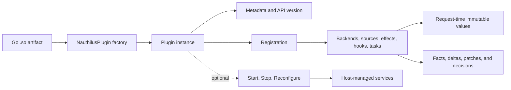

# Native Go Plugins

Native Go plugins extend Nauthilus with trusted code compiled into a Go shared object. A plugin can contribute authentication backends, pre-auth environment sources, post-backend subject sources, policy effects, HTTP hooks, startup tasks, metrics, and other host-integrated behavior without importing Nauthilus server internals.

The public boundary is:

```text
github.com/croessner/nauthilus/v4/pluginapi/v1
```

Every artifact exports exactly one factory with this signature:

```go
func NauthilusPlugin() (pluginapi.Plugin, error)
```

Nauthilus calls the factory once for each configured module instance. The same
artifact can therefore be configured more than once only when each factory
result owns its instance state **and** all process-global registrations are
collision-safe. Policy attribute IDs and hook routes are globally unique;
metric/cache scopes, connection-target names, and Redis script names can also
collide across instances.

## Choose a documentation view

### Build a plugin

Start with the developer path when you need to understand how the parts work together:

1. [Create your first plugin](./getting-started.md)
2. [Lifecycle and registration](./lifecycle-and-registration.md)
3. [Requests, runtime values, and effects](./runtime-and-effects.md)
4. [Host services](./host-services.md)
5. [Build, test, and debug](./build-test-debug.md)
6. [Security and compatibility](./security-and-compatibility.md)

These pages explain intent, control flow, ownership, and production design choices. They link to the exact API declarations where needed.

### Look up an API declaration

Use the [Go plugin API reference](./api-reference/index.md) when you already know the concept and need exact constants, fields, methods, validation rules, or result semantics. The reference follows the source package structure and includes:

- the root `pluginapi/v1` contract;
- the `helpers`, `password`, and `exchange` public subpackages;
- extension-point request and result values;
- typed authentication and MFA backend interfaces;
- all host service facades;
- naming, policy, error, and validation contracts.

## Extension model



The important boundary is directional: Nauthilus passes immutable or read-only API values into plugin code; the plugin returns explicit value objects describing changes. Server-owned request objects, Gin contexts, LDAP connections, internal policy structures, and mutable authentication state do not cross the public API.

## API version versus binary compatibility

`pluginapi.APIVersion` identifies the semantic public contract as `nauthilus.plugin.v1`. It does not make arbitrary Go shared objects ABI-compatible. Go's plugin loader also requires the host and plugin to agree on the Go toolchain, build experiment, build tags, package sources, and shared dependency graph. Treat a plugin artifact as release-specific and rebuild it for the exact Nauthilus build you deploy.

## Operator and example documentation

- [Configure native Go plugins](../../configuration/native-go-plugins.md) covers loader configuration and artifact verification.
- [Reference plugins](./reference-plugins/index.md) covers GeoIP/ASN, ClickHouse, and Have I Been Pwned.
- The compact compile-contract fixture lives in `pluginapi/v1/testdata/sampleplugin` in the Nauthilus repository.

:::note Current documentation channel

These pages describe the current `Next` documentation and the Nauthilus 3.1 development line. They are not release notes and do not imply that every development build is binary-compatible with another build.

:::
