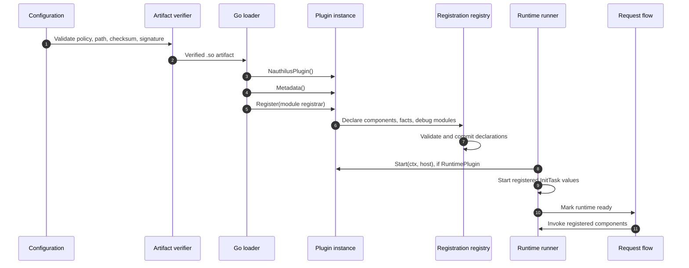

# Lifecycle and Registration

Nauthilus separates declaration from execution. Registration builds and validates a complete module description before request-time calls become possible; runtime startup then provides host services and activates resources.

## Lifecycle sequence



If a required module fails before runtime readiness, startup fails closed. An optional module factory/registration or module-level `Start` failure can be recorded without making the module available. A registered init-task start failure is fatal even when its module is optional.

## Factory

The artifact must be a `main` package and export exactly:

```go
func NauthilusPlugin() (pluginapi.Plugin, error)
```

The loader rejects a missing symbol, the wrong symbol type, a nil result, an invalid metadata contract, or a factory error. Keep the factory cheap and deterministic. It should allocate per-instance state, not open networks, start workers, or read mutable external data.

One artifact can back multiple configured modules. Nauthilus calls the factory once per module, so package globals accidentally share state across those instances. Prefer fields on the returned plugin object and protect any intentionally shared state explicitly.

Per-instance objects do not isolate process-global registrations. Policy
attribute IDs and hook method/path pairs must be globally unique, and metric or
cache scopes, connection-target names, and Redis script names can collide across
modules. A plugin that advertises multi-instance support must namespace those
identities deliberately; otherwise document and validate that it may be
configured only once.

## Metadata

`Plugin.Metadata()` is evaluated before registration. The host requires:

- `Name`: non-empty plugin product name;
- `Version`: non-empty product version;
- `APIVersion`: exactly `pluginapi.APIVersion`;
- optional diagnostic and discovery fields in `Description`, `DocsURL`, `Features`, `Capabilities`, and `Build`.

Example:

```go
func (p *Plugin) Metadata() pluginapi.Metadata {
    return pluginapi.Metadata{
        Name:        "customer_sql",
        Version:     "1.4.2",
        APIVersion:  pluginapi.APIVersion,
        Description: "Customer authentication backend.",
        DocsURL:     "https://example.invalid/customer-sql",
        Features: []pluginapi.Feature{
            "backend",
            "reconfigure",
        },
        Capabilities: []pluginapi.Capability{
            pluginapi.CapabilityCredentials,
        },
        Build: pluginapi.BuildInfo{
            GoVersion: "go1.26.x",
            GitCommit: "replace-at-build-time",
            BuildTime: "replace-at-build-time",
            BuildTags: []string{"netgo"},
        },
    }
}
```

Metadata capabilities declare what the product may use. They are not grants. The module must request each needed capability during registration, and the operator must allow it in `plugins.modules[].allow_capabilities`.

## Registration is declarative and staged

`Plugin.Register(registrar)` may:

- decode module-owned configuration through `Registrar.Config()`;
- require a declared capability;
- register init tasks;
- register environment and subject sources;
- register authentication backends;
- register synchronous obligation targets and asynchronous post-action targets;
- register HTTP hooks;
- register policy attribute definitions;
- register local debug modules.

Registration is staged at the component level, but the current registry commit is not a complete transaction. Debug modules and policy attributes are committed before components; a later commit error can therefore leave those declarations behind. Treat every registration error as fatal and restart after correcting it rather than assuming the failed attempt was side-effect free.

```go
func (p *Plugin) Register(registrar pluginapi.Registrar) error {
    var cfg Config
    if err := registrar.Config().Decode(&cfg); err != nil {
        return fmt.Errorf("decode module config: %w", err)
    }
    if err := cfg.Validate(); err != nil {
        return err
    }

    if err := registrar.RequireCapability(pluginapi.CapabilityCredentials); err != nil {
        return err
    }

    if err := registerAttributes(registrar); err != nil {
        return err
    }

    p.config.Store(&cfg)
    return registrar.RegisterBackend(&backend{plugin: p})
}
```

Do not retain the `Registrar`. It is a setup transaction, not a runtime service. Do not perform request-time work or expect the full `Host` during registration.

## Names and qualification

Module, component, and local debug names use:

```text
[a-z0-9][a-z0-9_]{0,62}
```

Nauthilus qualifies a local component as `<module>.<component>`. A backend whose `Name()` returns `passdb` in the configured module `customer_sql` is selected as:

```yaml
auth:
  backends:
    order:
      - plugin(customer_sql.passdb)
```

Names are intentionally narrow and stable because they become configuration identifiers, metric dimensions, discovery values, and policy references.

## Runtime startup

Implement `RuntimePlugin` when the instance needs host services or resources:

```go
var _ pluginapi.RuntimePlugin = (*Plugin)(nil)

func (p *Plugin) Start(ctx context.Context, host pluginapi.Host) error {
    if host == nil {
        return fmt.Errorf("plugin host is nil")
    }

    p.logger = host.Logger("database")
    p.tracer = host.Tracer("database")
    p.host = host
    return p.open(ctx, host.Config())
}

func (p *Plugin) Stop(ctx context.Context) error {
    return p.close(ctx)
}
```

`Start` completes before request-time invocation is enabled. Publish fully initialized state atomically; do not expose partially built clients or tables to component callbacks.

## Init tasks

An `InitTask` is a named lifecycle unit registered before startup. It receives both the runtime `Host` and the module `ConfigView`:

```go
type refreshTask struct{ plugin *Plugin }

func (refreshTask) Name() string { return "refresh" }

func (t refreshTask) Start(ctx context.Context, init pluginapi.InitContext) error {
    if err := t.plugin.loadInitialSnapshot(ctx, init.Config); err != nil {
        return err
    }

    init.Host.Go(ctx, "refresh", t.plugin.refreshLoop)
    return nil
}

func (t refreshTask) Stop(ctx context.Context) error {
    return t.plugin.flush(ctx)
}
```

Use init tasks for independently named startup or worker units that must be ready before request processing. Task names are module-local component names and must be unique.

## Supervised workers

Launch long-lived work through `Host.Go(ctx, name, fn)`:

- the host preserves trace and selected context values;
- request cancellation is not inherited by detached work;
- host or runtime lifetime cancellation stops the worker context;
- panics are recovered and recorded by the host;
- shutdown waits for supervised workers until the outer shutdown context expires.

The worker must still honor its context and own its internal retry, backoff, and resource bounds. `Host.Go` is supervision, not an unbounded job queue.

## Configuration reload

Implement `ReloadablePlugin` only if the module can validate and publish a new `plugins.modules[].config` subtree safely:

```go
var _ pluginapi.ReloadablePlugin = (*Plugin)(nil)

func (p *Plugin) Reconfigure(ctx context.Context, view pluginapi.ConfigView) error {
    var next Config
    if err := view.Decode(&next); err != nil {
        return err
    }
    if err := next.Validate(); err != nil {
        return err
    }

    prepared, err := prepareState(ctx, next)
    if err != nil {
        return err
    }

    previous := p.state.Swap(prepared)
    return closePrevious(previous)
}
```

Prepare the replacement before publishing it. The host commits its new config views only after every invoked reloadable module succeeds, but it cannot roll back internal state that an earlier plugin already published before a later plugin failed. Each implementation must delay its own state swap until validation and preparation succeed; a multi-module reload is not currently atomic across plugin instances.

A changed config subtree for a plugin that does not implement `ReloadablePlugin` is currently skipped rather than rejected. `Host.Config()` also remains the process-start host snapshot; only the module `ConfigView` passed to `Reconfigure` is current.

Only the opaque module `config` subtree is reloadable through this interface. Module additions/removals and changes to identity, path, checksum, signature, signer, optionality, stop timeout, capability allowlist, trust, allowed directories, or verification policy require a process restart.

## Shutdown

Shutdown is bounded by contexts from the host:

1. runtime readiness is disabled;
2. registered init tasks are stopped in reverse registration order;
3. runtime plugins are stopped in reverse configuration order; `stop_timeout` applies to each module `Stop`, not to init-task `Stop`;
4. supervised workers receive cancellation and the runner waits for them;
5. the process continues shutdown when the deadline expires.

Make every stop path idempotent. A plugin cannot rely on Go unloading the `.so`; `plugin.Open` artifacts remain mapped until the process exits.

If startup fails after earlier modules have started, the current runner does not perform a complete automatic rollback inside `Start`. Components must remain safe under process-level startup failure and external shutdown.

## Failure and panic boundaries

Nauthilus guards plugin lifecycle and request calls, but plugin authors remain responsible for secret-safe errors and bounded work. A panic or returned error cannot be allowed to disclose SQL, LDAP filters, tokens, password-derived values, message bodies, or raw external responses through logs or client-visible status.

Use typed result fields to distinguish a legitimate deny from a temporary failure. Returning a generic error usually maps to a secret-safe temporary failure at the host boundary; it is not the same as returning `Rejected`, `Authenticated: false`, `PolicyDecisionDeny`, or another explicit domain result.

## Reference

- [Core contract](./api-reference/contract.md)
- [Extension points](./api-reference/extensions.md)
- [Validation and naming](./api-reference/validation.md)
- [Configure native Go plugins](../../configuration/native-go-plugins.md)
