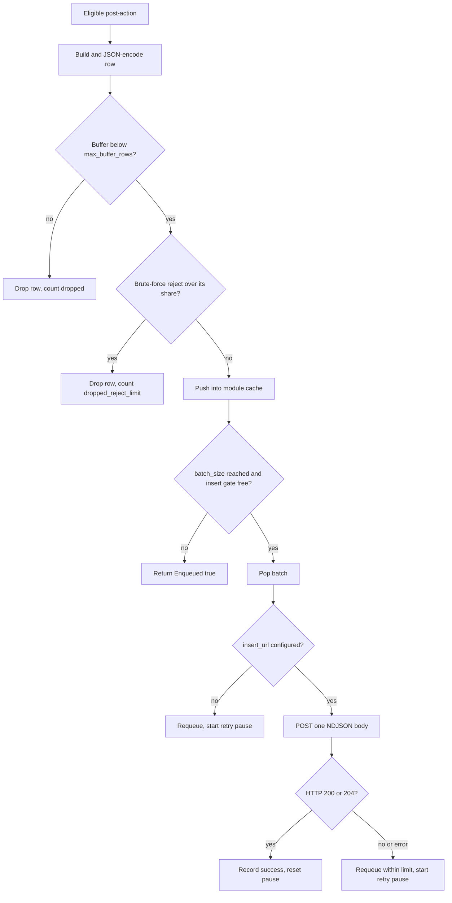

# ClickHouse Post-Action Plugin

The bundled `clickhouse` plugin converts a completed authentication request into a JSONEachRow analytics record. It queues records in a bounded buffer in the host's module-scoped process cache, optionally deduplicates equivalent login events through Redis, and posts a batch through the host HTTP facade when the configured count threshold is reached, on a configurable interval, and when the plugin stops.

Besides the login rows, the plugin can write two optional evidence streams that the host emits outside the post-action:

- **step events** (`nauthilus.auth_events`): second-factor verifications and OIDC authorization-code issuance and
  redemption;
- **brute-force evidence** (`nauthilus.bruteforce_lifecycle`, `nauthilus.bruteforce_attempts`): ban activations,
  releases, counter resets, counted increments, tolerated thresholds, and ban hits.

Rows written under the versioned diagnostic data contract carry `contract_version = 1`. Together with the step events
and the brute-force evidence they are the input of the read-only
[Support Authentication History](../../../guides/support-authentication-history.md).

The [ClickHouse Data Model Reference](../../data-stores/clickhouse-data-model.md) lists every table and view with the
component that fills each column, and the [Redis Keyspace Reference](../../data-stores/redis-keyspace.md#314-native-plugins)
lists the Redis keys of the plugin.

The container artifact is:

```text
/usr/local/lib/nauthilus/plugins/clickhouse.so
```

The native policy effect ID for a module named `clickhouse` is:

```text
authn/plugin.clickhouse.post_action
```

Nauthilus does not invoke this external effect implicitly. A selected policy rule obligation or the authn target's
`terminal_post_actions` must name it for every outcome that should create a row.

## Public contract

| Item | Value |
| --- | --- |
| Metadata name | `clickhouse` |
| Product version | `0.1.0` |
| Interfaces | `Plugin`, `RuntimePlugin`, `ReloadablePlugin` |
| Registered components | `PostActionTarget` named `post_action`; `AuthEventSink` and `BruteForceEventSink` when the host offers the additive event registrars |
| Authn Policy effect | `authn/plugin.clickhouse.post_action` |
| Sensitive capabilities | `password_hash` (required; registration fails unless the operator allows it) |
| Local debug module | `batch` |
| Main features | JSONEachRow, sealed terminal outcome, outcome-aware login deduplication, bounded per-stream process-cache batching, brute-force reject share, interval flush, retry backoff, reconfigure |

## Strict configuration schema

Unknown keys, wrong types, nonpositive numeric limits, invalid duration strings, a non-HTTP(S) insert URL, and two
streams sharing one cache key reject registration or reload.

### Login rows

| Field | Type | Default | Validation and meaning |
| --- | --- | --- | --- |
| `deployment` | string | empty | Trimmed deployment label written to every row and event. The support history reads only rows of its configured deployment. |
| `instance` | string | empty | Trimmed runtime instance label written to every row and event. |
| `insert_url` | string | empty | Optional syntactically, but operationally required HTTP(S) URL including `INSERT ... FORMAT JSONEachRow`. |
| `user` | string | empty | Trimmed ClickHouse username. |
| `password` | string | empty | ClickHouse password; preserved as configured. |
| `batch_size` | integer | `100` | Must be positive. A flush is attempted when the queue length reaches this threshold. |
| `max_buffer_rows` | integer | `10000` | Upper bound of buffered rows per stream and process, plus at most one in-flight batch. Zero selects the default; negative values are rejected. Lowering it on reload discards excess queued rows. |
| `max_brute_force_reject_rows` | integer | half of `max_buffer_rows`, at least `1` | Share of the login buffer that rows of requests rejected by an active brute-force ban may fill. Zero selects the default; it must leave at least one row for other login rows. |
| `flush_interval` | duration string | `0` | Positive values start one background worker per process that flushes a non-empty batch at that interval. `0` or `0s` keeps size-only batching; negative or unparsable values are rejected. |
| `cache_key` | string | `clickhouse:batch:logins` | Trimmed module-cache key. Empty selects the default. |
| `timeout` | duration string | `10s` | Must be positive; passed to the host HTTP request of every stream. |
| `max_response_bytes` | integer | `8192` | Must be positive; bounds the response body retained by the host HTTP facade. |
| `dedup_success` | boolean | `true` | Deduplicate equivalent login events whose sealed outcome is `ok`. |
| `dedup_failure` | boolean | `false` | Deduplicate equivalent login events whose sealed outcome is `fail`. |
| `auth_dedup_ttl` | duration string | `300s` | Must be positive; fixed deduplication window that starts at the first accepted event and is not extended by skipped repetitions. Applies to both enabled outcomes. |

### Step events

| Field | Type | Default | Validation and meaning |
| --- | --- | --- | --- |
| `events_insert_url` | string | empty | Optional HTTP(S) URL for `INSERT INTO nauthilus.auth_events FORMAT JSONEachRow`. Empty disables the stream; events are then counted as `skipped`. |
| `events_cache_key` | string | `clickhouse:batch:auth_events` | Module-cache key of the event buffer. |
| `events_flush_interval` | duration string | `10s` | Must be positive. The event worker always runs while `events_insert_url` is set, because events rarely fill a batch. |

### Brute-force evidence

| Field | Type | Default | Validation and meaning |
| --- | --- | --- | --- |
| `bruteforce_lifecycle_insert_url` | string | empty | Optional HTTP(S) URL for `INSERT INTO nauthilus.bruteforce_lifecycle FORMAT JSONEachRow`. |
| `bruteforce_attempts_insert_url` | string | empty | Optional HTTP(S) URL for `INSERT INTO nauthilus.bruteforce_attempts FORMAT JSONEachRow`; used by the counted and the hit streams. |
| `bruteforce_lifecycle_cache_key` | string | `clickhouse:batch:bruteforce_lifecycle` | Module-cache key of the lifecycle buffer. |
| `bruteforce_counted_cache_key` | string | `clickhouse:batch:bruteforce_counted` | Module-cache key of counted and tolerated rows. |
| `bruteforce_hits_cache_key` | string | `clickhouse:batch:bruteforce_hits` | Module-cache key of ban-hit rows. |
| `bruteforce_flush_interval` | duration string | `10s` | Must be positive. The brute-force worker runs while either brute-force insert URL is set. |

All five cache keys must be distinct, so no two streams share one buffer.

An empty `insert_url` does not reject registration. When a batch becomes flushable, the plugin restores it to the buffer, records `no_url`, logs that the batch was kept, starts the retry pause, and returns no flush error. Treat `insert_url` as required in a real deployment.

## Lifecycle and reload

`Register` decodes config, declares the local `batch` debug module, registers the post-action target, and registers
the step-event and brute-force event sinks when the host offers the additive registrars. The sinks are registered
whenever the module is loaded, so setting an events or brute-force insert URL by reload starts that export without a
restart. `Start` acquires all host facades, registers the metrics of every stream, and registers the redacted remote
`host:port` connection target when `insert_url` is set.

Every key under the module `config` reloads on SIGHUP. The plugin validates the candidate before the reload is committed, so an invalid value rejects the whole reload and keeps the running settings. After the commit, `Reconfigure` swaps the settings atomically, aligns the login, event, and brute-force flush workers with their intervals and insert URLs, and re-registers the connection target. Rows that are already batched stay queued: after a cache key change they move to the new key, and a changed insert URL or credentials apply to the next flush, including rows queued before the reload. A reload preserves an active retry pause. Each worker start or stop is logged as `clickhouse flush worker updated` with `flush_worker=running` or `flush_worker=stopped` and `stream=logins`, `events`, or `bruteforce`.

`Stop` ends the flush workers and attempts one final flush of every pending stream if its insert gate permits, bounded by `timeout`. A failed final insert is logged with the bounded fields `result` and `trigger` and does not block shutdown; those rows are lost with the process.

Changes requiring restart include the module name, artifact, signature/checksum, path, optional flag, capabilities, and other loader fields.

## Host services

| Host service | Scope and purpose |
| --- | --- |
| `Logger("clickhouse")` | lifecycle, failures, requeues, and successful inserts |
| `Logger("batch")` | queue and batch debug diagnostics |
| `Tracer("clickhouse")` | enqueue and flush child spans |
| `Metrics("clickhouse")` | plugin-owned queue and flush metrics of every stream |
| `Cache("clickhouse")` | module-scoped in-process row queues |
| `Redis()` | login-context deduplication and key building |
| `HTTP("batch")` | bounded ClickHouse insert requests |
| `ConnectionTargets("clickhouse")` | remote endpoint observability without URL path or SQL query |

The process cache is not a durable queue. There is no disk spool or delivery acknowledgement beyond the immediate HTTP response.

## Terminal outcome

The request snapshot of a post-action is captured while Policy prepares the selected effects, before the response is
finalized. The host therefore seals the terminal outcome of the request and binds it to the post-action when the
post-action executes after the response boundary (`PostActionRequest.Outcome`), and refreshes the snapshot's
`http_status` and `status_msg` from it.

- A TLS-required rejection or a backend temporary failure reads `outcome = 'tempfail'`, `http_status = 500`, and its
  tempfail text instead of a credential failure.
- `transport_status` holds the committed HTTP status separately, because header and nginx modes answer rejections with
  HTTP 200 and IdP login pages answer with 200 or 302. Never derive the result from it.
- `outcome = 'unknown'` is written when no terminal decision was sealed, for example after a client cancellation. The
  plugin then writes `http_status = 0`, an empty `status_msg`, and a NULL `transport_status`; it never substitutes a
  credential-failure default.
- The stable cause of a terminal result is `outcome_marker` + `response_marker` + `tempfail_reason`, refined by
  `policy_status` and `tempfail_checkpoint`; `policy_rule` names the presenting rule and `outcome_stage` its stage.

`authenticated`, `user_found`, `account`, `latency`, and the brute-force columns remain capture-time values.

## Eligibility and deduplication

The post-action skips a request when `Snapshot.Runtime.NoAuth` is true, except for an OIDC IDP request whose `GrantType` is nonempty. This exception preserves analytics for OIDC token operations.

`dedup_success` and `dedup_failure` select deduplication from the sealed terminal outcome: `ok` uses `dedup_success`
and `fail` uses `dedup_failure`. Temporary failures and unknown outcomes are never deduplicated, because they are
diagnostic evidence. Set both to `false` to retain every login event, or both to `true` to aggregate successes and
failures separately. For an enabled outcome with both a nonempty `Snapshot.Username` and `Snapshot.ClientIP`, the
plugin reserves a key with `SET NX` and `auth_dedup_ttl` as expiration.

The key combines username, client IP, protocol, service, authentication method, client ID, OIDC client projections,
SAML entity ID, OIDC grant, MFA method and completion, authentication and authorization outcomes, HTTP status, status
message, the terminal outcome with its Policy operation, outcome marker, response marker, and presenting rule, and the
IdP flow reference. Different login contexts and failure reasons therefore stay separate, and the password row of
every IdP browser flow is kept so that its step events can be joined. Request and session IDs, source ports, and
timing are excluded deliberately, so equivalent new requests inside the window still aggregate. Credentials and
password hashes are never part of the key. The fields are encoded with unambiguous boundaries and SHA-256 hashed under
`clickhouse:authdedup:v3:`, with the host Redis prefix applied as usual. Keys of earlier versions are not reused and
expire naturally, so a deployment starts a fresh deduplication window.

Results:

- `SET NX = false`: the duplicate is skipped, counted as `dedup_skipped`, and `Enqueued` is false.
- Redis unavailable or returns an error: deduplication fails open; the row is still queued and the failure is logged without the key or identity.
- outcome not enabled for deduplication, empty username, or empty client IP: no deduplication is attempted.

The reservation happens before buffer admission and HTTP delivery. It is not a delivery acknowledgement or an exactly-once guarantee.

## Queue and delivery semantics

Every stream (login rows, step events, brute-force lifecycle, counted, and hit rows) has its own buffer in the
module-scoped host cache, its own insert gate, and its own retry pause, so a stalled target cannot delay another
stream. The buffers are process-local memory. They are not stored in Redis and are not shared between processes: every
Nauthilus process or Kubernetes pod collects and flushes its own batches.



Flush triggers of the login stream:

- **Size:** the request that makes the local batch reach `batch_size` rows, or the lower buffer limit, attempts an inline flush and spends up to `timeout` on it.
- **Interval:** with a positive `flush_interval`, one background worker per process flushes a non-empty batch at that interval. Without it, a quiet process can hold rows for a long time, so production deployments should set it. During healthy delivery, a row's delay is roughly `flush_interval` plus one insert.
- **Stop:** the plugin attempts one final flush when it stops.

Exact consequences:

- All triggers of a stream share a nonblocking insert gate: at most one HTTP insert runs per stream and plugin instance. Other post-actions only enqueue and return without waiting for that insert.
- Each process buffers at most `max_buffer_rows` rows per stream plus one in-flight batch. When the buffer is full, new arrivals and requeued rows are discarded and counted as `dropped`; analytics overflow never returns a post-action error. The limit counts rows, not bytes.
- Login rows with the outcome marker `auth.outcome.brute_force_reject` may fill at most `max_brute_force_reject_rows` of the login buffer. An attack against a banned network therefore cannot crowd out successes and ordinary failures while ClickHouse is slow or unavailable. Rejects beyond the share are counted as `dropped_reject_limit`; the share is recounted when failed batches are requeued or moved on reload. Every ban hit is also recorded in the separate brute-force hit stream.
- After a failed insert or a missing insert URL, every trigger of that stream observes an exponential retry pause of 1, 2, 4, 8, 16, 32, and then at most 60 seconds after completion. Successful delivery resets the pause, a reload preserves it, and shutdown respects an active pause or insert instead of starting a competing request.
- A retry happens on the next eligible size or interval trigger, so configure `flush_interval` to recover without further authentication traffic.
- An interval insert already in progress finishes within `timeout` instead of being cancelled. Ambiguous transport failures can still cause duplicate rows if ClickHouse accepted a batch before the response was lost; every row carries an `event_id` that identifies such duplicates.
- Process termination loses rows still in the buffers. The buffers are best effort, not a durable queue.
- `QueuedID` is the configured cache key, not a unique per-row delivery ID.

## Step events

With `events_insert_url` set, the plugin writes one `nauthilus.auth_events` row per observed step:

| `event_type` | Emitted when | Main fields |
| --- | --- | --- |
| `mfa.verification` | the IdP verified or rejected a TOTP code, recovery code, or WebAuthn assertion | `method`, `result` (`success`, `invalid`, `error`, `rate_limited`, `rejected`), stable `reason`, `fail_latched`, `flow_effect` (`step_up_completed`, `primary_failure_kept`, `none`) |
| `oidc.code_issuance` | an authorization code was handed to the browser | `client_id`, `account`, `reason` = authentication source (`authenticated_in_flow`, `existing_session`, `not_recorded`) |
| `oidc.code_redemption` | the token endpoint consumed the code | `result`, `reason` (`tokens_issued`, `client_mismatch`, `redirect_uri_mismatch`, `pkce_mismatch`, `invalid_target`, `token_issue_error`, `client_state_error`); no client IP |

Every event carries `event_id`, `event_version`, `deployment`, `instance`, the observing `request_id`, and the
non-authorizing `flow_ref` that joins the password row of the same IdP flow. The flow reference is a truncated,
domain-separated digest of the flow handle; it cannot resume a flow. Self-service step-ups have an empty `flow_ref`.

The host delivers second-factor and completion events from two separate bounded queues of 1024 events each per
process, so a burst of silent SSO renewals never evicts second-factor evidence. A full queue drops events and counts
them in `plugin_auth_events_total{outcome="dropped",lane="mfa"}` or `lane="oidc_completion"`. The plugin buffers all
step events in one stream and flushes them every `events_flush_interval`; events never flush inline and are never
deduplicated. Emitting never blocks a request, and storage failures never change an authentication decision.

Event payloads never contain passwords, hashes, OTPs, recovery codes, authorization codes, PKCE verifiers, tokens,
cookies, session or ceremony handles, or WebAuthn data. `fail_latched = true` with `result = 'success'` means the
factor was right while the password was wrong; treat it as operator-only information.

Not recorded: browser aborts, factor ceremonies that were never submitted, token requests that never resolve a code
(client authentication failures, unknown, expired, or replayed codes), authorization errors and denials, SAML
assertion issuance, refresh and device-code grants, and the relying-party session after the token response.

## Brute-force evidence

With `bruteforce_lifecycle_insert_url` and/or `bruteforce_attempts_insert_url` set, the plugin writes the
brute-force events that the host emits on three bounded lanes:

| Kind | Host lane (capacity) | Table | Meaning |
| --- | --- | --- | --- |
| `ban_activated` | `bruteforce_lifecycle` (1024) | `bruteforce_lifecycle` | New ban instance; carries the activating rule's bucket, window counters, total, and effective limit. |
| `ban_activation_unconfirmed` | `bruteforce_lifecycle` | `bruteforce_lifecycle` | A ban exists whose creator is unknown. |
| `ban_released` | `bruteforce_lifecycle` | `bruteforce_lifecycle` | Administrative flush deleted a ban key; carries the operator reference. |
| `counters_reset` | `bruteforce_lifecycle` | `bruteforce_lifecycle` | Administrative flush unlinked bucket counters. |
| `counted` | `bruteforce_counted` (8192) | `bruteforce_attempts` | One increment the counter really applied. |
| `threshold_tolerated` | `bruteforce_counted` | `bruteforce_attempts` | Over limit, ban suppressed by toleration; never a ban. |
| `ban_hit` | `bruteforce_hits` (4096) | `bruteforce_attempts` | Request rejected by an existing ban. |

Lifecycle rows keep no claimed login names and no client address, because the request that writes a ban can come from
an uninvolved user behind the same network. Counted, tolerated, and hit rows carry the claimed login name and the
client IP, so access to the brute-force tables must stay limited to operators and the support history reader. The
hourly materialized summary `bruteforce_attempt_summary` keeps distinct-name counts as hash states, never raw names.

An attempt search with `include_ban_context` links the subject's own brute-force rejected requests to their recorded bans,
through the `ban_hit` rows of the request (`request_id`) or the request ID of the activation, and classifies the
contributions by recorded account. The support projection then sees codes, counts, and the subject's own increments,
never other identities. Rules whose windows reach beyond the 14-day raw retention still list the retained increments
and mark the list with `RAW_CONTRIBUTIONS_PARTIALLY_RETAINED`; a partial list never proves that an increment is
absent. See [Ban context and compact answers](../../../guides/support-authentication-history.md#ban-context-and-compact-answers).

Each kind uses its own plugin stream buffer, so a hammered banned network cannot evict counted contributions, and no
volume flood can evict lifecycle events. Counted and hit streams flush inline from their host lane goroutine, never an
authentication request, once a stream holds `batch_size` rows; that flush stays inside the host delivery deadline and
keeps failed rows for the worker. `bruteforce_flush_interval` flushes quiet streams and the lifecycle stream. No
password, password hash, or repeated-wrong-password value is exported.

## Complete row contract

The plugin emits all 89 keys on every encoded login row because the struct fields do not use `omitempty`. Optional numeric and boolean enrichment values use JSON `null` where represented by pointers; ordinary strings default to `""`.

| Group | Fields | Source |
| --- | --- | --- |
| Record identity | `ts`, `session`, `service`, `deployment`, `instance`, `decision_sources`, `rbl_lists` | UTC millisecond timestamp, request snapshot, module config, exchange/policy evidence, RBL diagnostics |
| Diagnostic contract | `contract_version`, `event_id`, `operation`, `outcome`, `outcome_stage`, `outcome_marker`, `response_marker`, `policy_rule`, `tempfail_reason`, `tempfail_checkpoint`, `policy_status`, `fsm_state`, `transport`, `transport_status`, `flow_ref` | plugin constant and per-row ID, sealed terminal outcome, transport boundary, IdP flow reference |
| Network and protocol | `client_ip`, `client_port`, `client_net`, `client_id`, `hostname`, `proto`, `method`, `user_agent`, `local_ip`, `local_port` | `RequestSnapshot` |
| Identity and credential analytics | `display_name`, `account`, `username`, `password_hash`, `pwnd_info` | snapshot, validated eight-character ClickHouse export derived from the host-owned full password hash, HIBP exchange |
| Brute-force and IDP | `brute_force_bucket`, `brute_force_counter`, `brute_force_tolerated`, `oidc_cid`, `saml_entity_id`, `grant_type`, `mfa_method`, `failed_login_count`, `failed_login_rank`, `failed_login_recognized` | snapshot diagnostics/IDP, brute-force toleration, failed-login exchange |
| GeoIP | `geoip_guid`, `geoip_country`, `geoip_iso_codes`, `geoip_status`, `geoip_source`, `geoip_matched`, `geoip_country_name`, `geoip_city_name`, `geoip_asn`, `geoip_asn_org`, `geoip_asn_prefix`, `geoip_asn_registry`, `geoip_asn_country`, `geoip_asn_allocated`, `geoip_asn_status` | Canonical `plugin.geoip.*` Policy facts; optional legacy analytics projection |
| Network privacy | `geoip_privacy_lookup_state`, `geoip_privacy_detected`, `geoip_privacy_classes`, `geoip_privacy_primary_class`, `geoip_privacy_confidence`, `geoip_privacy_source_authorities`, `geoip_privacy_data_stale`, `geoip_privacy_data_age_seconds`, `geoip_is_tor_exit_node`, `geoip_is_known_vpn_exit`, `geoip_is_community_vpn_exit`, `geoip_is_public_proxy`, `geoip_is_privacy_relay`, `geoip_is_hosting_network`, `geoip_is_shared_egress` | GeoIP privacy facts or exchange values |
| Reputation | `reputation_assessments`, `reputation_truncated` | Public reputation decision records of the native reputation plugin |
| Outcome and TLS | `repeating`, `rwp`, `user_found`, `authenticated`, `xssl_protocol`, `xssl_cipher`, `ssl_fingerprint`, `latency`, `http_status`, `status_msg` | request runtime flags, legacy TLS snapshot, sealed terminal outcome |

`features` is intentionally not emitted. `decision_sources` is the supported analytics source list.

`decision_sources` lists controls that **fired**, also when a configured policy still lets the request continue:
`blocklist`, `tls_encryption` (request without TLS context outside the cleartext networks), `relay_domains` (login
name with a domain part that is not a configured relay domain), `rbl` (RBL threshold reached), `brute_force` (a bucket
triggered or an existing ban was found), and the sources derived from exchange maps and Policy facts. Allowlisted,
soft-allowlisted, tolerated, skipped, or failed checks publish no source. A bucket that is over its limit while
toleration suppresses the block keeps `brute_force_bucket`, carries no `brute_force` source, and sets
`brute_force_tolerated = true`. The order is deterministic but can differ from rows of the retired Lua action, so query
membership, for example `has(splitByChar(',', decision_sources), 'rbl')`, instead of comparing exact strings.

`rbl_lists` (`Array(LowCardinality(String))`) holds every configured RBL list that listed the client IP, in
configuration order, also below the RBL threshold.

`reputation_assessments` holds one named tuple per reputation record fact and subject (`fact`, `role`, `kind`, `state`,
`profile`, `band`, `override`, `risk_score`, `trust_score`, `confidence`, `samples`, `source_diversity`,
`age_seconds`), with NULL measurements for `not_found` and `unavailable`, at most 64 tuples. `reputation_truncated` is
`true` when the host dropped record facts to keep the post-action within its work bounds or the plugin reached the
tuple cap.

:::warning Retired login columns

The plugin no longer exports the ten flat `reputation_*` columns of the removed GeoIP reputation map
(`reputation_score`, `reputation_positive_score`, `reputation_negative_score`, `reputation_ip_score`,
`reputation_asn_score`, `reputation_country_score`, `reputation_asn_country_score`, `reputation_samples`,
`reputation_source`, `reputation_decision`), nor `gp_attempts`, `gp_unique_ips`, `gp_unique_users`, `gp_ips_per_user`,
`prot_active`, `prot_reason`, `prot_backoff`, `prot_delay_ms`, `dyn_threat`, and `dyn_response`. They had no producer
in the current host. New rows still insert into tables that keep these columns and receive the column defaults there.
Dashboards, hooks, and reports that read them must switch to `reputation_assessments` and `decision_sources`; account
protection still appears as a decision source.

:::

### Exchange inputs

The row builder reads canonical Policy facts and these standard exchange values when present. The generic GeoIP provider needs no `plugin.exchange.geoip` value:

- `plugin.exchange.decision_sources`
- `plugin.exchange.feature.<name>` markers
- `plugin.exchange.geoip`
- `plugin.exchange.failed_login_hotspot`
- `plugin.exchange.account_protection` and `plugin.exchange.geoip_reputation` (decision sources only)
- `plugin.exchange.haveibeenpwnd`

Policy facts provide fallback evidence for selected blocklist, GeoIP policy, failed-login hotspot, and account-protection sources. Since the retired columns are no longer exported, `plugin.exchange.global_pattern` and `plugin.exchange.dynamic_response` are not read, and the account-protection and GeoIP reputation maps only add their decision sources. Decision source names are deduplicated deterministically. HIBP contributes `pwnd_info` only when its post-action ran earlier in the same plan.

The ClickHouse plugin emits no policy facts and no runtime delta. It populates `PostActionEnqueueResult.Enqueued` to describe queue acceptance and uses the cache key as `QueuedID`; the current host runtime ignores both fields. They are useful only to direct callers/tests until the host starts consuming the diagnostic fields.

## Schema and upgrades

New installations create every table from `contrib/clickhouse-kubernetes/schema.sql`: `logins`, `auth_events`,
`bruteforce_lifecycle`, `bruteforce_attempts`, `bruteforce_attempt_summary`, and its materialized view. `CREATE TABLE
IF NOT EXISTS` never migrates an existing table, so existing installations apply the additive, repeatable migrations
before deploying a plugin of this release:

1. `contrib/clickhouse-kubernetes/migrations/diagnostic-contract.sql` adds `deployment`, `instance`, the diagnostic
   contract columns, `brute_force_tolerated`, `reputation_assessments`, `reputation_truncated`, a `flow_ref` index, and
   the `auth_events` table.
2. `contrib/clickhouse-kubernetes/migrations/bruteforce-evidence.sql` adds the three brute-force tables and the summary
   view. Apply it before setting a brute-force insert URL.
3. Verify the columns and tables with the read-only `system.columns` and `system.tables` queries at the end of each
   migration file.
4. Deploy the plugin. ClickHouse accepts unknown JSONEachRow fields by default (`input_format_skip_unknown_fields = 1`)
   and drops them silently, so a new writer against an unmigrated table loses the new fields without an error. After
   the migration, append `&input_format_skip_unknown_fields=0` to every insert URL to turn later schema drift into
   visible insert errors.

An older writer keeps working against the migrated schema; its rows read `contract_version = 0` with empty outcome
columns. Existing rows are never rewritten, reinterpreted, or deleted. The first `ts` with `contract_version = 1` per
`deployment` and `instance` is the cutover boundary. OIDC completion events need no further migration; they use the
existing `auth_events` columns. Rolling back the plugin leaves the new columns and tables in place; do not drop
collected data.

```sql
ALTER TABLE nauthilus.logins ADD COLUMN IF NOT EXISTS rbl_lists
  Array(LowCardinality(String)) AFTER decision_sources;
```

The `rbl_lists` statement above and the earlier column statements remain part of the `ALTER TABLE` block of
`schema.sql`.

### Dropping the retired columns

The marked `retire-legacy-columns` block at the end of `schema.sql` drops exactly the 20 retired columns. It is not
part of a routine upgrade. Run it only as a separate, approved step after every writer runs a release with the cleaned
export, queued and retried batches of older releases are drained, no dashboard, hook, or report references the
columns, and a backup exists if their values are still needed. Dropping is irreversible: re-adding the columns before
a rollback to an older writer restores types and defaults, not the values. The retired Lua writer still sends them.

## Post-action ordering

Order HIBP before ClickHouse when analytics needs HIBP data:

```yaml
then:
  obligations:
    - id: authn/plugin.haveibeenpwnd.post_action
    - id: authn/plugin.clickhouse.post_action
```

HIBP's positive result writes `plugin.exchange.haveibeenpwnd` into the detached plan runtime. ClickHouse can read it only if HIBP has already completed. Reversing the order produces a valid ClickHouse row with an empty `pwnd_info`.

Neither plugin restores historical Lua markers such as `rt.action_haveibeenpwnd` or `rt.post_clickhouse`. Post-action runtime deltas remain plan-local and cannot modify the selected policy decision or client response.

## Metrics, spans, and debug

The host metrics facade adds the `nauthilus_plugin_clickhouse_` prefix and the `plugin_scope` label to the plugin
metrics, for example `nauthilus_plugin_clickhouse_clickhouse_queued_rows_total`.

| Instrument | Result values or attributes |
| --- | --- |
| `clickhouse_queued_rows_total{result}` | `queued`, `skipped` (no-auth request), `dedup_skipped`, `encode_error`, `dropped` (buffer full), `dropped_reject_limit` (brute-force reject share full) |
| `clickhouse_flush_batches_total{result}` | `success`, `no_url`, `http_error`, `status_error`, `requeued` |
| `clickhouse_flush_duration_seconds{result}` | same bounded flush result labels |
| `clickhouse_event_queued_rows_total{result}` | step-event stream; `skipped` means no `events_insert_url` |
| `clickhouse_event_flush_batches_total{result}`, `clickhouse_event_flush_duration_seconds{result}` | step-event stream flush results and duration |
| `clickhouse_bruteforce_{lifecycle,counted,hits}_queued_rows_total{result}` | brute-force stream enqueue outcomes |
| `clickhouse_bruteforce_{lifecycle,counted,hits}_flush_batches_total{result}`, `..._flush_duration_seconds{result}` | brute-force stream flush results and duration |
| `clickhouse.post_action.enqueue` | module, component, operation, batch size, final result |
| `clickhouse.post_action.flush` | module, component, operation, batch size, final result, recorded error |

Every `result` series of the counters exists from startup with value `0`, so `increase()` and `rate()` also see the
first flush after a restart. Histogram series appear with their first observation. Because batches are per process,
compare flush metrics per pod or sum them.

The host counts the delivery of step and brute-force events in `plugin_auth_events_total{outcome,lane}`: `outcome` is
`queued`, `delivered`, `failed`, or `dropped`, and `lane` is `mfa`, `oidc_completion`, `bruteforce_lifecycle`,
`bruteforce_counted`, or `bruteforce_hits`. Alert on `dropped` and on the plugin's `dropped`, `dropped_reject_limit`,
and `requeued` results.

Debug configuration:

```yaml
observability:
  log:
    level: debug
    debug_modules:
      - plugin.clickhouse
      - plugin.clickhouse.batch
```

Logs, labels, and plugin span attributes intentionally omit row bodies, raw SQL query strings, usernames, client IPs, and credentials. This does not remove those fields from the row sent to ClickHouse.

## Build and tests

```shell
NATIVE_ARTIFACT_LDFLAGS="$(go run -mod=vendor ./scripts/native_artifact_fingerprint -tags="netgo")"
NATIVE_PGO_FLAG="-pgo=off"
if [ -f server/default.pgo ]; then NATIVE_PGO_FLAG="-pgo=$PWD/server/default.pgo"; fi
GOEXPERIMENT=runtimesecret \
GOCACHE=/tmp/nauthilus-go-cache \
go test ./contrib/plugins/clickhouse

mkdir -p build
CGO_ENABLED=1 \
GOEXPERIMENT=runtimesecret \
go build \
  -mod=vendor \
  -tags="netgo" \
  -trimpath \
  "${NATIVE_PGO_FLAG}" \
  -buildmode=plugin \
  -ldflags "${NATIVE_ARTIFACT_LDFLAGS}" \
  -o build/clickhouse.so \
  ./contrib/plugins/clickhouse
```

The unit suite covers strict config defaults and failures, representative row mapping, retired columns, no-auth/OIDC behavior, plan ordering, threshold flushing, requeue, the brute-force reject share, Redis deduplication, secret-safe headers/logging, and connection-target registration. Unlike GeoIP, this package currently has no dedicated subprocess `plugin.Open` smoke test.

Integration tests behind the `clickhouse_integration` build tag write through the real plugin into a disposable
ClickHouse 25.8 container and read the rows back, including migrated, fresh, and retired schemas, dashboard queries,
brute-force evidence, and the read-only support history account:

```shell
contrib/clickhouse-kubernetes/run-integration-tests.sh
```

## Realistic module and policy configuration

```yaml
plugins:
  verification_policy: signature_required
  allowed_dirs:
    - /usr/local/lib/nauthilus/plugins
  trust:
    signers:
      - id: nauthilus-plugin-build-key-2026
        format: minisign
        public_key_file: /usr/share/nauthilus/plugin-keys/build-2026.pub
  modules:
    - name: clickhouse
      type: go
      path: /usr/local/lib/nauthilus/plugins/clickhouse.so
      signature: minisign:/usr/local/lib/nauthilus/plugins/clickhouse.so.minisig
      signer: nauthilus-plugin-build-key-2026
      optional: false
      allow_capabilities: [password_hash]
      config:
        deployment: production
        instance: nauthilus-k8s-01
        insert_url: "https://clickhouse.example.test:8443/?query=INSERT%20INTO%20nauthilus.logins%20FORMAT%20JSONEachRow&input_format_skip_unknown_fields=0"
        user: nauthilus_writer
        password: replace-through-protected-config-input
        batch_size: 100
        max_buffer_rows: 10000
        max_brute_force_reject_rows: 5000
        flush_interval: 30s
        cache_key: clickhouse:batch:logins
        timeout: 10s
        max_response_bytes: 8192
        dedup_success: true
        dedup_failure: false
        auth_dedup_ttl: 300s
        events_insert_url: "https://clickhouse.example.test:8443/?query=INSERT%20INTO%20nauthilus.auth_events%20FORMAT%20JSONEachRow&input_format_skip_unknown_fields=0"
        events_cache_key: clickhouse:batch:auth_events
        events_flush_interval: 10s
        bruteforce_lifecycle_insert_url: "https://clickhouse.example.test:8443/?query=INSERT%20INTO%20nauthilus.bruteforce_lifecycle%20FORMAT%20JSONEachRow&input_format_skip_unknown_fields=0"
        bruteforce_attempts_insert_url: "https://clickhouse.example.test:8443/?query=INSERT%20INTO%20nauthilus.bruteforce_attempts%20FORMAT%20JSONEachRow&input_format_skip_unknown_fields=0"
        bruteforce_flush_interval: 10s

policy:
  namespaces:
    authn:
      domain_plans:
        clickhouse_post_action:
          checkpoints:
            pre_auth:
              providers:
                - name: brute_force
                  use: authn/builtin/brute_force
                  actions: [authenticate]
            auth_backend:
              providers:
                - name: ldap_backend
                  use: authn/builtin/ldap_backend
                  actions: [authenticate]
            auth_decision:
              providers: []
      policy_sets:
        clickhouse_post_action:
          rules:
            - name: persist_successful_authentication
              checkpoint: auth_decision
              actions: [authenticate]
              if:
                attribute: backend.authenticated
                is: true
              then:
                decision: permit
                fsm_event_marker: auth.fsm.event.auth_permit
                obligations:
                  - id: authn/plugin.clickhouse.post_action
  targets:
    - namespace: authn
      action: authenticate
      schema: authn/authenticate/v1
      domain_plan: authn/clickhouse_post_action
      default_policy: authn/standard_auth
      terminal_post_actions:
        - id: authn/plugin.clickhouse.post_action
      plans:
        auth_decision:
          policy_sets: [authn/clickhouse_post_action]
```

`terminal_post_actions` records every answered request once, whichever rule answered it, including requests that the
built-in `authn/standard_auth` rules answer, such as early brute-force rejects. A rule obligation that names the same
post-action is folded into that completion, so the request still produces one row, not two. Without
`terminal_post_actions`, only requests whose selected rule carries the obligation produce a row; the support history
cannot see the others and always lists the known limit `NO_ROW_WITHOUT_ANALYTICS_EFFECT`.

The insert URLs above already disable unknown-field skipping. Use them only after the schema migrations are applied;
against an unmigrated table every insert then fails visibly instead of losing the new fields.

Protect the ClickHouse password through the surrounding configuration-delivery mechanism. The plugin currently accepts a string and has no plugin-specific `password_file` field.

## Security and privacy

- This integration exports authentication telemetry containing personal and security-sensitive data: account, username, client IP, session, user agent, TLS fingerprint, outcome, and an eight-character export derived from the host-owned full password hash. Step events add the account and client IP of second-factor attempts; brute-force attempt rows add claimed login names and client IPs.
- Use TLS or a comparably protected network, a write-only ClickHouse identity, narrow network policy, retention limits, and access auditing.
- Never expose the insert endpoint to untrusted config authors: every insert URL contains an executable ClickHouse query.
- Read the history through the dedicated, read-only support history account; do not grant the brute-force tables to Grafana or other analytics accounts.
- Redis dedup keys are SHA-256 digests of the login context; they do not contain the username or client IP in clear text.
- The in-memory buffers are not durable. They are bounded by `max_buffer_rows`; an unavailable endpoint drops rows beyond that limit instead of growing memory.
- The default code supports an empty URL and fail-open deduplication. Monitor `no_url`, `requeued`, `dropped`, `dropped_reject_limit`, and `dedup_fail_open` logs.

## Kubernetes deployment assets

:::danger The Kubernetes Job schema is not current

The standalone `contrib/clickhouse-kubernetes/schema.sql` and the two migrations implement the complete row contract,
the step-event table, and the brute-force evidence tables. The schema embedded in
`contrib/clickhouse-kubernetes/k8s-job.yaml` does not:

- it lacks `deployment`, `instance`, the diagnostic contract columns, `brute_force_tolerated`,
  `reputation_assessments`, and `reputation_truncated`;
- it creates neither `auth_events` nor the brute-force tables and summary view;
- the bundled Grafana dashboard reads `reputation_assessments`, which that schema does not create.

Apply `schema.sql` (new installations) or the migrations (existing tables) instead of relying on the Job's embedded
schema until it is aligned.

:::

Additional current limits:

- no durable spool;
- the Lua read-only `clickhouse-query.lua` hook is not implemented by this native plugin; use the read-only
  [Support Authentication History](../../../guides/support-authentication-history.md) for support questions;
- no automatic policy obligation;
- the old `rt.post_clickhouse` marker is not written back to live request runtime.
