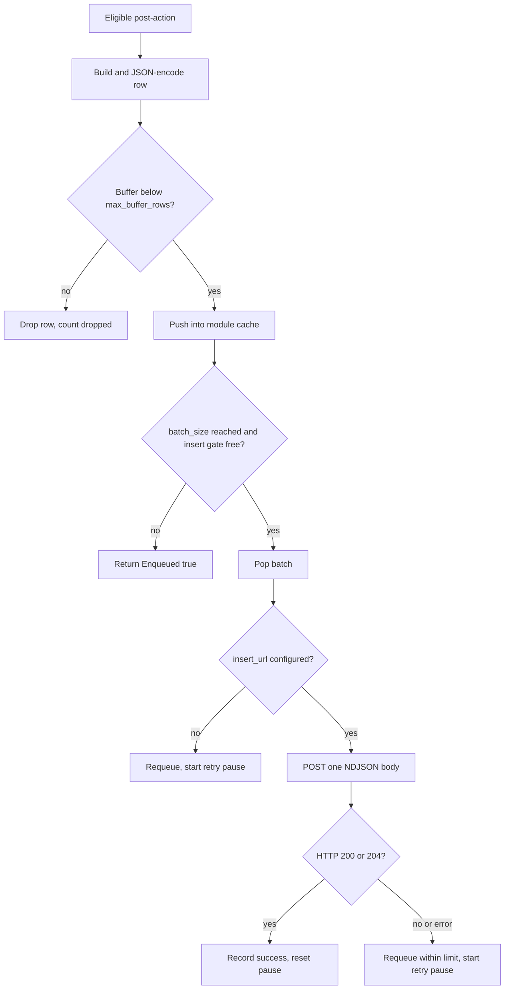

# ClickHouse Post-Action Plugin

The bundled `clickhouse` plugin converts a completed authentication request into a JSONEachRow analytics record. It queues records in a bounded buffer in the host's module-scoped process cache, optionally deduplicates equivalent login events through Redis, and posts a batch through the host HTTP facade when the configured count threshold is reached, on a configurable interval, and when the plugin stops.

The container artifact is:

```text
/usr/local/lib/nauthilus/plugins/clickhouse.so
```

The native policy effect ID for a module named `clickhouse` is:

```text
authn/plugin.clickhouse.post_action
```

Nauthilus does not invoke this external effect implicitly. A selected policy must include the obligation for every outcome that should create a row.

## Public contract

| Item | Value |
| --- | --- |
| Metadata name | `clickhouse` |
| Product version | `0.1.0` |
| Interfaces | `Plugin`, `RuntimePlugin`, `ReloadablePlugin` |
| Registered component | `PostActionTarget` named `post_action` |
| Authn Policy effect | `authn/plugin.clickhouse.post_action` |
| Sensitive capabilities | `password_hash` (required; registration fails unless the operator allows it) |
| Local debug module | `batch` |
| Main features | JSONEachRow, login-context deduplication, bounded process-cache batching, interval flush, retry backoff, reconfigure |

## Strict configuration schema

Unknown keys, wrong types, nonpositive numeric limits, invalid duration strings, and a non-HTTP(S) insert URL reject registration or reload.

| Field | Type | Default | Validation and meaning |
| --- | --- | --- | --- |
| `deployment` | string | empty | Trimmed deployment label written to every row. |
| `instance` | string | empty | Trimmed runtime instance label written to every row. |
| `insert_url` | string | empty | Optional syntactically, but operationally required HTTP(S) URL including `INSERT ... FORMAT JSONEachRow`. |
| `user` | string | empty | Trimmed ClickHouse username. |
| `password` | string | empty | ClickHouse password; preserved as configured. |
| `batch_size` | integer | `100` | Must be positive. A flush is attempted when the queue length reaches this threshold. |
| `max_buffer_rows` | integer | `10000` | Upper bound of buffered rows per process, plus at most one in-flight batch. Zero selects the default; negative values are rejected. Lowering it on reload discards excess queued rows. |
| `flush_interval` | duration string | `0` | Positive values start one background worker per process that flushes a non-empty batch at that interval. `0` or `0s` keeps size-only batching; negative or unparsable values are rejected. |
| `cache_key` | string | `clickhouse:batch:logins` | Trimmed module-cache key. Empty selects the default. |
| `timeout` | duration string | `10s` | Must be positive; passed to the host HTTP request. |
| `max_response_bytes` | integer | `8192` | Must be positive; bounds the response body retained by the host HTTP facade. |
| `dedup_success` | boolean | `true` | Deduplicate equivalent login events of authenticated requests. |
| `dedup_failure` | boolean | `false` | Deduplicate equivalent login events of unauthenticated requests. |
| `auth_dedup_ttl` | duration string | `300s` | Must be positive; fixed deduplication window that starts at the first accepted event and is not extended by skipped repetitions. Applies to both enabled outcomes. |

An empty `insert_url` does not reject registration. When a batch becomes flushable, the plugin restores it to the buffer, records `no_url`, logs that the batch was kept, starts the retry pause, and returns no flush error. Treat `insert_url` as required in a real deployment.

## Lifecycle and reload

`Register` decodes config, declares the local `batch` debug module, and registers the post-action target. `Start` acquires all host facades and registers the redacted remote `host:port` connection target when `insert_url` is set.

Every key under the module `config` reloads on SIGHUP. The plugin validates the candidate before the reload is committed, so an invalid value rejects the whole reload and keeps the running settings. After the commit, `Reconfigure` swaps the settings atomically, restarts the flush worker only when `flush_interval` changed, and re-registers the connection target. Rows that are already batched stay queued: after a `cache_key` change they move to the new key, and a changed `insert_url` or credentials apply to the next flush, including rows queued before the reload. A reload preserves an active retry pause. Each worker start or stop is logged as `clickhouse flush worker updated` with `flush_worker=running` or `flush_worker=stopped`.

`Stop` ends the flush worker and attempts one final flush of the pending batch if the insert gate permits, bounded by `timeout`. A failed final insert is logged with the bounded fields `result` and `trigger` and does not block shutdown; those rows are lost with the process.

Changes requiring restart include the module name, artifact, signature/checksum, path, optional flag, capabilities, and other loader fields.

## Host services

| Host service | Scope and purpose |
| --- | --- |
| `Logger("clickhouse")` | lifecycle, failures, requeues, and successful inserts |
| `Logger("batch")` | queue and batch debug diagnostics |
| `Tracer("clickhouse")` | enqueue and flush child spans |
| `Metrics("clickhouse")` | plugin-owned queue and flush metrics |
| `Cache("clickhouse")` | module-scoped in-process row queue |
| `Redis()` | login-context deduplication and key building |
| `HTTP("batch")` | bounded ClickHouse insert request |
| `ConnectionTargets("clickhouse")` | remote endpoint observability without URL path or SQL query |

The process cache is not a durable queue. There is no disk spool or delivery acknowledgement beyond the immediate HTTP response.

## Eligibility and deduplication

The post-action skips a request when `Snapshot.Runtime.NoAuth` is true, except for an OIDC IDP request whose `GrantType` is nonempty. This exception preserves analytics for OIDC token operations.

`dedup_success` and `dedup_failure` independently enable deduplication for requests whose `Runtime.Authenticated` flag is true or false. Set both to `false` to retain every login event, or both to `true` to aggregate successes and failures separately. For an enabled outcome with both a nonempty `Snapshot.Username` and `Snapshot.ClientIP`, the plugin reserves a key with `SET NX` and `auth_dedup_ttl` as expiration.

The key combines username, client IP, protocol, service, authentication method, client ID, OIDC client projections, SAML entity ID, OIDC grant, MFA method and completion, authentication and authorization outcomes, HTTP status, and status message. Different login contexts and failure reasons therefore stay separate. Request and session IDs, source ports, and timing are excluded deliberately, so equivalent new requests inside the window still aggregate. Credentials and password hashes are never part of the key. The fields are encoded with unambiguous boundaries and SHA-256 hashed under `clickhouse:authdedup:v2:`, with the host Redis prefix applied as usual. Keys of earlier versions are not reused and expire naturally.

Results:

- `SET NX = false`: the duplicate is skipped, counted as `dedup_skipped`, and `Enqueued` is false.
- Redis unavailable or returns an error: deduplication fails open; the row is still queued and the failure is logged without the key or identity.
- outcome not enabled for deduplication, empty username, or empty client IP: no deduplication is attempted.

The reservation happens before buffer admission and HTTP delivery. It is not a delivery acknowledgement or an exactly-once guarantee.

## Queue and delivery semantics

The batch lives in the module-scoped host cache, which is process-local memory. It is not stored in Redis and is not shared between processes: every Nauthilus process or Kubernetes pod collects and flushes its own batch under `cache_key`.



Flush triggers:

- **Size:** the request that makes the local batch reach `batch_size` rows, or the lower buffer limit, attempts an inline flush and spends up to `timeout` on it.
- **Interval:** with a positive `flush_interval`, one background worker per process flushes a non-empty batch at that interval. Without it, a quiet process can hold rows for a long time, so production deployments should set it. During healthy delivery, a row's delay is roughly `flush_interval` plus one insert.
- **Stop:** the plugin attempts one final flush when it stops.

Exact consequences:

- All triggers share a nonblocking insert gate: at most one HTTP insert runs per plugin instance. Other post-actions only enqueue and return without waiting for that insert.
- Each process buffers at most `max_buffer_rows` rows plus one in-flight batch. When the buffer is full, new arrivals and requeued rows are discarded and counted as `dropped`; analytics overflow never returns a post-action error. The limit counts rows, not bytes.
- After a failed insert or a missing `insert_url`, every trigger observes an exponential retry pause of 1, 2, 4, 8, 16, 32, and then at most 60 seconds after completion. Successful delivery resets the pause, a reload preserves it, and shutdown respects an active pause or insert instead of starting a competing request.
- A retry happens on the next eligible size or interval trigger, so configure `flush_interval` to recover without further authentication traffic.
- An interval insert already in progress finishes within `timeout` instead of being cancelled. Ambiguous transport failures can still cause duplicate rows if ClickHouse accepted a batch before the response was lost.
- Process termination loses rows still in the buffer. The buffer is best effort, not a durable queue.
- `QueuedID` is the configured cache key, not a unique per-row delivery ID.

## HTTP request and authentication

The plugin sends one newline-delimited JSON object per row with:

```text
Accept: */*
Content-Type: application/json
User-Agent: Nauthilus
```

Authentication behavior:

| Config | Headers |
| --- | --- |
| both `user` and `password` nonempty | `Authorization: Basic <base64(user:password)>` |
| only `user` | `X-ClickHouse-User` |
| only `password` | `X-ClickHouse-Key` |
| neither | no ClickHouse authentication header |

The Basic value uses padded standard Base64 as required by RFC 7617.

## Complete row contract

The plugin emits all 75 keys on every encoded row because the struct fields do not use `omitempty`. Optional numeric and boolean enrichment values use JSON `null` where represented by pointers; ordinary strings default to `""`.

| Group | Fields | Source |
| --- | --- | --- |
| Record identity | `ts`, `session`, `service`, `deployment`, `instance`, `decision_sources` | UTC millisecond timestamp, request snapshot, module config, exchange/policy evidence |
| Network and protocol | `client_ip`, `client_port`, `client_net`, `client_id`, `hostname`, `proto`, `method`, `user_agent`, `local_ip`, `local_port` | `RequestSnapshot` |
| Identity and credential analytics | `display_name`, `account`, `username`, `password_hash`, `pwnd_info` | snapshot, validated eight-character ClickHouse export derived from the host-owned full password hash, HIBP exchange |
| Brute-force and IDP | `brute_force_bucket`, `brute_force_counter`, `oidc_cid`, `saml_entity_id`, `grant_type`, `mfa_method`, `failed_login_count`, `failed_login_rank`, `failed_login_recognized` | snapshot diagnostics/IDP plus failed-login exchange |
| GeoIP | `geoip_guid`, `geoip_country`, `geoip_iso_codes`, `geoip_status`, `geoip_source`, `geoip_matched`, `geoip_country_name`, `geoip_city_name`, `geoip_asn`, `geoip_asn_org`, `geoip_asn_prefix`, `geoip_asn_registry`, `geoip_asn_country`, `geoip_asn_allocated`, `geoip_asn_status` | Canonical `plugin.geoip.*` Policy facts; optional legacy analytics projection |
| Reputation | `reputation_score`, `reputation_positive_score`, `reputation_negative_score`, `reputation_ip_score`, `reputation_asn_score`, `reputation_country_score`, `reputation_asn_country_score`, `reputation_samples`, `reputation_source`, `reputation_decision` | Only an explicitly supplied `plugin.exchange.geoip_reputation` map; no Policy-fact fallback |
| Global protection | `gp_attempts`, `gp_unique_ips`, `gp_unique_users`, `gp_ips_per_user`, `prot_active`, `prot_reason`, `prot_backoff`, `prot_delay_ms`, `dyn_threat`, `dyn_response` | global-pattern, account-protection, and dynamic-response exchange |
| Outcome and TLS | `repeating`, `rwp`, `user_found`, `authenticated`, `xssl_protocol`, `xssl_cipher`, `ssl_fingerprint`, `latency`, `http_status`, `status_msg` | request runtime flags, legacy TLS snapshot, diagnostics |

`features` is intentionally not emitted. `decision_sources` is the supported analytics source list.

:::note Reputation columns

The Lua `geoip_reputation.lua` writer that produced these values was removed together with its
`lua.plugin.geoip_reputation.*` facts. The columns remain for historical rows and are filled only when a caller supplies
the `plugin.exchange.geoip_reputation` runtime map; a `geoip_reputation` Policy fact neither fills them nor adds a
decision source. The native [reputation plugin](./reputation.md) publishes Policy assessment records and does not
write this exchange map.

:::

### Exchange inputs

The row builder reads canonical Policy facts and these standard exchange values when present. The generic GeoIP provider needs no `plugin.exchange.geoip` value:

- `plugin.exchange.decision_sources`
- `plugin.exchange.feature.<name>` markers
- `plugin.exchange.geoip`
- `plugin.exchange.geoip_reputation`
- `plugin.exchange.failed_login_hotspot`
- `plugin.exchange.account_protection`
- `plugin.exchange.global_pattern`
- `plugin.exchange.dynamic_response`
- `plugin.exchange.haveibeenpwnd`

Policy facts provide fallback evidence for selected blocklist, GeoIP policy, failed-login hotspot, and account-protection sources. Decision source names are deduplicated deterministically. HIBP contributes `pwnd_info` only when its post-action ran earlier in the same plan.

The ClickHouse plugin emits no policy facts and no runtime delta. It populates `PostActionEnqueueResult.Enqueued` to describe queue acceptance and uses the cache key as `QueuedID`; the current host runtime ignores both fields. They are useful only to direct callers/tests until the host starts consuming the diagnostic fields.

## Post-action ordering

Order HIBP before ClickHouse when analytics needs HIBP data:

```yaml
then:
  obligations:
    - id: authn/plugin.haveibeenpwnd.post_action
    - id: authn/plugin.clickhouse.post_action
```

HIBP's positive result writes `plugin.exchange.haveibeenpwnd` into the detached plan runtime. ClickHouse can read it only if HIBP has already completed. Reversing the order produces a valid ClickHouse row with an empty `pwnd_info`.

Neither plugin restores historical Lua markers such as `rt.action_haveibeenpwnd` or `rt.post_clickhouse`. Post-action runtime deltas remain plan-local and cannot modify the selected policy decision or client response.

## Metrics, spans, and debug

| Instrument | Result values or attributes |
| --- | --- |
| `clickhouse_queued_rows_total{result}` | `queued`, `skipped`, `dedup_skipped`, `encode_error`, `dropped` (buffer full) |
| `clickhouse_flush_batches_total{result}` | `success`, `no_url`, `http_error`, `status_error`, `requeued` |
| `clickhouse_flush_duration_seconds{result}` | same bounded flush result labels |
| `clickhouse.post_action.enqueue` | module, component, operation, batch size, final result |
| `clickhouse.post_action.flush` | module, component, operation, batch size, final result, recorded error |

Debug configuration:

```yaml
observability:
  log:
    level: debug
    debug_modules:
      - plugin.clickhouse
      - plugin.clickhouse.batch
```

Logs, labels, and plugin span attributes intentionally omit row bodies, raw SQL query strings, usernames, client IPs, and credentials. This does not remove those fields from the row sent to ClickHouse.

## Build and tests

```shell
NATIVE_ARTIFACT_LDFLAGS="$(go run -mod=vendor ./scripts/native_artifact_fingerprint -tags="netgo")"
GOEXPERIMENT=runtimesecret \
GOCACHE=/tmp/nauthilus-go-cache \
go test ./contrib/plugins/clickhouse

mkdir -p build
CGO_ENABLED=1 \
GOEXPERIMENT=runtimesecret \
go build \
  -mod=vendor \
  -tags="netgo" \
  -trimpath \
  -buildmode=plugin \
  -ldflags "${NATIVE_ARTIFACT_LDFLAGS}" \
  -o build/clickhouse.so \
  ./contrib/plugins/clickhouse
```

The unit suite covers strict config defaults and failures, representative row mapping, no-auth/OIDC behavior, plan ordering, threshold flushing, requeue, Redis deduplication, secret-safe headers/logging, and connection-target registration. Unlike GeoIP, this package currently has no dedicated subprocess `plugin.Open` smoke test.

## Realistic module and policy configuration

```yaml
plugins:
  verification_policy: signature_required
  allowed_dirs:
    - /usr/local/lib/nauthilus/plugins
  trust:
    signers:
      - id: nauthilus-plugin-build-key-2026
        format: minisign
        public_key_file: /usr/share/nauthilus/plugin-keys/build-2026.pub
  modules:
    - name: clickhouse
      type: go
      path: /usr/local/lib/nauthilus/plugins/clickhouse.so
      signature: minisign:/usr/local/lib/nauthilus/plugins/clickhouse.so.minisig
      signer: nauthilus-plugin-build-key-2026
      optional: false
      allow_capabilities: [password_hash]
      config:
        deployment: production
        instance: nauthilus-k8s-01
        insert_url: "https://clickhouse.example.test:8443/?query=INSERT%20INTO%20nauthilus.logins%20FORMAT%20JSONEachRow"
        user: nauthilus_writer
        password: replace-through-protected-config-input
        batch_size: 100
        max_buffer_rows: 10000
        flush_interval: 30s
        cache_key: clickhouse:batch:logins
        timeout: 10s
        max_response_bytes: 8192
        dedup_success: true
        dedup_failure: false
        auth_dedup_ttl: 300s

policy:
  namespaces:
    authn:
      domain_plans:
        clickhouse_post_action:
          checkpoints:
            pre_auth:
              providers:
                - name: brute_force
                  use: authn/builtin/brute_force
                  actions: [authenticate]
            auth_backend:
              providers:
                - name: ldap_backend
                  use: authn/builtin/ldap_backend
                  actions: [authenticate]
            auth_decision:
              providers: []
      policy_sets:
        clickhouse_post_action:
          rules:
            - name: persist_successful_authentication
              checkpoint: auth_decision
              actions: [authenticate]
              if:
                attribute: backend.authenticated
                is: true
              then:
                decision: permit
                obligations:
                  - id: authn/plugin.clickhouse.post_action
  targets:
    - namespace: authn
      action: authenticate
      schema: authn/authenticate/v1
      domain_plan: authn/clickhouse_post_action
      default_policy: authn/standard_auth
      plans:
        auth_decision:
          policy_sets: [authn/clickhouse_post_action]
```

Protect the ClickHouse password through the surrounding configuration-delivery mechanism. The plugin currently accepts a string and has no plugin-specific `password_file` field.

## Security and privacy

- This integration exports authentication telemetry containing personal and security-sensitive data: account, username, client IP, session, user agent, TLS fingerprint, outcome, and an eight-character export derived from the host-owned full password hash.
- Use TLS or a comparably protected network, a write-only ClickHouse identity, narrow network policy, retention limits, and access auditing.
- Never expose the insert endpoint to untrusted config authors: `insert_url` contains an executable ClickHouse query.
- Redis dedup keys are SHA-256 digests of the login context; they do not contain the username or client IP in clear text.
- The in-memory buffer is not durable. It is bounded by `max_buffer_rows`; an unavailable endpoint drops rows beyond that limit instead of growing memory.
- The default code supports an empty URL and fail-open deduplication. Monitor `no_url`, `requeued`, `dropped`, and `dedup_fail_open` logs.

## Current schema and deployment-asset mismatch

:::danger Not a validated native-plugin deployment yet

The checked-in ClickHouse deployment assets do not currently implement the complete row contract above:

- the standalone `contrib/clickhouse-kubernetes/schema.sql` lacks `deployment` and `instance`, although the plugin emits both fields on every row;
- the schema embedded in `contrib/clickhouse-kubernetes/k8s-job.yaml` also lacks `reputation_score`, `reputation_positive_score`, `reputation_negative_score`, and `reputation_samples`;
- the bundled Grafana dashboard queries reputation columns missing from the embedded Job schema;
- the example insert URL does not enable unknown-field skipping.

Align the actual ClickHouse table, standalone schema, embedded Job schema, dashboard queries, and all 75 emitted fields before using those assets as an end-to-end deployment. The website therefore does not present the current Kubernetes Job as a validated runnable setup.

:::

Additional current limits:

- no durable spool;
- no read-only ClickHouse query hook replacement;
- no automatic policy obligation;
- the old `rt.post_clickhouse` marker is not written back to live request runtime.
