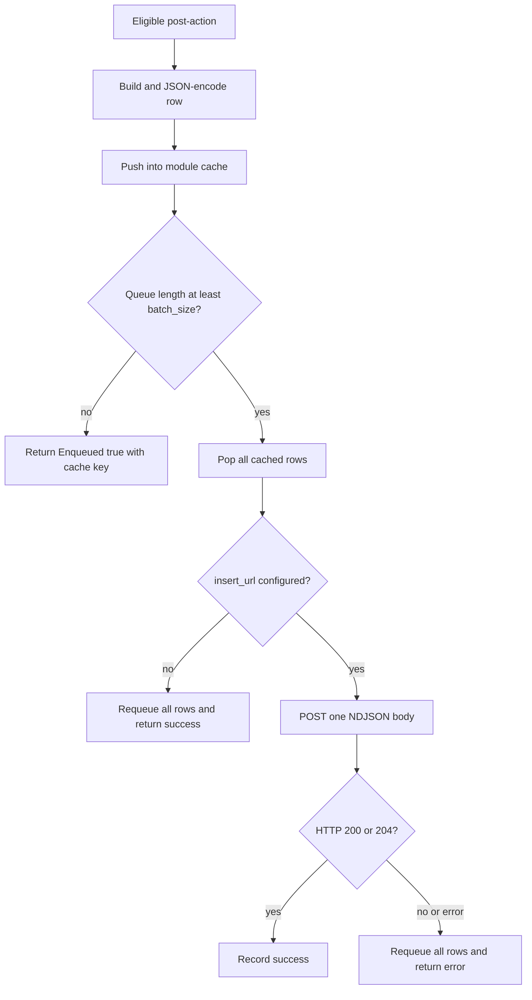

# ClickHouse Post-Action Plugin

The bundled `clickhouse` plugin converts a completed authentication request into a JSONEachRow analytics record. It queues records in the host's module-scoped process cache, deduplicates authenticated writes through Redis, and posts a batch through the host HTTP facade when the configured count threshold is reached.

The container artifact is:

```text
/usr/local/lib/nauthilus/plugins/clickhouse.so
```

The native policy effect ID for a module named `clickhouse` is:

```text
clickhouse.post_action
```

Nauthilus does not invoke this external effect implicitly. A selected policy must include the obligation for every outcome that should create a row.

## Public contract

| Item | Value |
| --- | --- |
| Metadata name | `clickhouse` |
| Product version | `0.1.0` |
| Interfaces | `Plugin`, `RuntimePlugin`, `ReloadablePlugin` |
| Registered component | `PostActionTarget` named `post_action` |
| Standard qualified target | `clickhouse.post_action` |
| Sensitive capabilities | none |
| Local debug module | `batch` |
| Main features | JSONEachRow, Redis deduplication, process-cache batching, reconfigure |

## Strict configuration schema

Unknown keys, wrong types, nonpositive numeric limits, invalid duration strings, and a non-HTTP(S) insert URL reject registration or reload.

| Field | Type | Default | Validation and meaning |
| --- | --- | --- | --- |
| `deployment` | string | empty | Trimmed deployment label written to every row. |
| `instance` | string | empty | Trimmed runtime instance label written to every row. |
| `insert_url` | string | empty | Optional syntactically, but operationally required HTTP(S) URL including `INSERT ... FORMAT JSONEachRow`. |
| `user` | string | empty | Trimmed ClickHouse username. |
| `password` | string | empty | ClickHouse password; preserved as configured. |
| `batch_size` | integer | `100` | Must be positive. A flush is attempted when the queue length reaches this threshold. |
| `cache_key` | string | `clickhouse:batch:logins` | Trimmed module-cache key. Empty selects the default. |
| `timeout` | duration string | `10s` | Must be positive; passed to the host HTTP request. |
| `max_response_bytes` | integer | `8192` | Must be positive; bounds the response body retained by the host HTTP facade. |
| `auth_dedup_ttl` | duration string | `300s` | Must be positive; Redis `SET NX` expiration for authenticated username/IP pairs. |

An empty `insert_url` does not reject registration. When a batch becomes flushable, the plugin restores it to the cache, records `no_url`, logs that the batch was kept, and returns no flush error. Treat `insert_url` as required in a real deployment.

## Lifecycle and reload

`Register` decodes config, declares the local `batch` debug module, and registers the post-action target. `Start` acquires all host facades and registers the redacted remote `host:port` connection target when `insert_url` is set.

`Reconfigure` validates and atomically replaces the config. It also updates connection-target registration. It does not migrate queued records between cache keys, flush the previous key, or renegotiate artifact/capability settings.

`Stop` releases facade references. It does not flush cached rows.

Changes requiring restart include the module name, artifact, signature/checksum, path, optional flag, and other loader fields. Config-only changes can use SIGHUP when validation succeeds, but changing `cache_key` while rows remain queued can strand the old queue.

## Host services

| Host service | Scope and purpose |
| --- | --- |
| `Logger("clickhouse")` | lifecycle, failures, requeues, and successful inserts |
| `Logger("batch")` | queue and batch debug diagnostics |
| `Tracer("clickhouse")` | enqueue and flush child spans |
| `Metrics("clickhouse")` | plugin-owned queue and flush metrics |
| `Cache("clickhouse")` | module-scoped in-process row queue |
| `Redis()` | authenticated request deduplication and key building |
| `HTTP("batch")` | bounded ClickHouse insert request |
| `ConnectionTargets("clickhouse")` | remote endpoint observability without URL path or SQL query |

The process cache is not a durable queue. There is no disk spool or delivery acknowledgement beyond the immediate HTTP response.

## Eligibility and deduplication

The post-action skips a request when `Snapshot.Runtime.NoAuth` is true, except for an OIDC IDP request whose `GrantType` is nonempty. This exception preserves analytics for OIDC token operations.

For an authenticated request with both a nonempty `Snapshot.Username` and `Snapshot.ClientIP`, the plugin attempts:

```text
SET NX clickhouse:authdedup:<username>:<client-ip> 1 EX <auth_dedup_ttl>
```

The host Redis key builder may add its configured namespace. Results:

- `SET NX = false`: the duplicate is skipped and `Enqueued` is false.
- Redis unavailable or returns an error: deduplication fails open; the row is still queued and the failure is logged without the key or identity.
- unauthenticated request, empty username, or empty client IP: no deduplication is attempted.

This Redis policy protects against repeated authenticated analytics writes, not against all duplicate post-action execution.

## Queue and delivery semantics



Exact consequences:

- Flush is count-triggered only. There is no timer-based flush.
- A queue below `batch_size` remains queued until later requests reach the threshold.
- `Stop` performs no final flush.
- Process termination loses rows still in the process cache.
- A missing URL requeues and does not return an error to the post-action runner.
- Transport errors and status codes other than 200/204 requeue and return an error.
- Requeue is best-effort back into the same process cache; there is no retry scheduler. A later enqueue that observes the threshold can trigger another attempt.
- `QueuedID` is the configured cache key, not a unique per-row delivery ID.

## HTTP request and authentication

The plugin sends one newline-delimited JSON object per row with:

```text
Accept: */*
Content-Type: application/json
User-Agent: Nauthilus
```

Authentication behavior:

| Config | Headers |
| --- | --- |
| both `user` and `password` nonempty | `Authorization: Basic <base64(user:password)>` |
| only `user` | `X-ClickHouse-User` |
| only `password` | `X-ClickHouse-Key` |
| neither | no ClickHouse authentication header |

The current implementation uses unpadded standard Base64 for the Basic value. Verify interoperability with the deployed ClickHouse HTTP endpoint.

## Complete row contract

The plugin emits all 75 keys on every encoded row because the struct fields do not use `omitempty`. Optional numeric and boolean enrichment values use JSON `null` where represented by pointers; ordinary strings default to `""`.

| Group | Fields | Source |
| --- | --- | --- |
| Record identity | `ts`, `session`, `service`, `deployment`, `instance`, `decision_sources` | UTC millisecond timestamp, request snapshot, module config, exchange/policy evidence |
| Network and protocol | `client_ip`, `client_port`, `client_net`, `client_id`, `hostname`, `proto`, `method`, `user_agent`, `local_ip`, `local_port` | `RequestSnapshot` |
| Identity and credential analytics | `display_name`, `account`, `username`, `password_hash`, `pwnd_info` | snapshot, host-owned short password hash, HIBP exchange |
| Brute-force and IDP | `brute_force_bucket`, `brute_force_counter`, `oidc_cid`, `saml_entity_id`, `grant_type`, `mfa_method`, `failed_login_count`, `failed_login_rank`, `failed_login_recognized` | snapshot diagnostics/IDP plus failed-login exchange |
| GeoIP | `geoip_guid`, `geoip_country`, `geoip_iso_codes`, `geoip_status`, `geoip_source`, `geoip_matched`, `geoip_country_name`, `geoip_city_name`, `geoip_asn`, `geoip_asn_org`, `geoip_asn_prefix`, `geoip_asn_registry`, `geoip_asn_country`, `geoip_asn_allocated`, `geoip_asn_status` | `plugin.exchange.geoip` |
| Reputation | `reputation_score`, `reputation_positive_score`, `reputation_negative_score`, `reputation_ip_score`, `reputation_asn_score`, `reputation_country_score`, `reputation_asn_country_score`, `reputation_samples`, `reputation_source`, `reputation_decision` | GeoIP reputation exchange, with policy-fact fallback |
| Global protection | `gp_attempts`, `gp_unique_ips`, `gp_unique_users`, `gp_ips_per_user`, `prot_active`, `prot_reason`, `prot_backoff`, `prot_delay_ms`, `dyn_threat`, `dyn_response` | global-pattern, account-protection, and dynamic-response exchange |
| Outcome and TLS | `repeating`, `rwp`, `user_found`, `authenticated`, `xssl_protocol`, `xssl_cipher`, `ssl_fingerprint`, `latency`, `http_status`, `status_msg` | request runtime flags, legacy TLS snapshot, diagnostics |

`features` is intentionally not emitted. `decision_sources` is the supported analytics source list.

### Exchange inputs

The row builder reads these standard values when present:

- `plugin.exchange.decision_sources`
- `plugin.exchange.feature.<name>` markers
- `plugin.exchange.geoip`
- `plugin.exchange.geoip_reputation`
- `plugin.exchange.failed_login_hotspot`
- `plugin.exchange.account_protection`
- `plugin.exchange.global_pattern`
- `plugin.exchange.dynamic_response`
- `plugin.exchange.haveibeenpwnd`

Policy facts provide fallback evidence for selected blocklist, GeoIP policy, failed-login hotspot, account-protection, and reputation sources. Decision source names are deduplicated deterministically. HIBP contributes `pwnd_info` only when its post-action ran earlier in the same plan.

The ClickHouse plugin emits no policy facts and no runtime delta. It populates `PostActionEnqueueResult.Enqueued` to describe queue acceptance and uses the cache key as `QueuedID`; the current host runtime ignores both fields. They are useful only to direct callers/tests until the host starts consuming the diagnostic fields.

## Post-action ordering

Order HIBP before ClickHouse when analytics needs HIBP data:

```yaml
then:
  obligations:
    - id: haveibeenpwnd.post_action
    - id: clickhouse.post_action
```

HIBP's positive result writes `plugin.exchange.haveibeenpwnd` into the detached plan runtime. ClickHouse can read it only if HIBP has already completed. Reversing the order produces a valid ClickHouse row with an empty `pwnd_info`.

Neither plugin restores historical Lua markers such as `rt.action_haveibeenpwnd` or `rt.post_clickhouse`. Post-action runtime deltas remain plan-local and cannot modify the selected policy decision or client response.

## Metrics, spans, and debug

| Instrument | Result values or attributes |
| --- | --- |
| `clickhouse_queued_rows_total{result}` | `queued`, `skipped`, `dedup_skipped`, `encode_error` |
| `clickhouse_flush_batches_total{result}` | `success`, `no_url`, `http_error`, `status_error`, `requeued` |
| `clickhouse_flush_duration_seconds{result}` | same bounded flush result labels |
| `clickhouse.post_action.enqueue` | module, component, operation, batch size, final result |
| `clickhouse.post_action.flush` | module, component, operation, batch size, final result, recorded error |

Debug configuration:

```yaml
observability:
  log:
    level: debug
    debug_modules:
      - plugin.clickhouse
      - plugin.clickhouse.batch
```

Logs, labels, and plugin span attributes intentionally omit row bodies, raw SQL query strings, usernames, client IPs, and credentials. This does not remove those fields from the row sent to ClickHouse.

## Build and tests

```shell
GOEXPERIMENT=runtimesecret \
GOCACHE=/tmp/nauthilus-go-cache \
go test ./contrib/plugins/clickhouse

mkdir -p build
CGO_ENABLED=1 \
GOEXPERIMENT=runtimesecret \
go build \
  -mod=vendor \
  -tags="netgo" \
  -trimpath \
  -buildmode=plugin \
  -o build/clickhouse.so \
  ./contrib/plugins/clickhouse
```

The unit suite covers strict config defaults and failures, representative row mapping, no-auth/OIDC behavior, plan ordering, threshold flushing, requeue, Redis deduplication, secret-safe headers/logging, and connection-target registration. Unlike GeoIP, this package currently has no dedicated subprocess `plugin.Open` smoke test.

## Realistic module and policy configuration

```yaml
plugins:
  verification_policy: signature_required
  allowed_dirs:
    - /usr/local/lib/nauthilus/plugins
  trust:
    signers:
      - id: nauthilus-plugin-build-key-2026
        format: minisign
        public_key_file: /usr/share/nauthilus/plugin-keys/build-2026.pub
  modules:
    - name: clickhouse
      type: go
      path: /usr/local/lib/nauthilus/plugins/clickhouse.so
      signature: minisign:/usr/local/lib/nauthilus/plugins/clickhouse.so.minisig
      signer: nauthilus-plugin-build-key-2026
      optional: false
      config:
        deployment: production
        instance: nauthilus-k8s-01
        insert_url: "https://clickhouse.example.test:8443/?query=INSERT%20INTO%20nauthilus.logins%20FORMAT%20JSONEachRow"
        user: nauthilus_writer
        password: replace-through-protected-config-input
        batch_size: 100
        cache_key: clickhouse:batch:logins
        timeout: 10s
        max_response_bytes: 8192
        auth_dedup_ttl: 300s

auth:
  policy:
    policies:
      - name: record_auth_success
        stage: auth_decision
        operations: [authenticate]
        if:
          attribute: auth.authenticated
          is: true
        then:
          decision: permit
          outcome_marker: auth.outcome.auth_success
          fsm_event_marker: auth.fsm.event.auth_permit
          response_marker: auth.response.ok
          obligations:
            - id: clickhouse.post_action
      - name: record_auth_failure
        stage: auth_decision
        operations: [authenticate]
        if:
          attribute: auth.authenticated
          is: false
        then:
          decision: deny
          outcome_marker: auth.outcome.auth_failure
          fsm_event_marker: auth.fsm.event.auth_deny
          response_marker: auth.response.fail
          obligations:
            - id: clickhouse.post_action
```

Protect the ClickHouse password through the surrounding configuration-delivery mechanism. The plugin currently accepts a string and has no plugin-specific `password_file` field.

## Security and privacy

- This integration exports authentication telemetry containing personal and security-sensitive data: account, username, client IP, session, user agent, TLS fingerprint, outcome, and a host-owned short password hash.
- Use TLS or a comparably protected network, a write-only ClickHouse identity, narrow network policy, retention limits, and access auditing.
- Never expose the insert endpoint to untrusted config authors: `insert_url` contains an executable ClickHouse query.
- Redis dedup keys contain username and client IP after the host namespace is applied.
- The in-memory queue is not durable and has no hard length limit. An unavailable endpoint can cause memory growth as rows are requeued.
- The default code supports an empty URL and fail-open deduplication. Monitor `no_url`, `requeued`, and `dedup_fail_open` logs.

## Current schema and deployment-asset mismatch

:::danger Not a validated native-plugin deployment yet

The checked-in ClickHouse deployment assets do not currently implement the complete row contract above:

- the standalone `contrib/clickhouse-kubernetes/schema.sql` lacks `deployment` and `instance`, although the plugin emits both fields on every row;
- the schema embedded in `contrib/clickhouse-kubernetes/k8s-job.yaml` also lacks `reputation_score`, `reputation_positive_score`, `reputation_negative_score`, and `reputation_samples`;
- the bundled Grafana dashboard queries reputation columns missing from the embedded Job schema;
- the example insert URL does not enable unknown-field skipping.

Align the actual ClickHouse table, standalone schema, embedded Job schema, dashboard queries, and all 75 emitted fields before using those assets as an end-to-end deployment. The website therefore does not present the current Kubernetes Job as a validated runnable setup.

:::

Additional current limits:

- no timer flush;
- no shutdown flush;
- no durable spool;
- no read-only ClickHouse query hook replacement;
- no automatic policy obligation;
- no queue migration when `cache_key` changes;
- the old `rt.post_clickhouse` marker is not written back to live request runtime.
