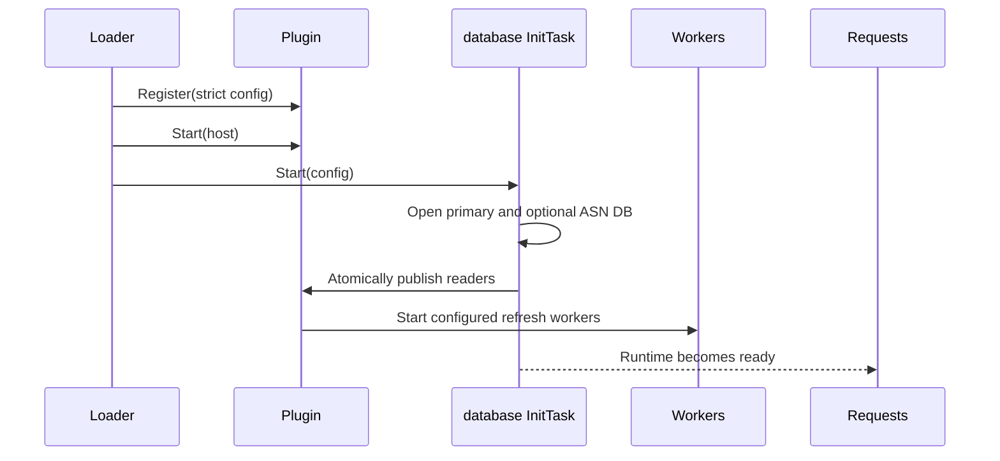

# GeoIP and ASN Plugin

The bundled `geoip` plugin registers configuration-compiled generic `DecisionFactProvider` components. Each entry in the required `decision_bindings` list selects exact Policy targets and one admitted IP input, so the same local lookup serves authentication, DKIM2 current-peer checks, reputation observations, or any other namespace. No binding is implicit. The plugin requires a local primary GeoIP database and can add ASN organization, routing-prefix, registry allocation, and network-privacy evidence from optional sources.

The authentication example binds the component `environment` for `authn/authenticate` and `authn/lookup_identity`, which Policy uses as `authn/plugin.geoip.environment`. Scalar bindings qualify their outputs under `plugin.geoip.*`; record bindings emit one correlated record collection. The plugin does not register an authentication-shaped `EnvironmentSource`.

The container artifact is:

```text
/usr/local/lib/nauthilus/plugins/geoip.so
```

## Public contract

| Item | Value |
| --- | --- |
| Metadata name | `geoip` |
| Product version | `0.1.0` |
| Interfaces | `Plugin`, `RuntimePlugin`, `ReloadablePlugin` |
| Registered lifecycle component | `InitTask` named `database` |
| Registered request components | One `DecisionFactProvider` per `decision_bindings` entry, named by its `component` |
| Canonical Policy provider | `<namespace>/plugin.geoip.<component>`, for example `authn/plugin.geoip.environment` |
| Source timeout | descriptor timeout `MaximumDecisionFactProviderTimeout` (10m); each lookup sequence is bounded by `lookup_timeout`, default `50ms` |
| Abort policy | `none` |
| Sensitive capabilities | none |
| Local debug modules | none; use the automatic `plugin.<module>` selector |

The configured module name participates in Policy binding. The reviewed example configures the module as `geoip`; a differently named module must use a matching provider declaration and exact descriptor ownership.

## Strict configuration schema

Configuration is decoded strictly. Unknown keys, wrong types, relative database paths, unsupported format strings, invalid URLs, and invalid durations reject registration or reload.

### Database and lookup fields

| Field | Type | Default | Validation and meaning |
| --- | --- | --- | --- |
| `database_path` | string | required | Cleaned absolute path to the required primary JSON or MaxMind database. File opening happens during the init task. |
| `database_format` | string | `auto` | Exactly `auto`, `json`, or `mmdb`. `auto` selects `mmdb` for a `.mmdb` suffix and `json` otherwise. Values are case-sensitive. |
| `asn_database_path` | string | empty | Optional cleaned absolute path to a secondary JSON or MaxMind ASN database. |
| `asn_database_format` | string | inferred | Exactly `auto`, `json`, or `mmdb`. Setting it without `asn_database_path` is invalid. |
| `refresh_interval` | duration string | disabled (`0`) | Non-negative interval for periodically reopening the local primary and optional ASN databases. Empty or `0s` disables this worker. |
| `lookup_timeout` | duration string | `50ms` | Must be positive. Bounds each request-time primary and ASN lookup sequence. |

### `decision_bindings`

`decision_bindings` is required and holds 1-32 immutable bindings. Each binding registers one fact provider.

| Field | Validation and meaning |
| --- | --- |
| `component` | Provider name, unique within the module. Policy refers to it as `<namespace>/plugin.geoip.<component>`. |
| `targets` | 1-32 exact `namespace/action` selectors sharing one namespace. A target can belong to only one binding. |
| `input.fact` | Admitted fact that carries the IP address (scalar) or the record list (record binding). |
| `input.category` | Category of that fact, for example `environment` or `resource`. |
| `output_schema` | `geoip.facts.v1` for a scalar binding, `geoip.records.v1` for a record binding. |
| `output_fact` | Record bindings only: the single output name, qualified as `plugin.geoip.<output_fact>`. Must be empty for scalar bindings. |
| `input.records.ip_field` | Record bindings only: string field that contains the IP. |
| `input.records.match` | Optional exact string predicates (at most 8) that select rows, for example `{kind: ip}`. |
| `input.records.correlation_fields` | Optional string fields (at most 8) copied into each output record. They cannot collide with GeoIP output names. |

Examples:

```yaml
decision_bindings:
  # Authentication: scalar facts under plugin.geoip.*
  - component: environment
    targets: [authn/authenticate, authn/lookup_identity]
    input: {fact: nauthilus.request.client.ip, category: environment}
    output_schema: geoip.facts.v1
  # Reputation observations: one record per admitted IP subject
  - component: observation
    targets: [reputation/observe]
    input:
      fact: resource.reputation.subjects
      category: resource
      records:
        ip_field: value
        match: {kind: ip}
        correlation_fields: [role]
    output_schema: geoip.records.v1
    output_fact: observations
```

Changing `decision_bindings` requires a restart; a reload that changes them is rejected and keeps the previous state. At activation, the host checks that every required input field is visible to the exact provider and has a compatible type.

### `freshness`

| Field | Type | Default | Validation and meaning |
| --- | --- | --- | --- |
| `freshness.max_age` | duration string | `1080h` (45 days) | Source age after which a match becomes `stale`. |
| `freshness.max_stale_age` | duration string | `2160h` (90 days) | Absolute maximum usable age. At least `max_age` and at most one year. |

Source age comes from the data, not from the reload time. JSON databases use the file's modification time. MaxMind databases use the earlier of the modification time and the embedded build time. Routing and registry snapshots use their own load times, and the oldest contributing source governs the result. Reloading unchanged data does not reset its age.

### `asn_lookup`

This optional worker downloads routing prefix-to-AS snapshots and builds an in-memory IPv4/IPv6 longest-prefix trie.

| Field | Type | Default | Validation and meaning |
| --- | --- | --- | --- |
| `asn_lookup.enabled` | boolean | `false` | Enables immediate and periodic routing snapshot fetches, with bounded retries after failures. |
| `asn_lookup.refresh_interval` | duration string | `720h` | Non-negative. Empty and explicit `0s` both select `720h`; disable with `enabled: false`. |
| `asn_lookup.timeout` | duration string | `30s` | Must be positive; applied independently to each configured source fetch. |
| `asn_lookup.source_urls` | list of strings | CAIDA IPv4 and IPv6 creation logs when enabled | Every entry must be a nonempty HTTP(S) URL, even when the worker is disabled. |

Default routing sources:

```text
https://publicdata.caida.org/datasets/routing/routeviews-prefix2as/pfx2as-creation.log
https://publicdata.caida.org/datasets/routing/routeviews6-prefix2as/pfx2as-creation.log
```

The parser accepts direct text or gzip-compressed prefix data and CAIDA creation logs. For a creation log it fetches the last valid listed snapshot path. Plain CIDR rows, CAIDA address/prefix-length rows, `AS` prefixes, AS sets, and MOAS tokens are accepted; for a set or MOAS value, the first numeric ASN is used.

### `asn_registry`

This optional worker downloads delegated RIR statistics and maps active ASN ranges to registry metadata.

| Field | Type | Default | Validation and meaning |
| --- | --- | --- | --- |
| `asn_registry.enabled` | boolean | `false` | Enables immediate and periodic registry feed fetches. |
| `asn_registry.refresh_interval` | duration string | `720h` | Non-negative. Empty and explicit `0s` both select `720h`; disable with `enabled: false`. |
| `asn_registry.timeout` | duration string | `30s` | Must be positive; applied independently to each feed. |
| `asn_registry.source_urls` | list of strings | five worldwide RIR feeds when enabled | Every entry must be a nonempty HTTP(S) URL. |

Default feeds cover AfriNIC, APNIC, ARIN, LACNIC, and RIPE NCC. Only `asn` rows whose status is `allocated` or `assigned` are retained.

### `privacy_intelligence`

This optional subsystem classifies addresses from immutable in-memory snapshots. It performs no file or network I/O on the request path and never makes the authentication decision itself.

| Field | Type | Default | Validation and meaning |
| --- | --- | --- | --- |
| `privacy_intelligence.enabled` | boolean | `false` | Requires at least one source or enabled hosting rules when set. |
| `privacy_intelligence.lookup_timeout` | duration string | `10ms` | Must be positive and no greater than the parent `lookup_timeout`. |
| `privacy_intelligence.max_snapshot_entries` | integer | `1000000` | Positive per-source input and expanded-entry bound. |
| `privacy_intelligence.max_download_bytes` | integer | `33554432` | Positive bound for one remote response, local source, or persistent-cache read. |
| `privacy_intelligence.refresh.cache_dir` | string | empty | Optional absolute directory for derived remote cache paths. |
| `privacy_intelligence.refresh.max_concurrent_downloads` | integer | `2` | Shared download limit; must be from `1` through `8`. |
| `privacy_intelligence.refresh.startup_jitter` | duration string | `30s` | Non-negative delay available before a background refresh when a cache or optional source permits deferral. |
| `privacy_intelligence.refresh.default_refresh_interval` | duration string | `6h` | Positive default for non-Tor sources. |
| `privacy_intelligence.refresh.default_min_refresh_interval` | duration string | `1h` | Positive lower bound for non-Tor source refresh. |
| `privacy_intelligence.refresh.default_max_refresh_backoff` | duration string | `24h` | Positive failure-backoff ceiling. |

The former environment-only `privacy_intelligence.public_log_fields` key is rejected; request logging is host-owned.

Each `sources` entry has this common contract:

| Field | Required | Meaning |
| --- | --- | --- |
| `id` | yes | Unique 1-63 character identifier containing lowercase letters, digits, and non-leading underscores. |
| `kind` | yes | `tor_exit_list`, `normalized_json`, `cidr_list`, or `cidr_csv`. |
| `authority` | yes | `official`, `operator`, `community`, or `derived`; Tor requires `official`. |
| `path` / `url` | exactly one | An absolute local path or credential-free HTTPS URL. Privacy URLs are stricter than the HTTP(S) URLs accepted by the ASN workers. |
| `required` | no | Makes initialization/reload fail when no valid initial snapshot can be obtained. After startup, a missing or expired required snapshot produces stale state. |
| `refresh_interval` | no | Positive interval, default `6h`; Tor defaults to `1h`. It must not be below `min_refresh_interval`. |
| `min_refresh_interval` | no | Positive lower bound, default `1h`; Tor has a hard minimum and default of `30m`. |
| `max_refresh_backoff` | no | Positive ceiling, default `24h`, and at least `refresh_interval`. |
| `refresh_jitter` | no | Non-negative and smaller than `refresh_interval`; defaults to the smaller of 10% of the interval or 10 minutes. |
| `max_age` | no | Positive freshness window, default `24h`. |
| `cache_path` | no | Absolute path available only to remote sources; otherwise derived from `refresh.cache_dir`. |
| `confidence` | no | Evidence confidence. Community values are capped at 80 and derived values at 60; official and operator values default to 100. This is evidence confidence, not authentication risk. |
| `license`, `license_url` | community | Both are mandatory for community sources; normalized community JSON must also carry license metadata. |

`cidr_list` and `cidr_csv` additionally require a bounded `provider` identifier and a nonempty `classes` list. CSV uses zero-based `cidr_column` in the range 0-63 and optional `has_header`; those CSV fields are rejected for line lists. Both formats accept only public unicast prefixes, reject the entire candidate on malformed input, deduplicate coverage, and losslessly collapse adjacent or contained prefixes before expanding classes. Supported classes are:

- `tor_exit`
- `known_vpn_exit`
- `community_vpn_exit`
- `public_proxy`
- `privacy_relay`
- `shared_egress`
- `hosting`

`shared_egress` is for operator-reviewed public NAT egress prefixes. The plugin intentionally does not infer it from an entire carrier ASN or organization name. `hosting` remains separate from VPN evidence and by itself does not set `privacy_detected`.

#### Source formats

- `tor_exit_list` accepts complete bare-address lists, TorDNSEL or CollecTor 1.0 exit records, and bounded Onionoo details JSON. Onionoo entries must describe running relays with the `Exit` flag. The plugin never sends the current client address to Tor.
- `normalized_json` is a strict versioned schema with `schema_version: 1`, source identity, authority, generation and optional validity timestamps, and per-prefix classes/provider/confidence. Unknown JSON fields, invalid metadata, invalid or non-public prefixes, and entries beyond the configured bounds reject the candidate atomically.
- `cidr_list` accepts one public prefix per line with blank lines and `#` comments.
- `cidr_csv` accepts RFC 4180 records and extracts the configured prefix column.

No third-party list is bundled. Operators remain responsible for feed licenses, attribution, automation terms, redistribution limits, and egress allowlists. The implementation does not require MaxMind Anonymous IP or another commercial privacy database.

#### Hosting rules and overrides

`privacy_intelligence.hosting` can derive `hosting` evidence from configured CIDRs, positive ASNs, and case-insensitive organization substrings. Organization matching is disabled unless patterns are explicitly configured, and the derived confidence ceiling is 60.

`privacy_intelligence.overrides` accepts an address prefix plus `add_classes` and/or `suppress_classes`, an optional reason, and an optional RFC 3339 expiry. Suppression normally removes only non-official evidence; `suppress_official: true` is required to suppress an official classification. Added evidence has operator authority and confidence 100.

## Primary JSON format

JSON is primarily a license-free test and development format:

```json
{
  "records": [
    {
      "cidr": "203.0.113.0/24",
      "country_iso": "DE",
      "country_name": "Germany",
      "city_name": "Berlin",
      "asn": 64500,
      "asn_org": "Example Access GmbH"
    }
  ]
}
```

`records` must contain at least one entry and every `cidr` must parse. Overlapping prefixes are allowed; the most specific match wins. Country codes, names, ASN values, and organizations are not otherwise normalized or semantically validated.

For production, use an appropriately licensed MaxMind City or Country database as the primary database. An optional MaxMind ASN database can supply the ASN and autonomous-system organization without replacing primary location data.

MaxMind files are read completely and opened from process-owned byte slices rather than mmap. Budget roughly the combined primary and ASN file sizes per Nauthilus process, plus temporary overlap while a reload validates and publishes replacement readers. In-flight lookups hold short leases on the retired readers until they finish.

## Enrichment precedence

The primary database is authoritative for whether the request matched at all. Optional ASN sources cannot create an ASN-only result for an address that the primary database did not match.

For a primary match, enrichment occurs in this order:

1. The primary database supplies location and any embedded ASN data.
2. The routing snapshot, when available, replaces ASN, routed prefix, ASN country, and registry with its longest-prefix record.
3. The secondary ASN database may fill a missing ASN, organization, or prefix. Conflicting nonzero ASNs are not merged.
4. The RIR registry snapshot replaces registry, ASN country, and status for the final ASN, and fills the allocation date when it is still empty.

This precedence matters when the sources have different update times.

## Lifecycle and reload



- A missing, unreadable, empty, malformed, or unsupported primary database makes the init task fail. A required module therefore prevents runtime readiness.
- Privacy initialization validates local sources, restores and revalidates configured caches, and performs an immediate remote fetch when necessary. A required privacy source without a valid cache or successful initial fetch makes initialization or reload fail; an unavailable optional source does not.
- `refresh_interval` waits for its first tick before reopening local databases. A failed refresh logs an error and keeps the previous readers.
- ASN routing and registry workers fetch immediately and then on their configured interval. A failed multi-source refresh keeps the last completely validated snapshot and retries after 30-60 seconds, doubling the delay up to 15 minutes with jitter across replicas. A shorter `refresh_interval` also caps the retry delay. A successful refresh resets the backoff and resumes the regular interval. Until a first snapshot succeeds, that source adds no ASN enrichment; the primary database remains usable.
- Each remote privacy source has a supervised worker. Refreshes are coalesced per source and share the configured download semaphore. A candidate is parsed and validated completely before the combined immutable lookup index is rebuilt and atomically published.
- Privacy refresh failures log only the validated source ID, retain the last-known-good snapshot, and advance a bounded exponential backoff. `Retry-After`, `Cache-Control: max-age`, `Expires`, validators, and configured jitter can raise the next-attempt time.
- Sources are fetched sequentially. With five RIR feeds and a `30s` per-source timeout, one failed pass can take substantially longer than 30 seconds.
- A SIGHUP reload applies every config change except `decision_bindings`, which is rejected as restart-bound. Before the reload is committed, the plugin only decodes and validates the candidate (`ValidateReconfigure`). After the commit, `Reconfigure` loads the databases and privacy sources. If that load fails, the plugin keeps its previous databases and settings, the reload is reported as `failed` for the module, and the next reload retries it.
- The refresh workers restart with the new settings and are stopped through their own cancellation. A periodic refresh that loaded data for replaced or stopped settings discards its result instead of publishing it.
- Database files are read and checked for concurrent replacement; a file that changes while it is being read is rejected.
- A changed privacy config is also loaded before publication; an unchanged privacy engine is reused. A successful reconfigure restarts optional workers. Routing state is reset and may be temporarily absent until the new immediate fetch succeeds; existing registry data is retained while registry refresh remains enabled.
- `Stop` cancels workers and closes active MaxMind readers.

Remote privacy caches are written with mode `0600` through a temporary file and atomic rename; their directories are created with mode `0700`. Cache metadata, authority, kind, source ID, entry count, public prefixes, classes, and confidence are revalidated before publication. An expired valid cache remains available as explicitly stale evidence while refresh is retried.

## Host services

The plugin uses:

| Host service | Scope and purpose |
| --- | --- |
| `Logger("geoip")` | lifecycle, refresh, record-count, and bounded error logs |
| `Tracer("geoip")` | child spans for request-time evaluation |
| `Metrics("geoip")` | plugin-owned counters, histogram, and gauge |
| `HTTP("privacy")` | bounded conditional requests for remote privacy sources |
| `ServiceContext()` | lifetime parent for refresh workers |
| `Go(...)` | host-supervised database, routing, registry, and privacy workers |

The privacy downloader uses the host HTTP facade. The older routing and registry downloaders use their own `net/http` clients, defaulting to `http.DefaultClient`. Those ASN downloads do **not** use `Host.HTTP`, and they do not register `Host.ConnectionTargets`; consequently, they do not receive host HTTP facade diagnostics or connection-target accounting.

## Fact contract

A scalar binding (`geoip.facts.v1`) declares the following environment facts for its configured targets. A record binding (`geoip.records.v1`) emits the same fields, without the `plugin.geoip.` prefix, inside one record per selected input row, plus its correlation fields.

| Fact | Type | Emission |
| --- | --- | --- |
| `plugin.geoip.lookup_state` | string | Always: `fresh`, `stale`, `not_found`, or `unavailable`. |
| `plugin.geoip.ip` | string | Always: the exact canonical input address. |
| `plugin.geoip.data_stale` | boolean | Always: whether the source is older than `freshness.max_age`. |
| `plugin.geoip.data_age_seconds` | integer | When the source timestamp is known. |
| `plugin.geoip.network` | string | For a usable match: the matching database prefix. |
| `plugin.geoip.matched` | boolean | Unless `unavailable`: `true` for a primary match, otherwise `false`. |
| `plugin.geoip.country_iso` | string | When nonempty. |
| `plugin.geoip.country_name` | string | When nonempty. |
| `plugin.geoip.city_name` | string | When nonempty. |
| `plugin.geoip.asn` | number | When greater than zero. |
| `plugin.geoip.asn_org` | string | When nonempty. |
| `plugin.geoip.asn_prefix` | string | When nonempty. |
| `plugin.geoip.asn_registry` | string | When nonempty. |
| `plugin.geoip.asn_country_iso` | string | When nonempty. |
| `plugin.geoip.asn_allocated` | string | When nonempty. |
| `plugin.geoip.asn_status` | string | When nonempty. |
| `plugin.geoip.privacy_lookup_state` | string | Whenever privacy intelligence is enabled: `evaluated`, `stale`, `unavailable`, `no_sources`, or `invalid_ip`. |
| `plugin.geoip.privacy_data_stale` | boolean | Whenever privacy intelligence is enabled. |
| `plugin.geoip.privacy_detected` | boolean | In `evaluated` or `stale` state. Hosting-only evidence remains `false`. |
| `plugin.geoip.privacy_classes` | string list | In `evaluated` or `stale` state, including an explicit empty list. |
| `plugin.geoip.privacy_primary_class` | string | When retained evidence selects a primary class. |
| `plugin.geoip.privacy_confidence` | number | With a primary class. |
| `plugin.geoip.privacy_source_authorities` | string list | When retained evidence has contributing authorities. |
| `plugin.geoip.privacy_data_age_seconds` | number | With contributing authorities; age of the oldest retained evidence. |
| `plugin.geoip.is_tor_exit_node` | boolean | Explicit true or false in `evaluated` or `stale` state. |
| `plugin.geoip.is_known_vpn_exit` | boolean | Explicit true or false in `evaluated` or `stale` state. |
| `plugin.geoip.is_community_vpn_exit` | boolean | Explicit true or false in `evaluated` or `stale` state. |
| `plugin.geoip.is_public_proxy` | boolean | Explicit true or false in `evaluated` or `stale` state. |
| `plugin.geoip.is_privacy_relay` | boolean | Explicit true or false in `evaluated` or `stale` state. |
| `plugin.geoip.is_hosting_network` | boolean | Explicit true or false in `evaluated` or `stale` state. |
| `plugin.geoip.is_shared_egress` | boolean | Explicit true or false in `evaluated` or `stale` state. |

Lookup states:

- `fresh`: a match from sufficiently recent data.
- `stale`: a match whose source is older than `max_age` but within `max_stale_age`.
- `not_found`: a valid database miss; the source age is still reported.
- `unavailable`: the data is older than `max_stale_age` or undated. Location, ASN, network, and `matched` are withheld, so there is no fabricated negative match, and expired records do not feed derived hosting classifications. Privacy evidence keeps its own independent state.

A missing, wrongly typed, or unparsable input address, including a zoned IPv6 address, returns the `invalid_input` error class without facts. IPv4-mapped IPv6 input is unmapped before lookup. Database and privacy failures are returned to the host as a fixed, redacted error; cancellation and deadline errors keep their identity. Raw database errors, which can contain queried addresses or private paths, never reach logs, spans, or the Policy collector.

Privacy state is deliberately tri-state rather than a simple boolean:

- `evaluated` means valid snapshots were evaluated, so explicit false classification facts are meaningful.
- `stale` means evidence was evaluated but a contributing or required source exceeded `max_age` or is missing.
- `unavailable`, `no_sources`, and `invalid_ip` omit classification booleans so absence cannot be mistaken for a verified negative.

The plugin does not deny a request merely because data is stale or unavailable. For fail-closed enforcement, make a source `required` to reject startup without any valid initial snapshot and write policy that requires `privacy_lookup_state: evaluated` and `privacy_data_stale: false` before trusting negative classifications.

## Record bindings

A record binding reads a record-list fact, selects rows whose string fields match every `match` predicate, and looks up the IP in `ip_field`. At most eight input records are accepted; a larger list is `invalid_input`. Caller-supplied network or ASN rows do not match an IP selector such as `{kind: ip}`, so callers cannot inject geographic claims. Configured `correlation_fields` are copied into each output record so consumers can join the result back to the source row; a missing correlation field is `invalid_input`.

The [reputation plugin](./reputation.md#asn-derivation-from-geoip) uses such a binding to derive ASN subjects for observations. Its example fragment `server/docs/examples/reputation_geoip_observation.yml` declares the output schema, including provider visibility for the reputation consumers.

## Generic provider boundary

Each provider accepts only its configured input fact and category for its exact targets. The input identity is configuration, not lookup code: the authentication example selects the host-normalized `nauthilus.request.client.ip`, while a DKIM2 current-peer binding selects `environment.rspamd.smtp_client_ip` for `dkim2/accept-message-instance`. The provider receives no credential, raw transport, response, or scheduling authority. Its result contains the declared facts and a safe error class only; request logging and Policy diagnostics remain host-owned.

### Client address input for authentication

`nauthilus.request.client.ip` carries the caller-supplied client address when one was sent (labelled untrusted unless it matches the transport peer) and otherwise the transport peer that scheduler guards also see, for example the gRPC peer of a backchannel identity lookup without `client_ip`. The caller-asserted `input.auth.client_ip` is only present when the transport adapter received a client address: HTTP falls back to the connection peer, gRPC does not. Binding `input.auth.client_ip` lets the loopback exemption guard and GeoIP disagree about the same request, and a gRPC call without `client_ip` from a non-exempt peer then fails the required input. Bind `nauthilus.request.client.ip` for `authn/authenticate` and `authn/lookup_identity`.

A request without any parseable client address, for example over a Unix socket, has no input fact. The provider reports `invalid_input`, and the configured provider `failure` mode applies, so a required GeoIP provider fails closed. A plan that treats such requests as not applicable skips the provider explicitly with a scheduler guard such as `{attribute: nauthilus.request.client.ip.present, is: false}` in `skip_if`.

There is no registered `plugin.exchange.geoip` execution path and no runtime alias for the removed `plugin.environment.geoip.*` fact family. Analytics consumers project the already collected `plugin.geoip.*` facts into their typed views instead of invoking a second GeoIP adapter.

## Metrics, spans, and debug

The plugin names below are `pluginapi.MetricDefinition.Name` values, not the final Prometheus collector names. The host exports native plugin metrics as `nauthilus_plugin_<scope>_<definition_name>` and prepends the host-owned `plugin_scope` label. This plugin calls `Host.Metrics("geoip")`, so both the collector-name scope and `plugin_scope` value are `geoip` even when the configured module name differs.

| Plugin definition name | Exported Prometheus family | Labels | Meaning |
| --- | --- | --- | --- |
| `geoip_lookup_total` | `nauthilus_plugin_geoip_geoip_lookup_total` | `plugin_scope="geoip"`, `result=matched|miss|invalid_ip|error` | Generic provider lookup attempts. |
| `geoip_lookup_seconds` | `nauthilus_plugin_geoip_geoip_lookup_seconds` | `plugin_scope="geoip"`, same result label | Lookup latency when a positive duration was recorded. The histogram exposes the usual `_bucket`, `_sum`, and `_count` series. |
| `geoip_database_records` | `nauthilus_plugin_geoip_geoip_database_records` | `plugin_scope="geoip"`, `state=loaded` | Combined primary and optional ASN database record indicator. |
| `geoip_privacy_source_refresh_total` | `nauthilus_plugin_geoip_geoip_privacy_source_refresh_total` | `plugin_scope="geoip"`, `source=<configured ID>`, `result=success|error` | Background privacy refresh attempts. |
| `geoip_privacy_snapshot_entries` | `nauthilus_plugin_geoip_geoip_privacy_snapshot_entries` | `plugin_scope="geoip"` | Total entries in currently published privacy snapshots. |
| `freshness_total` | `nauthilus_plugin_geoip_freshness_total` | `plugin_scope="geoip"`, `state=fresh|stale|not_found|unavailable` | Lookup results by data freshness. It carries no IP, ASN, country, or path. |

For example, a matched-lookup series is selected as:

```text
nauthilus_plugin_geoip_geoip_lookup_total{plugin_scope="geoip",result="matched"}
```

Request tracing uses separate span names and attributes:

| Span | Attributes | Meaning |
| --- | --- | --- |
| `geoip.environment.evaluate` | `plugin.module`, `plugin.component`; on match `geoip.matched`, `geoip.country_iso` | Request-time child span. |
| `geoip.database.primary.lookup` | `geoip.lookup.result=matched|miss|error` | Primary database child lookup. |
| `geoip.asn.routing.lookup` | same | Routing-prefix child lookup when configured. |
| `geoip.database.asn.lookup` | same | Secondary ASN database child lookup when configured. |
| `geoip.asn.registry.lookup` | same | Registry child lookup when configured. |
| `geoip.privacy.lookup` | same; parent adds privacy state/class/staleness | In-memory privacy lookup when enabled. |

For MaxMind data, the records gauge uses the search-tree node count, not a count of business records. Routing prefix and RIR range counts are logged when their snapshots load, but are not included in this gauge. Privacy refresh error logs expose only the validated source ID, not the URL or transport details.

GeoIP declares no local debug submodule. Enable the configured module selector:

```yaml
observability:
  log:
    level: debug
    debug_modules:
      - plugin.geoip
```

## Build and tests

From the exact Nauthilus host checkout:

```shell
NATIVE_ARTIFACT_LDFLAGS="$(go run -mod=vendor ./scripts/native_artifact_fingerprint -tags="netgo")"
GOEXPERIMENT=runtimesecret \
GOCACHE=/tmp/nauthilus-go-cache \
go test ./contrib/plugins/geoip

mkdir -p build
CGO_ENABLED=1 \
GOEXPERIMENT=runtimesecret \
go build \
  -mod=vendor \
  -tags="netgo" \
  -trimpath \
  -buildmode=plugin \
  -ldflags "${NATIVE_ARTIFACT_LDFLAGS}" \
  -o build/geoip.so \
  ./contrib/plugins/geoip
```

The package test includes a subprocess smoke test that builds the `.so`, opens it through Go's `plugin` package, resolves `NauthilusPlugin`, and checks the API version. Loading in a helper process avoids comparing a plugin against the test binary's different package hashes.

## Realistic configuration and policy

```yaml
plugins:
  verification_policy: signature_required
  allowed_dirs:
    - /usr/local/lib/nauthilus/plugins
  trust:
    signers:
      - id: nauthilus-plugin-build-key-2026
        format: minisign
        public_key_file: /usr/share/nauthilus/plugin-keys/build-2026.pub
  modules:
    - name: geoip
      type: go
      path: /usr/local/lib/nauthilus/plugins/geoip.so
      signature: minisign:/usr/local/lib/nauthilus/plugins/geoip.so.minisig
      signer: nauthilus-plugin-build-key-2026
      optional: false
      config:
        decision_bindings:
          - component: environment
            targets: [authn/authenticate, authn/lookup_identity]
            input: {fact: nauthilus.request.client.ip, category: environment}
            output_schema: geoip.facts.v1
        freshness:
          max_age: 1080h
          max_stale_age: 2160h
        database_path: /var/lib/GeoIP/GeoLite2-City.mmdb
        database_format: mmdb
        asn_database_path: /var/lib/GeoIP/GeoLite2-ASN.mmdb
        asn_database_format: mmdb
        refresh_interval: 1h
        lookup_timeout: 50ms
        asn_lookup:
          enabled: true
          refresh_interval: 720h
          timeout: 30s
        asn_registry:
          enabled: true
          refresh_interval: 720h
          timeout: 30s
        privacy_intelligence:
          enabled: true
          lookup_timeout: 10ms
          max_snapshot_entries: 1000000
          max_download_bytes: 33554432
          refresh:
            cache_dir: /var/lib/nauthilus/privacy/cache
            max_concurrent_downloads: 2
            startup_jitter: 30s
            default_refresh_interval: 6h
            default_min_refresh_interval: 1h
            default_max_refresh_backoff: 24h
          sources:
            - id: tor_exit
              kind: tor_exit_list
              authority: official
              url: https://onionoo.torproject.org/details?type=relay&running=true&flag=Exit&fields=exit_addresses%2Crunning%2Cflags
              refresh_interval: 1h
              min_refresh_interval: 30m
              max_refresh_backoff: 12h
              refresh_jitter: 5m
              max_age: 6h
              required: true
            - id: apple_private_relay
              kind: cidr_csv
              authority: official
              url: https://mask-api.icloud.com/egress-ip-ranges.csv
              provider: apple_private_relay
              classes:
                - privacy_relay
                - shared_egress
              cidr_column: 0
              has_header: false
              confidence: 100
              max_age: 24h
            - id: x4b_vpn
              kind: cidr_list
              authority: community
              url: https://raw.githubusercontent.com/X4BNet/lists_vpn/main/output/vpn/ipv4.txt
              provider: x4bnet
              classes:
                - community_vpn_exit
              license: MIT
              license_url: https://github.com/X4BNet/lists_vpn#license
              confidence: 55
              max_age: 24h

policy:
  namespaces:
    authn:
      condition_sets:
        strings:
          allowed_country_iso:
            - DE
            - AT
            - CH
      providers:
        environment:
          kind: native
          module: geoip
          targets:
            - action: authenticate
            - action: lookup_identity
          produced_facts:
            - plugin.geoip.lookup_state
            - plugin.geoip.data_age_seconds
            - plugin.geoip.data_stale
            - plugin.geoip.ip
            - plugin.geoip.network
            - plugin.geoip.matched
            - plugin.geoip.country_iso
            - plugin.geoip.country_name
            - plugin.geoip.city_name
            - plugin.geoip.asn
            - plugin.geoip.asn_org
            - plugin.geoip.asn_prefix
            - plugin.geoip.asn_registry
            - plugin.geoip.asn_country_iso
            - plugin.geoip.asn_allocated
            - plugin.geoip.asn_status
            - plugin.geoip.privacy_lookup_state
            - plugin.geoip.privacy_detected
            - plugin.geoip.privacy_classes
            - plugin.geoip.privacy_primary_class
            - plugin.geoip.privacy_confidence
            - plugin.geoip.privacy_source_authorities
            - plugin.geoip.privacy_data_stale
            - plugin.geoip.privacy_data_age_seconds
            - plugin.geoip.is_tor_exit_node
            - plugin.geoip.is_known_vpn_exit
            - plugin.geoip.is_community_vpn_exit
            - plugin.geoip.is_public_proxy
            - plugin.geoip.is_privacy_relay
            - plugin.geoip.is_hosting_network
            - plugin.geoip.is_shared_egress
          failure: indeterminate
          timeout: 50ms
      domain_plans:
        geoip:
          checkpoints:
            pre_auth:
              providers:
                - name: brute_force
                  use: authn/builtin/brute_force
                  actions: [authenticate]
                - name: plugin_environment_geoip
                  use: authn/plugin.geoip.environment
                  actions: [authenticate, lookup_identity]
            auth_backend:
              providers:
                # Replace this binding when authentication uses another backend.
                - name: ldap_backend
                  use: authn/builtin/ldap_backend
                  actions: [authenticate, lookup_identity]
            auth_decision:
              providers: []
      policy_sets:
        geoip:
          visibility: private
          rules:
            - name: deny_current_tor_password_auth
              checkpoint: pre_auth
              actions: [authenticate]
              require_providers: [plugin_environment_geoip]
              if:
                all:
                  - attribute: plugin.geoip.is_tor_exit_node
                    is: true
                  - attribute: plugin.geoip.privacy_data_stale
                    is: false
              then:
                decision: deny
                response_marker: auth.response.fail
            - name: deny_unexpected_country
              checkpoint: pre_auth
              actions: [authenticate]
              require_providers: [plugin_environment_geoip]
              if:
                all:
                  - attribute: plugin.geoip.matched
                    is: true
                  - attribute: plugin.geoip.lookup_state
                    eq: fresh
                  - attribute: plugin.geoip.country_iso
                    not_in: "@string.allowed_country_iso"
                  - attribute: plugin.geoip.asn_registry
                    not_in:
                      - ripencc
                      - arin
              then:
                decision: deny
                response_marker: auth.response.fail
  targets:
    - namespace: authn
      action: authenticate
      schema: authn/authenticate/v1
      domain_plan: authn/geoip
      default_policy: authn/standard_auth
      plans:
        pre_auth:
          policy_sets: [authn/geoip]
    - namespace: authn
      action: lookup_identity
      schema: authn/lookup_identity/v1
      domain_plan: authn/geoip
      default_policy: authn/standard_auth
```

The specific policy grammar must match the active Nauthilus config generation. The stable contracts supplied by this plugin are the configured component names and registered fact IDs. Decide explicitly how rules treat `stale` and `unavailable` lookups; the example only denies on fresh data.

## Security, privacy, and current limits

- The plugin handles client IP-derived location, ASN, and network-classification data. Treat its central logs, traces, snapshots, and caches according to your privacy policy.
- Use HTTPS and explicit egress allowlists for routing and RIR sources; their legacy parsers permit HTTP. Privacy source URLs must be credential-free HTTPS.
- A creation log may name an absolute follow-up URL. Configure only trusted creation-log sources.
- A routing source can consume up to 128 MiB compressed response data and 128 MiB decompressed data; two default sources plus trie construction need corresponding memory headroom.
- Each RIR response is bounded at 32 MiB and feeds are fetched sequentially.
- Routing and RIR fetches bypass `Host.HTTP` and connection-target observability. Privacy downloads use `Host.HTTP`, but the plugin still declares no static connection targets because URLs are plugin configuration.
- Privacy snapshots and caches contain IP-derived intelligence. Keep cache paths private, retain the restrictive permissions, and do not expose source/provider/license metadata through request logs.
- A negative privacy result is meaningful only in `evaluated` or `stale` state. Do not convert unavailable states into false policy claims, and decide explicitly whether stale data should fail open or fail closed.
- Generic prefix feeds are accepted only as classifications explicitly assigned by the operator; the plugin does not assess whether a list is accurate, complete, or legally usable.
- The primary local database remains mandatory even when routing lookup or privacy intelligence is enabled.
- Keep database files current. Once data exceeds `freshness.max_stale_age`, every lookup is `unavailable` and geographic rules stop matching.
- The checked-in `geoip-test.mmdb` is intentionally not a real MaxMind database; it tests path/format handling only.
- MaxMind data has its own licensing and update requirements and is not bundled by this plugin source directory.
