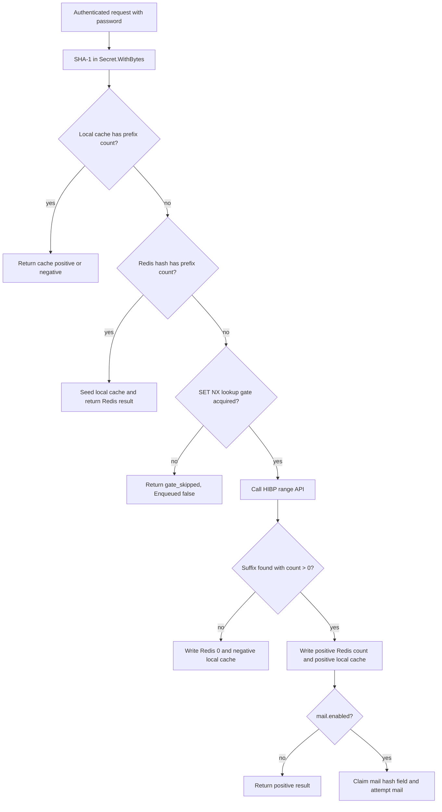

# Have I Been Pwned Plugin

The bundled `haveibeenpwnd` plugin checks the request password after successful authentication through the HIBP Pwned Passwords range API. It computes SHA-1 inside the request-scoped secret closure, sends only the five-character k-anonymity prefix, caches positive and negative results, uses Redis gates to suppress duplicate lookups, publishes positive analytics data to later post-actions, and can optionally send SMTP or LMTP mail through the host mail facade.

The container artifact is:

```text
/usr/local/lib/nauthilus/plugins/haveibeenpwnd.so
```

The native effect ID with the standard module name is:

```text
authn/plugin.haveibeenpwnd.post_action
```

## Public contract

| Item | Value |
| --- | --- |
| Metadata name | `haveibeenpwnd` |
| Product version | `0.1.0` |
| Interfaces | `Plugin`, `RuntimePlugin`, `ReloadablePlugin` |
| Registered component | `PostActionTarget` named `post_action` |
| Authn Policy effect | `authn/plugin.haveibeenpwnd.post_action` |
| Metadata capabilities | `credentials`, `mail` |
| Always required capability | `credentials` |
| Conditionally required capability | `mail` when `mail.enabled: true` at registration |
| Local debug modules | `lookup`, `mail` |

Metadata lists possible capabilities; it does not grant them. The module must include `credentials` in `allow_capabilities`. Add `mail` before process startup when mail is enabled.

## Strict configuration schema

Unknown keys, wrong types, invalid URL schemes, nonpositive limits or TTLs, invalid mail ports, unreadable/oversized body templates, and syntactically invalid templates reject registration or reload.

### Lookup, cache, and Redis

| Field | Type | Default | Validation and meaning |
| --- | --- | --- | --- |
| `redis_pool` | string | `default` | Trimmed compatibility field. The native plugin currently ignores named pool selection and always uses `Host.Redis()`. |
| `api_base_url` | string | `https://api.pwnedpasswords.com/range/` | Must be HTTP(S), include a host, and is normalized to exactly one trailing slash. |
| `http_timeout` | duration string | `10s` | Must be positive. |
| `http_max_response_bytes` | integer | `1048576` | Must be positive. |
| `cache_positive_ttl` | duration string | `1h` | Must be positive. |
| `cache_negative_ttl` | duration string | `10m` | Must be positive. |
| `redis_positive_ttl` | duration string | `1h` | Must be positive. |
| `redis_negative_ttl` | duration string | `24h` | Must be positive. Also used to extend a positive Redis hash after successful mail. |
| `gate_ttl` | duration string | `5m` | Must be positive; expiration for the external-lookup `SET NX` gate. |

Setting a custom `redis_pool` does not select that pool. Startup logs classify it as `custom_ignored`. Do not interpret this field as current named-pool support.

### `mail`

| Field | Type | Default | Validation and meaning |
| --- | --- | --- | --- |
| `mail.enabled` | boolean | `false` | Enables mail after a fresh positive HTTP lookup. Requires `CapabilityMail` at registration. |
| `mail.use_lmtp` | boolean | `false` | Selects LMTP instead of SMTP in the host message. |
| `mail.server` | string | `localhost` | Trimmed; empty selects the default. |
| `mail.port` | integer | `25` | Must be between 1 and 65535. |
| `mail.helo_name` | string | `localhost` | Trimmed; empty selects the default. |
| `mail.tls` | boolean | `false` | Requests TLS through the host mail transport. |
| `mail.starttls` | boolean | `false` | Requests STARTTLS through the host mail transport. |
| `mail.username` | string | empty | Trimmed SMTP/LMTP username. |
| `mail.password` | string | empty | Mail password, preserved as configured. |
| `mail.mail_from` | string | `postmaster@localhost` | Trimmed sender; empty selects the default. |
| `mail.website` | string | empty | Trimmed website value exposed to templates. |
| `mail.template_path` | string | builtin text body | Optional local file, read during registration/reload, maximum 64 KiB. |
| `mail.subject_template` | string | `Password leak detected for your account <{{ .Account }}>` | Go `text/template`; empty selects the default. |

Both templates use `missingkey=error` and receive exactly:

```text
Account
HashPrefix
Count
Website
Timestamp
```

Template parsing at config time catches syntax errors. Some invalid field selections can still parse and then fail when the template is executed for a positive result; that produces `template_error` at request time.

## Capabilities and reload

`Register` always calls `RequireCapability(credentials)`. When the initial config has `mail.enabled: true`, it also calls `RequireCapability(mail)` and records that mail was active at registration.

Consequences:

- Mail disabled at startup: grant only `credentials`.
- Mail enabled at startup: grant both `credentials` and `mail`.
- The module `config` reloads on SIGHUP. The plugin validates the candidate before the reload is committed; an invalid value, including an unreadable `mail.template_path`, rejects the whole reload and keeps the running config.
- Reload may change mail transport fields and may disable mail. Enabling mail again reloads while the capability acquired at registration is still active.
- Reload cannot enable mail on an instance that registered with mail disabled, because it holds no mail capability. The change is reported as `restart_required` and rejects the reload.
- Changing `allow_capabilities` is a loader-level change and requires restart.

## Host services

| Host service | Scope and purpose |
| --- | --- |
| `Logger("haveibeenpwnd")` | lifecycle and bounded operational messages |
| `Logger("lookup")` | secret-free lookup debug result |
| `Logger("mail")` | secret-free mail debug result |
| `Tracer("haveibeenpwnd")` | check, HTTP, and mail child spans |
| `Metrics("haveibeenpwnd")` | check, HTTP latency, and mail result instruments |
| `Cache("haveibeenpwnd")` | process-local positive/negative counts |
| `Redis()` | persistent count hash, lookup gate, mail gate, and key namespace |
| `HTTP("haveibeenpwnd")` | bounded HIBP range request |
| `Mail("mail")` | host-managed SMTP/LMTP send when enabled |
| `ConnectionTargets("haveibeenpwnd")` | redacted HIBP API `host:port` registration |

The mail scope is exactly `mail`, not `haveibeenpwnd`. This controls the scoped host mail facade and associated diagnostics.

## Eligibility and credential handling

The post-action skips without HTTP, Redis, or mail when:

- `Snapshot.Runtime.NoAuth` is true;
- `Snapshot.Runtime.Authenticated` is false;
- no `CredentialProvider` is present;
- `CredentialProvider.Password` returns no secret;
- the secret is zero or empty.

For an eligible request, SHA-1 is calculated only inside `Secret.WithBytes`. The plain password is not placed into a request snapshot, config value, log field, runtime delta, metric label, or trace attribute.

HIBP receives:

```text
GET <api_base_url><first-five-lowercase-sha1-hex-characters>
Accept: */*
User-Agent: Nauthilus
```

The suffix is matched case-insensitively in the response. Only a strictly positive integer count is treated as leaked.

## Cache, Redis, and HTTP order



Key shapes before any host Redis namespace is applied:

```text
HAVEIBEENPWND:<md5(account)>
HAVEIBEENPWND:GATE:<md5(account)>:<sha1-prefix>
hibp:<account>:<sha1-prefix>                 # process cache
```

MD5 is used only to preserve the legacy Redis key layout; it is not used as a password hash. The process-cache key contains the account directly.

Redis behavior is required after a local-cache miss. Unlike ClickHouse deduplication, Redis failures here return an error rather than failing open.

The plugin does not separately reject an empty `Snapshot.Account`. An empty account therefore shares the same MD5-based Redis identity and local cache prefix across requests. Ensure the selected authentication path supplies a stable nonempty account; mail additionally assumes that value is a usable recipient address.

## Result and runtime exchange contract

Bounded successful/skip check outcomes include:

```text
skipped
cache_positive
cache_negative
redis_positive
redis_negative
gate_skipped
http_positive
http_negative
```

An HTTP transport failure and a non-200 response instead return an error; `http_error` and `status_error` are recorded by the HTTP metric and span rather than becoming a successful check outcome.

Every lookup outcome after credential eligibility populates a diagnostic `result` field in `PostActionEnqueueResult.Logs`. Early eligibility skips return `Enqueued: false` without result logs. The current host ignores result `Logs` and `Enqueued`; these fields are visible only to direct callers/tests. A positive result also includes:

```text
haveibeenpwnd_result = leaked
```

Positive results publish:

```text
plugin.exchange.haveibeenpwnd = {
  hash_info: <five-character-prefix><decimal-count>,
  leaked: true,
  count: <non-negative integer>
}
```

`hash_info` contains no separator. For example, prefix `abcde` and count `42` produce `abcde42`. The full SHA-1 hash, suffix, and password are never published.

The delta is visible only to later post-action steps in the same detached plan. It does not change the policy decision, client response, or live request runtime. The plugin intentionally does not restore `rt.action_haveibeenpwnd`.

The plugin's `Enqueued` value describes whether the check produced an accepted result, not whether a background job was created:

- eligibility skip and duplicate lookup gate: `false`;
- positive or negative cache, Redis, or HTTP result: `true`;
- errors: returned as errors.

## Exact mail semantics

Mail is attempted only when all of these conditions hold:

1. the request was eligible;
2. local cache did not contain the prefix;
3. Redis did not contain the prefix;
4. the lookup gate was acquired;
5. a fresh HIBP HTTP response contained the password suffix with a positive count;
6. the positive count was successfully written to Redis and the local cache;
7. `mail.enabled` is true.

Positive cache and Redis hits never send mail.

For a fresh positive result, the mail path:

1. claims `HSETNX <hibp-key> send_mail 1`;
2. skips with `gate_skipped` when the field already exists;
3. renders subject and body;
4. sends through `Host.Mail("mail")`;
5. after success, extends the HIBP hash expiration to `redis_negative_ttl`.

:::warning No retry after a claimed mail failure

The `send_mail` claim happens before template rendering and transport send. The positive count is also already cached and stored in Redis. If rendering or sending fails:

- the mail claim is not removed;
- the positive count remains stored;
- later requests normally take the cache or Redis path;
- those paths do not call the mail routine.

The current implementation therefore does not provide an immediate retry after a claimed template or send failure. Recovery waits for the relevant cached/Redis state to expire and a later request to perform a fresh positive HTTP lookup. Do not describe this path as guaranteed mail delivery.

:::

The plugin deliberately does not call the legacy `nauthilus_send_mail_hash` Lua script because the script and Lua action disagree on `send_email` versus `send_mail`. The native implementation owns duplicate notification suppression directly with `HSETNX`.

## Metrics, spans, and debug

| Instrument | Result values or attributes |
| --- | --- |
| `haveibeenpwnd_checks_total{result}` | `skipped`, cache, Redis, successful HTTP positive/negative, and gate-skip outcomes |
| `haveibeenpwnd_http_duration_seconds{result}` | `http_positive`, `http_negative`, `http_error`, `status_error` |
| `haveibeenpwnd_mail_attempts_total{result}` | `disabled`, `gate_skipped`, `template_error`, `send_error`, `sent` |
| `haveibeenpwnd.post_action.check` | bounded operation and result attributes |
| `haveibeenpwnd.post_action.http_lookup` | bounded HTTP lookup result and recorded error |
| `haveibeenpwnd.post_action.mail_notify` | bounded mail result and recorded error |

```yaml
observability:
  log:
    level: debug
    debug_modules:
      - plugin.haveibeenpwnd
      - plugin.haveibeenpwnd.lookup
      - plugin.haveibeenpwnd.mail
```

Plugin logs, metrics, and span attributes omit passwords, accounts, full hashes, response bodies, recipients, rendered subjects/bodies, template paths, and raw mail transport errors.

## Build and tests

```shell
NATIVE_ARTIFACT_LDFLAGS="$(go run -mod=vendor ./scripts/native_artifact_fingerprint -tags="netgo")"
GOEXPERIMENT=runtimesecret \
GOCACHE=/tmp/nauthilus-go-cache \
go test ./contrib/plugins/haveibeenpwnd

mkdir -p build
CGO_ENABLED=1 \
GOEXPERIMENT=runtimesecret \
go build \
  -mod=vendor \
  -tags="netgo" \
  -trimpath \
  -buildmode=plugin \
  -ldflags "${NATIVE_ARTIFACT_LDFLAGS}" \
  -o build/haveibeenpwnd.so \
  ./contrib/plugins/haveibeenpwnd
```

The unit suite uses fake credentials, HTTP, mail, process cache, and Redis. It covers strict config, capabilities, reload restrictions, local/Redis/HTTP outcomes, runtime exchange, lookup and mail gates, successful mail, redacted mail errors, negative caching, and connection-target registration. It does not contact the public HIBP service and currently has no subprocess `plugin.Open` smoke test.

## Realistic configuration and policy

Minimal lookup without mail:

```yaml
plugins:
  verification_policy: signature_required
  allowed_dirs:
    - /usr/local/lib/nauthilus/plugins
  trust:
    signers:
      - id: nauthilus-plugin-build-key-2026
        format: minisign
        public_key_file: /usr/share/nauthilus/plugin-keys/build-2026.pub
  modules:
    - name: haveibeenpwnd
      type: go
      path: /usr/local/lib/nauthilus/plugins/haveibeenpwnd.so
      signature: minisign:/usr/local/lib/nauthilus/plugins/haveibeenpwnd.so.minisig
      signer: nauthilus-plugin-build-key-2026
      optional: false
      allow_capabilities:
        - credentials
      config:
        redis_pool: default
        api_base_url: https://api.pwnedpasswords.com/range/
        http_timeout: 10s
        http_max_response_bytes: 1048576
        cache_positive_ttl: 1h
        cache_negative_ttl: 10m
        redis_positive_ttl: 1h
        redis_negative_ttl: 24h
        gate_ttl: 5m
        mail:
          enabled: false

policy:
  namespaces:
    authn:
      domain_plans:
        haveibeenpwnd_post_action:
          checkpoints:
            pre_auth:
              providers:
                - name: brute_force
                  use: authn/builtin/brute_force
                  actions: [authenticate]
            auth_backend:
              providers:
                - name: ldap_backend
                  use: authn/builtin/ldap_backend
                  actions: [authenticate]
            auth_decision:
              providers: []
      policy_sets:
        haveibeenpwnd_post_action:
          rules:
            - name: inspect_successful_authentication
              checkpoint: auth_decision
              actions: [authenticate]
              if:
                attribute: backend.authenticated
                is: true
              then:
                decision: permit
                obligations:
                  - id: authn/plugin.haveibeenpwnd.post_action
  targets:
    - namespace: authn
      action: authenticate
      schema: authn/authenticate/v1
      domain_plan: authn/haveibeenpwnd_post_action
      default_policy: authn/standard_auth
      plans:
        auth_decision:
          policy_sets: [authn/haveibeenpwnd_post_action]
```

To enable mail, add `mail` to `allow_capabilities` before restart and configure the transport:

```yaml
allow_capabilities:
  - credentials
  - mail
config:
  mail:
    enabled: true
    use_lmtp: false
    server: smtp.example.test
    port: 587
    helo_name: auth.example.test
    tls: false
    starttls: true
    username: nauthilus
    password: replace-through-protected-config-input
    mail_from: postmaster@example.test
    website: https://self-service.example.test/
    template_path: /etc/nauthilus/templates/hibp-mail.txt
    subject_template: "Password leak detected for your account <{{ .Account }}>"
```

## Security, privacy, and current limits

- The plugin requires access to the request password. Grant `credentials` only to a reviewed, verified artifact.
- Use the default HTTPS HIBP endpoint or another trusted HTTPS endpoint. Config validation also permits plain HTTP.
- The k-anonymity request discloses the first five SHA-1 hexadecimal characters, not the password or complete hash.
- Account-derived Redis/cache keys and mail recipients are personal data. Protect Redis, mail logs, and configuration accordingly.
- `mail.password` is a string in the current plugin schema; use the surrounding protected configuration-delivery mechanism.
- Custom templates can expose Account, HashPrefix, Count, Website, and Timestamp in mail. Review templates as data-export code.
- A fresh positive lookup that encounters a mail error returns an error after the positive cache and Redis state have already been written.
- Named Redis pools are not implemented despite the compatibility field.
- There is no guarantee that `Snapshot.Account` is a valid email address.
- HIBP checks only authenticated, non-`NoAuth` requests. It is not a password-registration rejection service and cannot alter the already selected authentication decision from this post-action.
