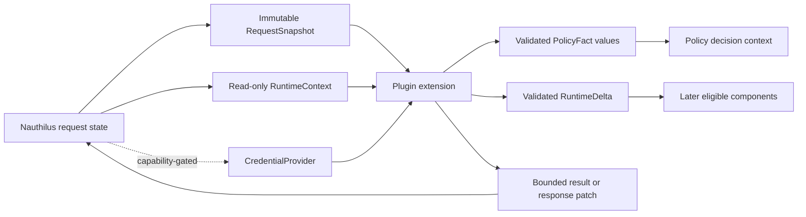

# Requests, Runtime Values, and Effects

The native API is value-oriented. Nauthilus passes immutable or read-only request state into a component and the component returns a result that describes facts, state changes, enforcement, or follow-up work. Plugin code never receives a mutable internal authentication object.

## Data-flow model



This boundary provides two guarantees to the host: plugin outputs are explicit and can be validated, and server-owned mutable objects do not escape. It does not sandbox the plugin process itself.

## Request snapshots

`RequestSnapshot` contains copied, redacted request metadata. Its fields fall into these groups:

| Group | Examples | Notes |
| --- | --- | --- |
| Identity | `Username`, `Account`, `AccountField`, `UniqueUserID`, `DisplayName` | Values known at the current extension point; fields can be empty when not resolved yet. |
| Transport | `ClientIP`, `ClientPort`, `ClientNet`, `ClientHost`, `LocalIP`, `LocalPort`, `UserAgent` | Safe value copies, not network objects. |
| Protocol | `Service`, `Protocol`, `Method`, `Session`, `ExternalSessionID` | `Session` is request correlation state; treat it as sensitive even though it is exposed. |
| IdP | `IDP.RequestedScopes`, client metadata, grant type, redirect URI, MFA method/completion | Populated only when the host has the corresponding IdP context. |
| TLS | normalized `TLSInfo` and compatibility values below `TLS.Legacy` | Certificate/key material is never exposed. |
| Diagnostics | status text, brute-force metadata, latency, HTTP status | Bounded current outcome metadata, not a mutable result. |
| Runtime flags | debug, no-auth, user-found, authenticated, authorized, source-stage flags | A snapshot of host-derived booleans at the invocation point. |
| Headers | `map[string][]string` | Copied and redacted; authorization, cookie, proxy authorization, and configured password-bearing headers are not passed through in clear text. |

The exact field list and population caveats are in [Runtime and request values](./api-reference/runtime.md).

Treat every map, slice, and byte sequence as request-local input. Current adapters make defensive copies at the boundary, but mutating input is still misleading and does not update core state.

## Credentials and secrets

Passwords never appear in `RequestSnapshot` or `RuntimeContext`. A component uses its request's `CredentialProvider` only after the module successfully requested the `credentials` capability:

```go
secret, ok := request.Credentials.Password(ctx)
if !ok || secret.IsZero() {
    return pluginapi.BackendResult{UserFound: true}, nil
}

matched, err := password.CompareHash(storedHash, secret)
```

`Secret.WithBytes` exposes bytes only inside a callback:

```go
err := secret.WithBytes(func(value []byte) error {
    return verifyWithExternalLibrary(value)
})
```

Do not retain the slice, convert it to a long-lived string, attach it to an error, or pass it to a detached worker. Clear any plugin-owned copy immediately after use.

## Runtime context

`RuntimeContext` is a read-only view:

```go
value, ok := request.Runtime.Get("plugin.exchange.geoip")
allValues := request.Runtime.Snapshot()
```

Both operations return isolated values. A plugin proposes changes by returning `RuntimeDelta`:

```go
pluginapi.RuntimeDelta{
    Set: map[string]any{
        "plugin.environment.customer_risk": map[string]any{
            "score": 42,
        },
    },
    Delete: []string{"plugin.environment.customer_risk.previous"},
}
```

Runtime values may be `nil`, booleans, strings, finite numeric scalars,
string-keyed maps, slices, and arrays, recursively. Structs such as `time.Time`
or `netip.Addr`, pointers, and opaque server/plugin objects are rejected. The
current normalizer has no maximum key length, entry count, slice length, total
size, or recursion depth and does not detect cyclic map/slice graphs. Return
small acyclic values, use stable names, and never use runtime context as a
secret store.

### Standard exchange keyspace

Cross-plugin analytics and post-action coordination use `plugin.exchange.*`, defined by `pluginapi/v1/exchange`. Bundled examples include:

```text
plugin.exchange.geoip
plugin.exchange.geoip_reputation
plugin.exchange.haveibeenpwnd
plugin.exchange.feature.<name>
plugin.exchange.decision_sources
```

The historical Lua `rt` table is not the native exchange contract. Native code should not read or write `rt` for new integrations.

Producer ownership matters: only the producer for a standard exchange key should replace that key. Consumers should use the defensive normalization helpers from the `exchange` package instead of assuming one concrete decoded map type.

## Policy facts

A `PolicyFact` is typed evidence for the policy engine:

```go
pluginapi.PolicyFact{
    Attribute: "plugin.environment.geoip.country_iso",
    Value:     "DE",
}
```

Before any component can emit it, the module registers an `AttributeDefinition` describing:

- stable ID;
- policy stage and operations;
- category and value type;
- compatible producer types or one exact compiled producer check;
- optional typed detail definitions and sensitivity.

Environment, subject, and obligation facts are validated against the compiled
active policy snapshot for registered ID, value type, stage, and operation.
`ProducerTypes` and `ProducerCheck` constrain policy compilation and planning,
but the current request-time validator does not compare them with the component
that emitted the fact; do not treat them as runtime isolation. Backend and
account-list facts currently receive only non-empty-ID and runtime-value
normalization in the plugin adapter before core collection; they do not receive
the same registry/stage/type validation there. Plugin authors must still
register and type them correctly and must not rely on either implementation gap.

A fact is not automatically public log output. Use explicit `LogField` values or `PublicPolicyFactLogField` when a selected value is intentionally safe to log.

## Dependency-scheduled sources

Environment and subject sources return `SourceDescriptor` from `Descriptor()`.

Current runtime behavior requires careful reading:

- `Name` identifies the local component and is qualified with the module name.
- `Timeout` bounds a call when positive; zero relies on the surrounding context; negative values are rejected.
- `Requires` and `After` accept local or fully qualified native source names. Local names are qualified during registration.
- Cross-family dependencies between Lua and native sources are not supported.
- In the current 3.1 development runtime, `Requires` and `After` are both merged into a hard dependency list. A missing dependency blocks the source; `After` is not merely a soft ordering hint.
- `Priority` is validated/stored/discovered but is not currently used by the native scheduler.
- `AbortPolicy` is validated/defaulted/discovered but current native execution does not apply its `none`, `source`, or `request` distinctions.

:::warning Descriptor fields versus live behavior

Do not design correctness around `Priority` or `AbortPolicy` until the runtime implements them. Treat both dependency lists as required native predecessors in current builds.

:::

## Environment sources

An `EnvironmentSource` runs before backend authentication. It receives snapshot/runtime data and an optional capability-gated credential provider. Its result can carry:

- `Status` and structured `Logs`;
- registered `Facts`;
- a validated `RuntimeDelta`;
- `Triggered` diagnostic state;
- an `Abort` flag.

Current environment execution stops later dependency levels whenever any applied result has `Abort: true`, regardless of the descriptor's `AbortPolicy`. Sibling sources in the same level have already run and their results are still applied in registration order. Subject results have no `Abort` field, so the descriptor policy is entirely ineffective for subject sources.

## Authentication backends

The base `Backend` interface owns two operations:

- `VerifyPassword` returns `BackendResult`;
- `ListAccounts` returns `AccountListResult`.

A backend can additionally implement any independent typed MFA interface:

| Interface | Operations |
| --- | --- |
| `TOTPBackend` | begin, finish, verify, and delete TOTP state |
| `RecoveryCodeBackend` | generate, consume, and delete recovery codes |
| `WebAuthnBackend` | list, save, update, and delete WebAuthn credentials |
| `PublicMFAStateBackend` | return public MFA metadata for an identity edge |

`Runtime.NoAuth` marks a passwordless identity lookup path. A backend should return safe account, attribute, and identity metadata without asking the credential provider for a password.

`BackendIdentityResult` carries field-name metadata and group values. `TOTPSecretField` and `TOTPRecoveryField` name attributes; they do not contain a secret or recovery codes. Typed MFA operations are authoritative for plugin-owned MFA state.

Backend errors and panics become secret-safe temporary failures at the host boundary. Return domain results such as `UserFound: false` or `Authenticated: false` for legitimate outcomes; do not use raw database errors as decision signals.

## Subject sources

A `SubjectSource` runs after backend evaluation and receives a copied `BackendResult`. It may return:

- status, logs, facts, and runtime changes;
- a selected backend reference;
- backend string-attribute mutations;
- an explicit `BackendResultPatch` for account, account field, auth flags, selected backend, and attributes;
- a bounded HTTP response mutation;
- `Rejected`.

The input backend result is deliberately not a reversible serialization of all internal core state. In particular, reverse subject readback does not reconstruct prior backend `Status` and `Facts`. Identity field metadata and groups can be read, but `BackendResultPatch` cannot replace identity metadata, groups, status, facts, or MFA values.

Parallel sibling sources receive independent copies. Mutating an input map does not mutate the retained result or another sibling's request.

## Response mutations

Subject sources and synchronous obligations can return allowed header changes while an HTTP response is still mutable:

```go
Response: pluginapi.ResponseMutation{
    Headers: pluginapi.ResponseHeaderMutation{
        Delete: []string{"X-Old-Risk"},
        Set: map[string][]string{
            "X-Nauthilus-Risk": {"stepup"},
        },
    },
    StatusHeader: true,
}
```

The host canonicalizes names, applies deletes before sets, and merges results in deterministic execution order. It filters forbidden or host-owned names including credentials, cookies, hop-by-hop fields, and `Auth-Status`. `StatusHeader` asks the host to materialize the selected status through the supported response path; it is not a general arbitrary-header bypass.

Response mutation has no body, cookie, stream, writer, Gin context, or arbitrary status-code surface. Use a native hook when the plugin owns a complete HTTP response. Mutations are no-ops for non-HTTP or already-written responses.

## Synchronous obligations

An `ObligationTarget` executes on the request path after policy selection. It receives:

- the request snapshot and current runtime;
- a strict read-only `ArgsView` containing policy-selected effect arguments;
- the current validated fact set.

Its `ObligationResult` may report application state, temporary failure, status/logs/facts, runtime changes, and response headers. Keep it deterministic, quick, and bounded. Result facts must be registered for the `auth_decision` stage. `StatusMessage.Temporary` is not the obligation tempfail switch; use `ObligationResult.Temporary`.

## Detached post-actions

A `PostActionTarget` accepts or skips work after policy selection. It receives effect args and facts, an optional credential provider, and the host-generated compatible short password hash when a password existed.

Native and Lua post-actions are executed as one detached plan in final-obligation order. Of the current `PostActionEnqueueResult` fields, only `RuntimeDelta` is applied by the host; `Status`, `Logs`, `QueuedID`, `Enqueued`, and `Temporary` are currently ignored. A returned error or an invalid delta aborts the remaining mixed plan.

The delta is visible only to later steps in that plan. It does not change:

- the already selected policy decision;
- the client response;
- response mutations;
- live request runtime after the plan finishes.

Use `Host.Go` for supervised background work and return promptly after acceptance. Post-action results do not add new facts to the completed decision.

`PostActionRequest.PasswordHash` normally contains the host-compatible eight-character short hash. In development mode the public password helper returns the prepared `nonce + NUL + password` bytes as a string, so the field can contain recoverable cleartext material. Treat it as a credential, regardless of capability grants, and never log or persist it.

Ordering can be semantically important. The bundled HIBP action must precede ClickHouse when the ClickHouse row should include the fresh `plugin.exchange.haveibeenpwnd.hash_info` value.

## HTTP hooks

A `Hook` declares a method/path binding and returns a complete `HookResponse`. The host provides copied path, method, query, redacted headers, bounded body, and snapshot data.

Without an operator scope override, current coarse authentication behavior is:

| Auth | Public scope | Internal scope | Admin scope |
| --- | --- | --- | --- |
| `none` | allowed | 403 | 403 |
| `token` | valid bearer token | bearer token with `authenticate` | bearer token with `admin` |
| `admin` | bearer token with `admin` | bearer token with `admin` | bearer token with `admin` |
| `session` | Basic-auth context | Basic-auth context | Basic-auth context |

`HookAuthSession` does not elevate enforcement based on `HookScopeAdmin`. Do not treat `ScopeAdmin` plus `HookAuthSession` as administrative authorization. Use `HookAuthAdmin` for an administrative hook, and keep external routing/auth controls in place until the core limitation is fixed.

Operators can configure `plugins.modules[].hooks[].required_scopes` for a
registered local hook. A non-empty list is injected into the effective
descriptor, requires `HookAuthToken` on a non-public hook, and replaces the
coarse matrix above. It uses any-of semantics: one matching bearer scope is
enough. Plugins must leave `HookDescriptor.RequiredScopes` empty. Authorization
runs before body reading and request construction; invalid, duplicate,
unmatched, or conflicting operator entries fail registration.

Hooks cannot return unsafe response headers. The host owns content length, transport/security headers, authorization/cookie headers, and HEAD body suppression. Register separate GET and HEAD descriptors when both methods are intended.

Canonical and alias bindings are method-specific. Aliases are tried only after
normal route matching fails, so an application route takes precedence. The
current collision boundary removes both duplicate canonical bindings or the
duplicate alias from routing instead of failing startup.

The request body is read only after authorization. A positive `MaxBodyBytes` is
the exact limit; zero uses the 1 MiB host default. Oversized requests return 413
without invoking plugin code. There is currently no corresponding hook response
body limit, so plugins must bound generated responses themselves.

Hook errors and recovered panics produce a secret-safe 500 response, descriptor
deadline expiry produces 504, and an invalid status or unsafe response header
produces 502. Returned error details and recovered panic values are not exposed
to the HTTP caller.

## Exact reference

- [Extension points](./api-reference/extensions.md)
- [Backend and MFA interfaces](./api-reference/backends.md)
- [Runtime and request values](./api-reference/runtime.md)
- [Result value objects](./api-reference/results.md)
- [Policy declarations](./api-reference/policy.md)
- [Hooks](./api-reference/hooks.md)
- [Runtime exchange helpers](./api-reference/exchange.md)
