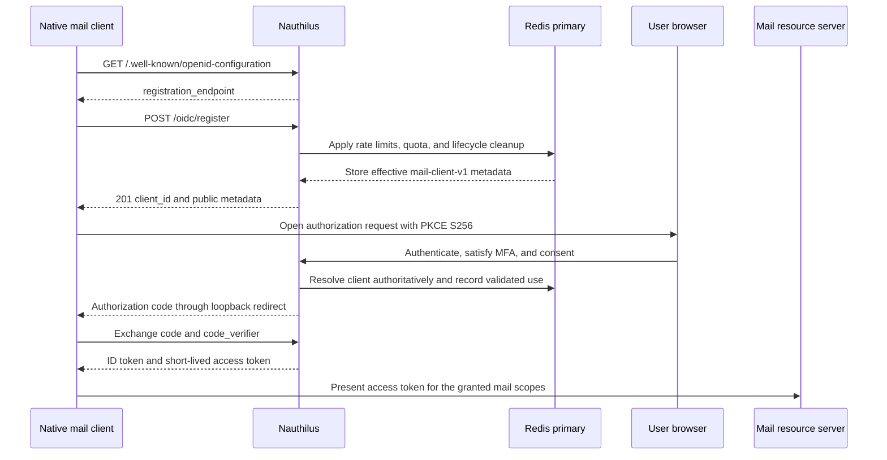

# Operating OIDC Dynamic Client Registration

Nauthilus implements a deliberately restricted Dynamic Client Registration (DCR) service for public native mail
clients. It uses RFC 7591 as the registration protocol and the literal loopback redirect pattern from RFC 8252, while
fixing the security-sensitive client properties through the server-owned `mail-client-v1` profile.

This guide covers the complete operator-facing contract: prerequisites, configuration, client requests, authorization
and token behavior, lifecycle, revocation, monitoring, and failure handling.

:::warning Restricted profile

This is not an open-ended OAuth client provisioning API. Do not use it for browser applications, confidential clients,
machine-to-machine clients, claimed HTTPS redirects, custom URI schemes, or arbitrary OAuth metadata.

:::

## Security Model

The registration endpoint is anonymous, but clients cannot choose credentials or broaden their own privileges. The
operator controls the scope allowlist, MFA floor, token lifetimes, rate limits, active-client quota, and lifecycle.

Every accepted client has these fixed properties:

| Property | Effective value |
| --- | --- |
| Profile | `mail-client-v1`, version `1` |
| Application type | `native` |
| Client type | Public; no client secret |
| Grant type | `authorization_code`, with optional paired `refresh_token` |
| Response type | `code` |
| PKCE | Required, `S256` only |
| Token endpoint authentication | `none` |
| Subject type | `public` |
| ID token signing algorithm | `RS256` |
| Redirects | Literal IPv4 or IPv6 HTTP loopback only, with or without a path |
| Access token | Opaque by default or JWT with `access_token_type: jwt`; no longer than 15 minutes |
| Consent | Interactive and required for every authorization unless the operator sets `skip_consent: true` |

Dynamic clients are stored separately from static `identity.oidc.clients[]`. Static wildcard and `localhost` redirect
exceptions never apply to them. Static client IDs may not start with the reserved `dcr_` prefix.

The end-to-end relationship is:



## Prerequisites

Before enabling DCR, confirm all of the following:

- `identity.oidc.enabled` is `true`.
- `identity.oidc.issuer` is an absolute HTTPS URL with a host and without userinfo, query, or fragment.
- Nauthilus can sign RS256 ID tokens, either through automatic key rotation or an active RS256 signing key.
- The provider metadata still includes `code`, `public`, `none`, `S256`, and `RS256` in the corresponding supported
  lists. These values are present in the defaults; retain them if you override the lists.
- Redis is available through the authoritative write handle. Registration and every security-sensitive dynamic-client
  lookup fail closed when this state is unavailable or corrupt.
- Every DCR scope exists in the provider's built-in `scopes_supported` or in `custom_scopes`.
- The protected IMAP, SMTP, or mail gateway resource servers use the same deployment-owned scope semantics. Nauthilus
  does not assign meaning to names such as `mail:imap` automatically.
- `runtime.servers.http.trusted_proxies` contains only proxy addresses or narrow networks you operate. Source limits use
  the effective client IP after this trusted-proxy handling.

## Complete Configuration

The following production-oriented example enables refresh tokens and two deployment-owned mail scopes:

```yaml
runtime:
  servers:
    http:
      trusted_proxies:
        - "192.0.2.10/32"

identity:
  oidc:
    enabled: true
    issuer: "https://auth.example.com"

    # Automatic rotation provides the required active RS256 signing capability.
    auto_key_rotation: true
    key_rotation_interval: 24h
    key_max_age: 168h

    custom_scopes:
      - name: "mail:imap"
        description: "Access IMAP mail"
        claims:
          - name: "mail_access"
            type: "string"
      - name: "mail:smtp"
        description: "Submit mail through SMTP"
        claims:
          - name: "mail_submit"
            type: "string"

    dynamic_client_registration:
      enabled: true
      profile: "mail-client-v1"
      profile_version: 1

      required_scopes:
        - "openid"
      optional_scopes:
        - "offline_access"
        - "mail:imap"
        - "mail:smtp"
      allow_refresh_tokens: true

      consent_mode: "all_or_nothing"
      skip_consent: false
      delayed_response: false
      require_mfa: []
      supported_mfa: []
      required_mfa_level: 0
      access_token_type: "opaque"
      access_token_lifetime: 15m
      refresh_token_lifetime: 720h

      # Optional native-application profile extensions (see below).
      default_scopes: []
      implied_scopes: []
      id_token_claims:
        mappings: []
      access_token_claims:
        mappings: []

      # Inject the same secret into every Nauthilus replica.
      source_hmac_key: "${NAUTHILUS_DCR_SOURCE_HMAC_KEY}"

      limits:
        request_body_bytes: 16384
        redirect_uris: 4
        scopes: 16
        client_name_runes: 128
        string_bytes: 1024
        active_clients: 10000
        source_window: 10m
        source_registrations: 5
        source_daily_registrations: 20
        global_window: 1m
        global_registrations: 100

      lifecycle:
        unused_ttl: 24h
        inactivity_ttl: 720h
        maximum_ttl: 8760h
        tombstone_ttl: 720h
```

Generate the HMAC key from a cryptographically secure source, for example with `openssl rand -base64 48`, and inject it
through the process environment or your secret manager. The effective configuration value must contain at least 32
bytes. It pseudonymizes source addresses used for registration records and rate-limit keys; it is not a client secret.
Keep it stable and identical across replicas. Rotating it changes the source pseudonym and therefore breaks continuity
with the existing per-source rate budget.

See [Environment, Validation, and Dumps](../configuration/reference.md) for environment placeholders, validation, and
secret-safe configuration inspection.

### Main Policy Fields

| Field | Default | Operator contract |
| --- | --- | --- |
| `enabled` | `false` | Adds the registration route and discovery metadata when true. |
| `profile` | `mail-client-v1` | Fixed; other profile names are rejected. |
| `profile_version` | `1` | Fixed; other versions are rejected. |
| `required_scopes` | none | Must be non-empty and contain `openid`; `offline_access` cannot be required. Required scopes are added to every registration. |
| `optional_scopes` | none | Additional scopes a client may request. No value may duplicate a required scope. |
| `allow_refresh_tokens` | `false` | Must be true exactly when `offline_access` is present in `optional_scopes`. |
| `consent_mode` | `all_or_nothing` | Fixed. Dynamic clients cannot reuse remembered consent. |
| `skip_consent` | `false` | Waives the consent page for all dynamic clients. `prompt=consent` still forces it. |
| `delayed_response` | `false` | Delayed login-failure presentation for all dynamic clients, like the per-client option of static clients: a wrong password proceeds to the MFA step for existing users and is reported only at the end. |
| `require_mfa` | `[]` | MFA methods that must **all** be registered before authorization; not an either/or selection. Must be a subset of `supported_mfa` when that is set. |
| `supported_mfa` | `[]` | MFA methods dynamic clients may use for challenges and enrollment. Empty permits all available methods. |
| `required_mfa_level` | `0` | Minimum fresh MFA assurance required during browser authorization. Must be reachable through the methods allowed by `supported_mfa` under the global MFA policy. |
| `access_token_type` | `opaque` | `opaque` or `jwt`. Other values are rejected. |
| `access_token_lifetime` | `15m` | Must be positive and no greater than `15m`. Applies to opaque and JWT access tokens. |
| `refresh_token_lifetime` | `720h` | Used when refresh is enabled; must be positive and no greater than `720h`. |
| `default_scopes` | `[]` | Scopes registered when a client omits both `scope` and `grant_types`. Each must be in `required_scopes` or `optional_scopes`; the list may not be longer than `limits.scopes`. |
| `implied_scopes` | `[]` | Scopes added to every authorization of a dynamic client, but only if the client registered them. Each must be in `required_scopes` or `optional_scopes`; `offline_access` cannot be implied. |
| `id_token_claims.mappings` | `[]` | ID-token claim mappings applied to all dynamic clients, with the same syntax as static clients. |
| `access_token_claims.mappings` | `[]` | Access-token claim mappings applied to all dynamic clients, with the same syntax as static clients. |
| `source_hmac_key` | none | Required when enabled and at least 32 bytes. Keep secret and consistent across instances. |

Scope names must be unique, trimmed RFC 6749 scope tokens. A configured DCR scope that the provider does not support
causes startup validation to fail.

### Native Application Profile Extensions

Some native applications, for example the OpenCloud desktop client, register automatically whenever discovery
advertises a registration endpoint. They send neither `scope` nor `grant_types` and request their own default scopes at
authorization time. The following fields let such applications work without weakening the profile:

- **`default_scopes`.** When a registration omits both `scope` and `grant_types`, the profile registers
  `default_scopes` (plus the required scopes). If they contain `offline_access` and `allow_refresh_tokens` is true, the
  `refresh_token` grant is registered with it. `default_scopes` must cover every scope the application later requests
  at authorization time. An explicit request never falls back to the defaults, so a client that names
  `offline_access` must still name the `refresh_token` grant.
- **`implied_scopes`.** These scopes are added to every authorization of a dynamic client, but only when the client
  registered them. Use them for resource-server scopes an application does not know to request. `offline_access`
  cannot be implied, so refresh capability always stays an explicit registration decision.
- **`id_token_claims` and `access_token_claims`.** These apply the same claim mappings as static clients to all dynamic
  clients. Claims stay gated by the scopes granted in the authorization. Resource servers that assign users or roles
  from token claims need matching mappings.
- **`access_token_type: jwt`.** Issues JWT access tokens for resource servers that validate tokens locally. With JWT
  access tokens, the UserInfo endpoint returns the access-token claim set, so claims a resource server reads from
  UserInfo must also be mapped under `access_token_claims`.
- **`skip_consent: true`.** Waives the consent page for all dynamic clients, like the per-client option of static
  clients. Dynamic clients still never inherit a remembered consent decision, and `prompt=consent` still forces the
  page. Enable it only when every native application that can register is trusted: an application registered on the
  user's device then obtains tokens without a consent step whenever the browser already holds an authenticated IdP
  session.
- **`delayed_response: true`.** Enables the delayed login-failure presentation for all dynamic clients, like the
  per-client option of static clients: a wrong password proceeds to the MFA step for existing users and is reported
  only at the end.

### MFA Enrollment for Dynamic Clients

`require_mfa`, `supported_mfa`, and `required_mfa_level` are operator-owned profile settings, not registration request
metadata. They follow the same model as static clients (see
[MFA Assurance Policy](../configuration/idp/mfa-assurance.md)):

- `require_mfa` enforces registration of **every** listed method before authorization succeeds.
- `supported_mfa` limits the methods offered for challenges and enrollment; an empty list permits all methods.
- `required_mfa_level` sets the minimum strength of the fresh MFA proof.

Method names are `totp`, `webauthn`, and `recovery_codes`. Unknown or duplicate methods, and a `require_mfa` that is not
a subset of a non-empty `supported_mfa`, fail configuration validation. Both lists apply to existing registrations
without re-registration.

Enrollment uses the same parent-bound browser flow as static clients. `prompt=none` cannot enroll a missing factor, and
setting an assurance level alone does not configure enrollment. For TOTP plus recovery-code enrollment, configure:

```yaml
identity:
  oidc:
    dynamic_client_registration:
      require_mfa: ["totp", "recovery_codes"]
      required_mfa_level: 2
```

When no registered method of the user meets the policy, the browser shows an "Authentication method unavailable" page
(HTTP `409`) that asks the user to contact the administrator, instead of a bare status code.

A profile for such an application might look like this; the scope and claim names are deployment-owned:

```yaml
identity:
  oidc:
    dynamic_client_registration:
      enabled: true
      required_scopes: ["openid"]
      optional_scopes: ["offline_access", "profile", "email", "groups"]
      allow_refresh_tokens: true
      default_scopes: ["openid", "offline_access", "profile", "email", "groups"]
      implied_scopes: ["groups"]
      access_token_type: "jwt"
      access_token_claims:
        mappings:
          - claim: "groups"
            from: "groups"
      source_hmac_key: "${NAUTHILUS_DCR_SOURCE_HMAC_KEY}"
```

Because `groups` is part of `default_scopes`, every automatically registered client registers it, and
`implied_scopes` adds it to each authorization even when the application does not request it. For a client that did
not register `groups`, the implied scope has no effect.

### Input, Rate, and Quota Limits

Omitted limit values use the secure defaults below. Configured values must remain positive and below the implementation
ceiling.

| Field | Default | Maximum | Meaning |
| --- | ---: | ---: | --- |
| `request_body_bytes` | `16384` | `1048576` | Maximum JSON request body size. |
| `redirect_uris` | `4` | `32` | Maximum redirect URI entries. |
| `scopes` | `16` | `128` | Maximum requested and effective scope count. |
| `client_name_runes` | `128` | `1024` | Maximum Unicode code points in `client_name`. |
| `string_bytes` | `1024` | `8192` | Byte limit for redirects and string metadata. |
| `active_clients` | `10000` | `1000000` | Global active dynamic-client quota. |
| `source_window` | `10m` | `24h` | Per-source registration-attempt counter window. |
| `source_registrations` | `5` | `1000000` | Attempts from one source within `source_window`. |
| `source_daily_registrations` | `20` | `1000000` | Attempts from one source during a 24-hour counter lifetime. |
| `global_window` | `1m` | `1h` | Deployment-wide registration-attempt window. |
| `global_registrations` | `100` | `1000000` | Attempts across the deployment within `global_window`. |

An attempt consumes source and global budget before content type, body size, JSON, and metadata validation. This prevents
malformed requests from bypassing anonymous endpoint limits. A `429` response can therefore mean a source limit, the
global limit, or the active-client quota.

### Lifecycle Fields

| Field | Default | Meaning |
| --- | --- | --- |
| `unused_ttl` | `24h` | Lifetime of a client that has never completed a validated protocol use. |
| `inactivity_ttl` | `720h` | Lifetime since the last validated authorization, code exchange, or refresh exchange. |
| `maximum_ttl` | `8760h` | Absolute lifetime from registration; cannot exceed one year. |
| `tombstone_ttl` | `720h` | Retention of the bounded expired-client marker. |

Every lifecycle duration must be positive. `unused_ttl`, `inactivity_ttl`, and `tombstone_ttl` may not exceed
`maximum_ttl`.

Nauthilus removes expired records lazily during resolution and in bounded cleanup batches before registration attempts.
Cleanup processes at most 100 due records per attempt, so it cannot turn one anonymous request into an unbounded Redis
operation.

## Registration Endpoint

When DCR is enabled, discovery includes:

```json
{
  "registration_endpoint": "https://auth.example.com/oidc/register"
}
```

The endpoint accepts only `POST` with `Content-Type: application/json`. Every response on the path includes
`Cache-Control: no-store` and `Pragma: no-cache`.

### Minimal Registration

Only `redirect_uris` is required in the JSON request. Omitted fixed metadata is supplied by the profile, and configured
required scopes are added automatically:

```bash
curl --fail-with-body \
  --request POST \
  --header 'Content-Type: application/json' \
  --data '{
    "redirect_uris": ["http://127.0.0.1:49152/oauth/callback"],
    "client_name": "Example Mail Client",
    "scope": "mail:imap mail:smtp",
    "software_id": "com.example.mail",
    "software_version": "2.4.0"
  }' \
  https://auth.example.com/oidc/register
```

Example `201 Created` response:

```json
{
  "client_id": "dcr_bA5jR7mG6xJ0qK2zW4nP8sU1vC9dE3fH5tY7iL0oN2Q",
  "client_id_issued_at": 1786000000,
  "redirect_uris": ["http://127.0.0.1:49152/oauth/callback"],
  "client_name": "Example Mail Client",
  "scope": "openid mail:imap mail:smtp",
  "grant_types": ["authorization_code"],
  "response_types": ["code"],
  "token_endpoint_auth_method": "none",
  "application_type": "native",
  "subject_type": "public",
  "id_token_signed_response_alg": "RS256",
  "software_id": "com.example.mail",
  "software_version": "2.4.0"
}
```

The generated `client_id` starts with `dcr_` and contains at least 256 random bits. The response intentionally contains
no `client_secret`, `registration_access_token`, or `registration_client_uri`.

### Registration with Refresh Support

Refresh support must be selected as a pair: request both the `refresh_token` grant and the `offline_access` scope. The
operator policy must also allow refresh tokens.

```json
{
  "redirect_uris": ["http://127.0.0.1:49152/oauth/callback"],
  "client_name": "Example Mail Client",
  "scope": "offline_access mail:imap mail:smtp",
  "grant_types": ["authorization_code", "refresh_token"]
}
```

Requesting only one half of the pair, or requesting the pair when `allow_refresh_tokens` is false, returns
`invalid_client_metadata`.

### Registration Without Scope and Grant Types

When a request contains neither `scope` nor `grant_types` and the profile configures `default_scopes`, Nauthilus
registers the default scopes. If they include `offline_access` and refresh tokens are allowed, the `refresh_token`
grant is added automatically:

```json
{
  "redirect_uris": ["http://127.0.0.1"],
  "client_name": "Desktop Client"
}
```

With `default_scopes: ["openid", "offline_access", "profile"]` the effective metadata contains
`"scope": "openid offline_access profile"` and `"grant_types": ["authorization_code", "refresh_token"]`. A request that
names either `scope` or `grant_types` is evaluated exactly as sent and never falls back to the defaults.

### Recognized Metadata

| Request member | Rule |
| --- | --- |
| `redirect_uris` | Required non-empty array; strict loopback rules apply. |
| `client_name` | Optional display name without control characters. |
| `scope` | Optional single-space-delimited subset of the configured allowlist; required scopes are added. When both `scope` and `grant_types` are omitted, `default_scopes` applies. |
| `grant_types` | Defaults to `authorization_code`; may additionally contain `refresh_token`. When both are omitted and the default scopes contain `offline_access`, `refresh_token` is added. |
| `response_types` | Defaults to and, when supplied, must be exactly `["code"]`. |
| `token_endpoint_auth_method` | May be omitted or exactly `none`. |
| `application_type` | May be omitted or exactly `native`. |
| `subject_type` | May be omitted or exactly `public`. |
| `id_token_signed_response_alg` | May be omitted or exactly `RS256`. |
| `software_id` | Optional bounded software identifier. |
| `software_version` | Optional bounded software version. |

Unknown extension members are ignored as required for interoperability. Recognized RFC 7591/OIDC metadata outside the
profile is rejected, including client credentials, JWKS metadata, contacts and policy URIs, logout redirects, request
URIs, response encryption, and registration management credentials. A `software_statement` is always rejected with
`unapproved_software_statement`.

The decoder also rejects invalid UTF-8, duplicate top-level names, `null` for recognized values, a non-object body,
trailing JSON values, and wrong JSON types.

### Loopback Redirect Rules

Accepted redirect hosts are literal loopback addresses only:

```text
http://127.0.0.1:49152/oauth/callback
http://[::1]:49152/oauth/callback
http://127.0.0.1
http://[::1]:49152
```

The path is optional (RFC 8252 section 7.3). The port is optional during registration, but a supplied port must be
numeric and between 1 and 65535. During authorization, the port may differ from the registered value; the literal host
and complete path must still match. IPv4 and IPv6 registrations are distinct.

Prefer `127.0.0.1` for applications that show a consent page. Nauthilus adds `http://127.0.0.1:*` to the CSP
`form-action` directive so the browser may follow the redirect after the consent form, but CSP cannot express IPv6
literals, so browsers block that redirect to `http://[::1]:<port>`. See
[Loopback Redirects and CSP `form-action`](../configuration/idp/oidc.md#loopback-redirects-and-csp-form-action).

The following are rejected:

- `localhost` or any DNS name;
- HTTPS, claimed web redirects, and private-use URI schemes;
- query strings, fragments, or userinfo;
- wildcard syntax;
- percent-encoded paths, backslashes, and `.` or `..` path segments;
- duplicates that differ only by loopback port.

### Status and Error Handling

| Status | Meaning |
| ---: | --- |
| `201` | Client created; the body contains effective public metadata. |
| `400` | RFC 7591 error: `invalid_redirect_uri`, `invalid_client_metadata`, or `unapproved_software_statement`. |
| `405` | Method other than `POST`. |
| `413` | Body exceeds `request_body_bytes`. |
| `415` | Media type is not `application/json`. |
| `429` | Per-source rate, daily source rate, global rate, or active-client quota exceeded. |
| `503` | Authoritative Redis state or registration persistence is unavailable. |

RFC 7591 errors have this shape:

```json
{
  "error": "invalid_client_metadata",
  "error_description": "scope \"mail:unknown\" is not allowed"
}
```

Generic HTTP failures return an `error` containing the HTTP status text. Clients should not assume that `429` includes
a `Retry-After` header.

A rate-limited attempt always returns the same generic `429`. The structured registration audit record names the
exhausted budget in `reason`: `source_window_limit`, `source_daily_limit`, or `global_window_limit`.

The generated [IdP API reference](../api-reference/idp/register-oidc-dynamic-client.api.mdx) contains the machine-readable
request, response, and status contract.

## Authorization and Token Use

Registration does not authenticate a user and does not issue tokens. The native client must start a normal OIDC
Authorization Code flow after receiving its `client_id`.

### Authorization Request

The client must generate a fresh high-entropy PKCE verifier and send its SHA-256 challenge:

```text
GET /oidc/authorize?
  response_type=code&
  client_id=dcr_...&
  redirect_uri=http%3A%2F%2F127.0.0.1%3A53001%2Foauth%2Fcallback&
  scope=openid%20mail%3Aimap%20mail%3Asmtp&
  code_challenge=BASE64URL_SHA256_VERIFIER&
  code_challenge_method=S256&
  state=RANDOM_CSRF_VALUE&
  nonce=RANDOM_OIDC_NONCE
```

Nauthilus resolves the dynamic client from the Redis primary and re-applies the current operator policy, including the
current `access_token_type`, claim mappings, `implied_scopes`, `skip_consent`, `delayed_response`, and MFA policy. By default the browser must interact
with the IdP and consent on every authorization; remembered consent from a prior authorization is never reused for an
anonymous dynamic client. With `skip_consent: true` the consent page is skipped unless the request carries
`prompt=consent`. `required_mfa_level` is enforced as a minimum fresh assurance level.

### Code Exchange

The public client sends its `client_id` and PKCE verifier but no secret:

```bash
curl --fail-with-body \
  --request POST \
  --header 'Content-Type: application/x-www-form-urlencoded' \
  --data-urlencode 'grant_type=authorization_code' \
  --data-urlencode 'client_id=dcr_...' \
  --data-urlencode 'code=AUTHORIZATION_CODE' \
  --data-urlencode 'redirect_uri=http://127.0.0.1:53001/oauth/callback' \
  --data-urlencode 'code_verifier=ORIGINAL_HIGH_ENTROPY_VERIFIER' \
  https://auth.example.com/oidc/token
```

The returned access token uses the DCR-specific lifetime. It is opaque unless the profile sets
`access_token_type: jwt`. Resource servers must validate its granted scope and should use the normal Nauthilus
introspection, local JWT validation, or a deployment-specific authorization integration. Because the dynamic client is
public, it cannot authenticate to introspection itself; configure a separate confidential resource server credential
when remote introspection is required. List `mail-client-v1` in that client's
`token_introspection.dynamic_client_profiles` so it may introspect tokens of dynamic clients; see
[Resource Servers and Resource Indicators](../configuration/idp/oidc.md#resource-servers-and-resource-indicators). An ID token is an identity assertion and must not be accepted as a mail API
credential.

JWT access tokens of dynamic clients are validated like opaque ones at UserInfo and introspection: the client must
still be active, the granted scopes must still be allowed, and the lifetime must not exceed the current profile.
Refresh rotation denylists the previous JWT, so a rotated JWT cannot be reused. A resource server that validates JWTs
only locally does not see these server-side checks until the token expires.

### Refresh Rotation

When refresh support was registered and the user granted `offline_access`, each successful refresh exchange returns a
new refresh token. The consume-and-issue operation is atomic. Reuse of a consumed ancestor is treated as replay and
revokes the active descendant of that refresh family.

```bash
curl --fail-with-body \
  --request POST \
  --header 'Content-Type: application/x-www-form-urlencoded' \
  --data-urlencode 'grant_type=refresh_token' \
  --data-urlencode 'client_id=dcr_...' \
  --data-urlencode 'refresh_token=CURRENT_REFRESH_TOKEN' \
  https://auth.example.com/oidc/token
```

The client must replace the stored refresh token after every success and serialize concurrent refresh attempts. Keeping
and retrying an older token can revoke the whole family.

## Runtime Policy Changes

Stored registrations do not freeze privileges. Nauthilus revalidates them against the current configuration during
authorization, code exchange, refresh exchange, and access-token validation at UserInfo and introspection.

- Removing optional scopes strips privileges that are no longer allowed; stale authorization state must restart.
- Adding a new required scope invalidates registrations that never contained it.
- Disabling refresh support removes `refresh_token` and `offline_access` from the runtime client.
- Shorter access or refresh lifetimes take precedence over the values stored at registration.
- Changes to `access_token_type`, `skip_consent`, `delayed_response`, claim mappings, and `implied_scopes` apply to existing dynamic clients
  at their next authorization or refresh without re-registration. `implied_scopes` never add a scope the client did
  not register.
- A higher `required_mfa_level` takes precedence immediately. Lowering the configured value does not weaken the MFA
  level captured by an existing registration. JWT access tokens carry no MFA level, so MFA is enforced at authorization
  and checked again against the stored session at the next refresh.
- Changes to `require_mfa` and `supported_mfa` apply to existing registrations at their next authorization. A
  registration whose effective minimum level is no longer reachable through the allowed methods fails closed. MFA
  policy changes do not revoke tokens that were already issued.
- Disabling DCR removes the registration endpoint after restart, removes `registration_endpoint` from discovery, and
  makes existing dynamic clients unavailable at runtime.
- Changing the fixed profile or profile version is rejected by configuration validation.

Plan policy narrowing as a user-visible change: in-flight browser authorization or refresh operations can fail closed
and require a fresh registration or authorization.

## Lifecycle, Sessions, and Revocation

Dynamic-client records have unused, inactivity, and absolute expiry. Activity is updated only after a validated
authorization, authorization-code exchange, or refresh exchange; registration attempts and failed protocol requests do
not extend the lifetime.

Access and refresh tokens are tracked per user in Redis. Browser OIDC logout and the all-sessions management operation
advance a per-user dynamic-token epoch before cleanup. This prevents an in-flight request from storing a usable token
after logout or administrative revocation.

Operators can use the protected management API:

| Operation | Behavior |
| --- | --- |
| `GET /api/v1/oidc/sessions/{user_id}` | Lists static and dynamic access-token sessions using non-secret derived IDs. |
| `DELETE /api/v1/oidc/sessions/{user_id}/{token}` | Deletes the selected access-token session; pass the list response `id` as the historical `{token}` parameter. |
| `DELETE /api/v1/oidc/sessions/{user_id}` | Revokes all static and dynamic access and refresh state for the user. |

Bearer-authenticated management calls require `nauthilus:authenticate` plus `nauthilus:security` or
`nauthilus:admin`. See [OIDC Session Administration](../rest-api.md#oidc-session-administration) and the
[Admin Client](./admin-client.md#oidc-sessions) guide.

Upgrading from an earlier v4 prerelease removes all existing dynamic client registrations and all dynamic access and refresh
tokens, because the Redis key layout changed without migration. Native clients register again. See
[Token State in Redis](../configuration/idp/oidc.md#token-state-in-redis) for the upgrade details and the retired keys
that need manual cleanup.

There is intentionally no RFC 7592 registration-management credential or client delete endpoint. Client records retire
through configured lifecycle expiry; disabling the DCR policy makes them unavailable at runtime. Use configured
lifecycle and user token revocation instead of manipulating internal Redis keys.

## Monitoring and Audit

The registration handler exposes bounded-cardinality Prometheus metrics:

| Metric | Labels | Use |
| --- | --- | --- |
| `idp_dynamic_client_registrations_total` | `outcome`, `code` | Registration successes, protocol rejections, rate/quota failures, and storage failures. |
| `idp_dynamic_client_registration_duration_seconds` | none | End-to-end registration latency. |

Structured log events include:

- `event=oidc_dynamic_client_registration` for the HTTP registration result, status, duration, profile, and bounded
  reason, including `source_window_limit`, `source_daily_limit`, or `global_window_limit` for rate-limited attempts;
- `event=oidc_dynamic_client_security` for validated authorization/code/refresh use, expiry cleanup, and user-wide
  revocation.

Security events do not log raw source addresses, redirect metadata, bearer tokens, or refresh tokens. Source addresses
are HMAC-pseudonymized before they enter DCR state.

Recommended alerts and dashboards:

- alert on sustained `503` or `outcome=failed` storage failures;
- investigate sudden `429` growth by source/network and deployment capacity;
- watch registration latency together with Redis primary latency;
- compare accepted-registration trends, configured lifecycle, and `429` quota failures when capacity planning;
- retain structured security events long enough to correlate registration, validated use, expiry, and user revocation.

## Deployment Verification

After validating and deploying the configuration, verify the public and operational surfaces in order.

Check discovery:

```bash
curl --fail --silent --show-error \
  https://auth.example.com/.well-known/openid-configuration \
  | jq -r '.registration_endpoint'
```

Expected result:

```text
https://auth.example.com/oidc/register
```

Register one disposable native client with a literal loopback redirect and confirm:

- status `201`;
- `Cache-Control: no-store` and `Pragma: no-cache`;
- a `dcr_` client ID;
- no client secret or registration management credential;
- required scopes added to the effective `scope` string.

Then perform one browser Authorization Code flow with PKCE `S256`, verify the consent prompt appears (unless
`skip_consent` is enabled), exchange the code, and validate the access token at the intended mail resource. If refresh is enabled, rotate once. Prove replay
revocation only with an isolated disposable user/client because deliberately reusing the old token invalidates the
active family.

Finally, list the user's OIDC sessions, delete all sessions, and verify that both the current access token and refresh
token are unusable. Confirm registration counters and structured audit events were emitted without token or redirect
material.

## Troubleshooting

| Symptom | Likely cause | Operator action |
| --- | --- | --- |
| Configuration fails on `source_hmac_key` | Missing or shorter than 32 bytes. | Inject the same high-entropy value into every replica. |
| Configuration requires RS256 | No automatic rotation and no active RS256 signing key. | Enable automatic rotation or configure an active RS256 key; keep RS256 advertised. |
| Configuration rejects scopes | Missing `openid`, duplicated lists, unsupported scope, invalid token syntax, or refresh/offline mismatch. | Reconcile required, optional, built-in, and custom scopes. |
| Discovery has no `registration_endpoint` | DCR is disabled or the new config has not been deployed/restarted. | Validate the effective config and restart all serving replicas consistently. |
| `invalid_redirect_uri` | Host is not literal loopback, scheme/path is unsafe, or entries collide after port normalization. | Use `http://127.0.0.1[/<path>]` or `http://[::1][/<path>]` with an optional numeric port. |
| Browser blocks the redirect after the consent form | The redirect targets `http://[::1]:<port>`, which CSP `form-action` cannot allow, or a custom `form-action 'none'` is configured. | Let the application use `127.0.0.1`; do not set `form-action 'none'` on the IdP frontend. |
| Automatically registered application receives tokens without expected scopes or claims | The application registered without `scope`, and `default_scopes` does not cover the scopes it requests later; unregistered scopes are dropped from the authorization. | Add the requested scopes to `optional_scopes` and `default_scopes`, and map the claims under `id_token_claims`/`access_token_claims`. |
| `invalid_client_metadata` on refresh registration | `refresh_token` and `offline_access` were not requested together or are disabled by policy. | Request the pair and enable it explicitly, or omit both. |
| Unexpected `429` | Invalid attempts consume rate budget, the source IP is collapsed at a proxy, or active quota is exhausted. | Inspect trusted proxies, counters, cleanup health, and configured limits before raising them. |
| `503` on registration or client use | Authoritative Redis write state is unavailable. | Restore Redis primary connectivity; do not route security reads to a stale replica. |
| Existing client stops working after config change | Current policy removed scope/refresh support, raised MFA, shortened lifetime, or disabled DCR. | Treat the change as intentional narrowing or restore the previous validated policy. |
| Refresh replay invalidates the family | The client retried an already consumed token, often due to concurrent refreshes. | Serialize refresh operations and persist the replacement token atomically. |
| Single-session delete leaves refresh capability | The single route deletes one access-token session only. | Use the all-sessions delete route for complete user-wide access and refresh revocation. |

## Deliberate Non-Goals

The `mail-client-v1` profile does not provide:

- RFC 7592 client read, update, or delete operations;
- registration access tokens or registration client URIs;
- confidential client credentials or `private_key_jwt` registration;
- Client Credentials or Device Authorization grants;
- custom URI schemes, claimed HTTPS redirects, `localhost`, or wildcard redirects;
- client-provided JWKS, request objects, encrypted ID tokens, UserInfo signing, or logout metadata;
- a browser-JavaScript registration API or CORS contract.

Use static `identity.oidc.clients[]` for applications that need any of those separately reviewed capabilities.
