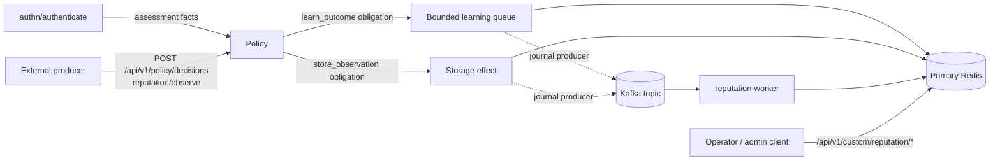

# Operating the Reputation Subsystem

Nauthilus ships a generic, native reputation subsystem. It learns from independent evidence, such as backend
authentication results or verdicts from a mail filter, and publishes decaying reputation assessments as Policy facts.
Policy decides what an assessment means; the plugin never denies or permits a request itself.

This guide covers deployment and operation. The field-by-field contract is in the
[Reputation plugin reference](../developer/go-plugins/reference-plugins/reputation.md).

:::info Replaces the Lua `geoip_reputation` plugin

The Lua subject plugin `geoip_reputation.lua`, its `GEOIP_REPUTATION_*` settings, and its
`lua.plugin.geoip_reputation.*` facts were removed without a runtime alias. Remove them from deployment configuration
and Policy rules. The native plugin does not import the old Redis counters; a new model starts with unknown reputation.
ClickHouse `reputation_*` columns are now filled only from an explicitly supplied `plugin.exchange.geoip_reputation`
map, not from Policy facts.

:::

## How it fits together



- **Assessment**: a configured target binding reads primary Redis and publishes one record per subject with state,
  band, override, and scores.
- **Learning**: evidence enters only through a Policy-selected obligation, either the capture-only authentication
  learner or the storage effect for the `reputation/observe` target.
- **Storage**: without a journal, learning is applied to Redis directly. With a `producer` journal, the event is
  admitted in Redis, published to Kafka, and applied by the separate `reputation-worker`.
- **Administration**: audited operator overrides and allocation recovery through the Management API or the Python
  admin client.

## Prerequisites

1. **Artifacts.** The stable and debug container images contain
   `/usr/local/lib/nauthilus/plugins/reputation.so` (plus `.minisig` in signed builds). Only the stable image also
   contains the `/usr/app/reputation-worker` executable. Load the plugin as described in
   [Configure native Go plugins](../configuration/native-go-plugins.md).
2. **Primary Redis.** All reads and writes use the host's primary Redis connection and key prefix. Replicas are never
   used. All keys of one atomic operation share a Cluster hash slot.
3. **HMAC key material.** Subjects are stored as HMAC tags. Configure two host-owned scopes under
   `plugins.opaque_identifier_tagger`, one for subjects and one for manifests. Each key file must contain exactly
   32 bytes and is referenced by absolute path; key bytes never appear in plugin configuration:

   ```yaml
   plugins:
     opaque_identifier_tagger:
       scopes:
         - scope: reputation-subject
           active:
             version: current
             secret_ref:
               file: /run/secrets/reputation-subject-key
         - scope: reputation-manifest
           active:
             version: allocation
             secret_ref:
               file: /run/secrets/reputation-manifest-key
   ```

   Keys are captured at startup; replacing a key file requires a restart. Use the same key files on every server and
   worker that shares the Redis prefix.

## Base module configuration

Every deployment needs the model block. The values below are the repository's calibration example; they are not
production defaults. Choose `model_id` deliberately: changing ingestion semantics later requires a new ID.

```yaml
plugins:
  modules:
    - name: reputation
      type: go
      path: /usr/local/lib/nauthilus/plugins/reputation.so
      signature: minisign:/usr/local/lib/nauthilus/plugins/reputation.so.minisig
      config:
        state_schema: reputation-state.v1
        model_id: production-v1
        allocation_maintenance: false
        allocation_drain_generation: 0
        subject_scope: reputation-subject
        manifest_scope: reputation-manifest
        retention: 2160h
        event_manifest_ttl: 49h
        subject_seen_ttl: 49h
        maximum_retry_horizon: 24h
        maximum_source_classes: 8
        maximum_new_subjects_per_source_hour: 1000
        maximum_event_manifests_per_source: 10000
        maximum_seen_events_per_subject: 10000
        profiles:
          fast: {half_life: 6h}
          operational: {half_life: 168h}
          baseline: {half_life: 720h}
        score: {alpha: 2, saturation: 20, temperature: 1.5}
        bands:
          learned_blocked: false
          minimum_confidence: 0.2
          minimum_samples: 3
          diversity_mass_floor: 0.5
          minimum_block_source_classes: 2
          authoritative_risk_max_age: 24h
          severe_risk_max_age: 24h
          severe_risk_score: 0.65
          trusted: {score: 0.65, confidence: 0.70, samples: 20}
          positive: {score: 0.35, confidence: 0.35, samples: 5}
          suspicious_fast: {score: 0.65, confidence: 0.50, samples: 5}
          suspicious_operational: {score: 0.60, confidence: 0.50, samples: 5}
          blocked: {score: 0.80, confidence: 0.75, samples: 20}
        network_subjects: {ipv4_prefix: 24, ipv6_prefix: 64}
        account_normalization: exact
        services: []
        # source_class_caps, sources, signals, target_bindings: see the sections below
```

The plugin is not reloadable. Any configuration change requires a restart of every process loading it. Keep one
coherent configuration across all servers and workers that share the Redis prefix.

### Storage start and Redis readiness

The storage start, including a start with `allocation_maintenance` enabled, retries transient Redis failures such as
refused or reset connections, timeouts, `LOADING`, `TRYAGAIN`, `CLUSTERDOWN`, `READONLY`, `MASTERDOWN`, `MOVED`/`ASK`,
and `NOSCRIPT`. It backs off from one to five seconds for at most ten attempts within about fifty seconds, the budget of
the host's own Redis readiness check. Each retry is logged at `WARN` with its attempt and an `error_class` field such as
`loading`, `connection`, or `timeout`. Permanent failures end the start at once: ACL rejections, Lua script errors,
model or allocation identity mismatches, and invalid stored state. The start error names the failed step and keeps the
concrete Redis cause, so the host's startup error log shows why the module could not start; request-time storage errors
still expose only the closed failure classes.

The plugin starts before the HTTP listener. Size the startup probe for the host's Redis readiness loop (up to ten
attempts five seconds apart) plus this retry before `/healthz` can answer; a startup probe budget of about 150 seconds
covers both.

## Learn from authentication

Authentication learning uses the backend result frozen by the host immediately after the verified or cached
credential check, before the final Policy decision. It never sees passwords, password hashes, final authentication
flags, or caller facts. Pre-backend denials, identity lookups, and health checks do not learn.

Add the authentication catalog to the module `config`. It mirrors the tested
`server/docs/examples/reputation_authentication_catalog.yml` fragment:

```yaml
auth_learning_queue:
  capacity: 1024
  max_age: 30s
  timeout: 5s
auth_learning:
  success_signal: auth.success
  bad_credentials_signal: auth.bad_credentials
source_class_caps:
  authentication: {risk: 20, trust: 20, samples: 100}
target_bindings:
  - target: authn/authenticate
    component: authentication
    output_fact: auth_subjects
    decision_profile: operational
    subjects:
      - {attribute: input.auth.client_ip, category: environment, role: auth_client, kind: ip}
sources:
  authentication:
    source_policy_id: authentication-backend-v1
    binding:
      kind: host_execution
      module: reputation
      component: learn_outcome
      extension_point: obligation
      operation: execute
      targets: [authn/authenticate]
    source_class: authentication
    allowed_signals: [auth.success, auth.bad_credentials]
    allowed_subjects: {auth_client: [ip], auth_account: [account]}
    derived_subjects: {auth_client: [network]}
    maximum_subjects: 2
    maximum_lateness: 10m
    future_clock_skew: 0s
    allow_magnitude: false
    requests_per_second: 10
    max_concurrency: 2
signals:
  auth.success:
    direction: trust
    weight: 0.20
    magnitude: forbidden
    subject_roles: {auth_client: {ip: 1.0, network: 0.25}, auth_account: {account: 1.0}}
    source_classes: [authentication]
    evidence_origin: host_backend_outcome
    authoritative: false
    max_event_age: 10m
    profiles: [fast, operational, baseline]
  auth.bad_credentials:
    direction: risk
    weight: 0.20
    magnitude: forbidden
    subject_roles: {auth_client: {ip: 1.0, network: 0.25}}
    source_classes: [authentication]
    evidence_origin: host_backend_outcome
    authoritative: false
    max_event_age: 10m
    profiles: [fast, operational, baseline]
```

Successful logins add low trust to the verified account and the client IP/network. Bad credentials add low risk to
the IP/network only, so a guessing attacker cannot poison an account. Neither signal spreads to the ASN. Account risk
and authoritative abuse require separate evidence sources.

The assessment input may also use the host's canonical `nauthilus.request.client.ip` fact name.

### Select assessment and learning in Policy

The binding above registers the fact provider `authn/plugin.reputation.authentication` with the record facts
`plugin.reputation.auth_subjects` (selected profile) and `plugin.reputation.auth_subjects_fast`,
`_operational`, and `_baseline`. Schedule it before the backend result is learned, and attach the capture-only
obligation `authn/plugin.reputation.learn_outcome` to independent backend-result rules at `auth_decision`:

```yaml
policy:
  namespaces:
    authn:
      providers:
        authentication:
          kind: native
          module: reputation
          targets:
            - action: authenticate
          produced_facts:
            - plugin.reputation.auth_subjects
            - plugin.reputation.auth_subjects_fast
            - plugin.reputation.auth_subjects_operational
            - plugin.reputation.auth_subjects_baseline
          failure: indeterminate
          timeout: 500ms
      domain_plans:
        reputation:
          checkpoints:
            pre_auth:
              providers:
                - name: reputation_assessment
                  use: authn/plugin.reputation.authentication
                  actions: [authenticate]
            auth_backend:
              providers:
                - name: ldap_backend
                  use: authn/builtin/ldap_backend
                  actions: [authenticate]
            auth_decision:
              providers: []
      policy_sets:
        reputation_learning:
          visibility: private
          rules:
            - name: learn_backend_success
              checkpoint: auth_decision
              actions: [authenticate]
              if:
                attribute: backend.authenticated
                is: true
              then:
                decision: permit
                obligations:
                  - id: authn/plugin.reputation.learn_outcome
  targets:
    - namespace: authn
      action: authenticate
      schema: authn/authenticate/v1
      domain_plan: authn/reputation
      default_policy: authn/standard_auth
      plans:
        auth_decision:
          policy_sets: [authn/reputation_learning]
```

Replace the LDAP backend binding with the backend you use, and merge these resources with your existing authn Policy
generation. To learn from bad credentials as well, add the same obligation to the rule in your policy that handles a
failed backend result at `auth_decision`.

Attach the obligation to rules that reflect the independent backend outcome only. Never attach it to a rule that
denies because of reputation; that would feed the plugin's own verdict back into its evidence. The learner itself
decides between `success_signal` and `bad_credentials_signal` from the frozen backend status.

Keep reputation consumers observational (log or report the band) until your enforcement scenarios are calibrated.
An `unavailable` tuple means storage could not be read; decide explicitly whether a rule fails open or closed.

### Queue behavior

Capture only places the event in a bounded in-process queue. A fixed worker pool, sized by the source's effective
`max_concurrency` and rate-limited by `requests_per_second`, performs Redis admission and optional Kafka delivery.

- A full queue drops the new event (`queue_full`). There is no overflow file.
- Transient failures retry the same event identity at least 250 ms apart within `max_age`; otherwise the event
  `expired`.
- Storage outages, quota exhaustion, and queue pressure never change the authentication result.
- A graceful shutdown drains the queue within the host shutdown deadline. A hard crash loses queued and in-flight
  events.

Size `capacity` from measured arrival rate, worker latency, acceptable learning lag, and memory. Use
`source_admission_capacity.authentication` to raise worker concurrency or rate without changing the model:

```yaml
source_admission_capacity:
  authentication: {requests_per_second: 200, max_concurrency: 16}
```

## Accept external observations

External producers, such as a mail filter, submit evidence through the [Generic Policy API](./generic-policy-api.md)
to the dedicated `reputation/observe` target. The complete working configuration is
`server/docs/examples/go_plugin_reputation.yml`; its essential parts are:

- a source with `binding: {kind: api_caller, caller_principal: ScanWriter}` and signals with
  `evidence_origin: external_pre_policy` (or `authoritative_external` for an authenticated authoritative feed);
- a `policy.api.clients` profile for that exact principal, limited to target `reputation/observe`, schema
  `reputation/observe/v1`, the six `reputation.*` resource attributes, `diagnostics: false`, and concurrency/rate
  limits no higher than the source's;
- the closed `reputation/observe/v1` schema contribution, the `observation_context` fact provider, the `storage`
  effect provider, and the `store_observation` obligation effect;
- a policy set that denies `observation_valid == false` and permits valid, learning-eligible events with the
  `reputation/store_observation` obligation;
- exactly one `reputation/observe` target with `mode: enforce` and `no_match: deny`.

Startup fails if any of these contracts does not match. A request looks like this:

```json
{
  "version": "1",
  "target": {"namespace": "reputation", "action": "observe"},
  "resource": {
    "attributes": {
      "reputation.event_id": {"string": "scan-2026-09-24-0001"},
      "reputation.observed_at": {"timestamp": "2026-09-24T10:15:00Z"},
      "reputation.signal": {"string": "scan.clean"},
      "reputation.subjects": {
        "records": [
          {
            "fields": [
              {"name": "role", "value": {"string": "smtp_peer"}},
              {"name": "kind", "value": {"string": "ip"}},
              {"name": "value", "value": {"string": "192.0.2.8"}}
            ]
          }
        ]
      }
    }
  }
}
```

`reputation.event_id` is the producer's stable event identity. Retry with exactly the same body: an exact retry is a
successful duplicate, while a different payload for the same event ID is rejected as `event_conflict`. Timestamps
must fall within the source's `maximum_lateness` and `future_clock_skew`. A lost response is an unknown but replay-safe
outcome; resend the same event.

### ASN enrichment from GeoIP

To learn about the peer's ASN as well, merge `server/docs/examples/reputation_geoip_observation.yml`. It adds a GeoIP
record binding `reputation/plugin.geoip.observation` on the observe target and sets `asn_provider`, `asn_fact`, and
`asn_max_age` on the source. See the [GeoIP plugin](../developer/go-plugins/reference-plugins/geoip.md#record-bindings)
for the binding contract. Missing, stale, or ambiguous GeoIP evidence makes the ASN-dependent observation
indeterminate; a verified GeoIP miss still admits the IP and network. Deploy ASN expansion under a new `model_id` if
an older ASN-enabled model is already registered.

## Durable Kafka journal

Without a journal, learning workers apply evidence to Redis directly. The optional journal decouples writes through
Kafka:

1. The producer (every Nauthilus server loading the plugin) still admits the immutable manifest in Redis first.
2. It publishes a signed record to Kafka and waits for acknowledgement from all in-sync replicas within
   `delivery_timeout`.
3. The `reputation-worker` consumes the topic and applies the subject updates to Redis. Consumer offsets are committed
   only after every contribution is applied, recognized as a duplicate, or quarantined.

Kafka acceptance is the only durable receipt. There is no local outbox or filesystem fallback, and client-side Kafka
buffers are volatile. A lost acknowledgement is ambiguous; retries keep the event identity and Redis deduplication
absorbs duplicates. Redis remains the authority for scores and deduplication.

### Producer configuration

Add the `journal` block to the module configuration on the authentication and Policy servers:

```yaml
journal:
  role: producer
  brokers: [kafka-0.kafka.example.internal:9093]
  topic: reputation.events
  quarantine_topic: reputation.quarantine
  group_id: reputation-worker
  ca_file: /etc/nauthilus/kafka/ca.crt
  certificate_file: /etc/nauthilus/kafka-client/tls.crt
  key_file: /etc/nauthilus/kafka-client/tls.key
  delivery_timeout: 2s
```

All fields are required, even those only the consumer uses. Brokers need explicit numeric ports; `delivery_timeout` is
between `100ms` and `10s`. The TLS client verifies the broker certificate against `ca_file` (TLS 1.2 minimum). Client
certificates are re-read for each new TLS handshake, so a rotated leaf is picked up without restart; a CA change
requires a restart.

### Worker configuration and deployment

The worker is a separate executable that reuses the Nauthilus configuration loader, Redis client, HMAC keys, prefix,
and atomic scripts. It starts no authentication, LDAP, OIDC, or SAML routes:

```shell
/usr/app/reputation-worker -config /etc/nauthilus/nauthilus.yml
/usr/app/reputation-worker -version
```

The worker's configuration file must be a complete, valid Nauthilus YAML configuration with:

- exactly one module named `reputation` whose configuration is identical to the producers' except
  `journal.role: consumer`;
- the same Redis settings, key prefix, and `plugins.opaque_identifier_tagger` scopes and key files;
- `runtime.servers.http.address` and `runtime.servers.http.tls` with `enabled: true`, `cert`, and `key` (the worker
  serves HTTPS only);
- `observability.metrics.endpoint_auth.basic` enabled with a username and password.

It exposes only two routes on that listener:

| Route | Behavior |
| --- | --- |
| `GET /healthz` | `{"status":"up"}` when the worker is ready, otherwise HTTP 503 `{"status":"down"}`. |
| `GET /metrics` | Prometheus metrics, protected by the configured Basic credentials. |

Deployment guidance:

- Give worker pods a distinct application label so authentication Services cannot select them.
- Consumers must run the same `model_id`, Redis namespace, and key material as the producers. During a model change,
  keep compatible consumers until accepted work has drained.
- Create the topic and quarantine topic ahead of time. Grant producers write access to the topic, and the worker read
  access to the topic and its consumer group plus write access to the quarantine topic.
- A new consumer group starts at the earliest offset. If the committed offset falls outside Kafka retention, the
  worker stops consuming instead of silently resetting.

### Consumer failure handling

- Transient Redis failures keep the offset uncommitted; the worker retries the session after a short pause.
- Records with an incompatible model, an invalid signature, or an expired replay window are copied to the quarantine
  topic before their offset is committed. They are never applied late. Alert on quarantine growth and review those
  records explicitly.
- Processing must finish before the Redis manifest expires (`event_manifest_ttl`). Extending Kafka retention does not
  extend the safe replay window.
- During a broker outage, authentication continues. Background learning retries within `auth_learning_queue.max_age`
  and is then counted as expired, or dropped when the queue is full. Previously acknowledged records remain in Kafka.

A single-broker Kafka has no replica failover: broker or volume loss interrupts learning, and a lost volume loses
unconsumed records. Plan replicated brokers in independent failure domains when you need availability.

### Enable and disable the journal safely

- Enable the consumer worker before switching producers to `role: producer`.
- Before removing the journal again, stop producing, let the worker drain accepted records, and verify consumer
  progress. Roll back paired server and plugin artifacts together.

## Management API

The plugin extends the Management API with optional routes. All require a backchannel bearer token with
`nauthilus:admin`; Basic backchannel credentials, Policy API credentials, and tokens with only
`nauthilus:authenticate` are rejected. The audit actor is derived from the authenticated token subject (or client).
Bodies are JSON, at most 4096 bytes, and subjects are never accepted in URLs.

| Operation | Route | Reference |
| --- | --- | --- |
| Inspect one exact subject | `POST /api/v1/custom/reputation/lookup` | [lookupReputation](../api-reference/management/lookup-reputation.api.mdx) |
| Create or replace an override | `PUT /api/v1/custom/reputation/override` | [putReputationOverride](../api-reference/management/put-reputation-override.api.mdx) |
| Remove an override | `DELETE /api/v1/custom/reputation/override` | [deleteReputationOverride](../api-reference/management/delete-reputation-override.api.mdx) |
| Allocation status or drain | `POST /api/v1/custom/reputation/allocation` | [manageReputationAllocation](../api-reference/management/manage-reputation-allocation.api.mdx) |

The routes return 404 when the plugin is not loaded.

### Lookup

```json
{"kind": "ip", "subject": "192.0.2.8"}
```

`kind` is one of `ip`, `network`, `asn`, `dns_domain`, `account`, or `service`. The response contains all three
decayed profiles with state, band, override, and scores; per-slot evidence timestamps (Unix seconds) and active
override metadata; and the `model_id`, `model_revision`, and `config_revision`. It never returns the subject, HMAC
tag, Redis keys, or raw event history. For an IP, the response also shows a matching `ip_override_networks` override.
Reads never refresh retention.

### Overrides

```json
{
  "kind": "ip",
  "subject": "192.0.2.8",
  "band": "blocked",
  "ttl_seconds": 3600,
  "reason": "incident",
  "origin": "operator",
  "audit_id": "ticket-123"
}
```

- `band` is `blocked`, `trusted`, or `neutral`. Across slots, precedence is blocked, trusted, neutral, then learned
  state.
- `ttl_seconds` is mandatory: `0` means no expiry, otherwise at most one year.
- `reason` and `origin` are lower-case identifiers; `audit_id` is an opaque correlation of up to 128 bytes.
- Replacing or deleting an override requires `previous_audit` set to the current override's audit ID; creating one
  uses an empty value. A mismatch returns 409.
- `slot` selects `active` (default) or `previous`, the previous subject-key generation during key rotation. A change
  affects only that slot.

Success is returned only after a separate primary read confirms the override and its receipt. A 503 or 504 means the
outcome may be unknown: look the subject up before retrying, and never guess `previous_audit`. One `operator-audit`
receipt per subject slot (the latest change) is retained for 90 days; it is not a complete audit history.

### Python admin client

The bundled [admin client](./admin-client.md) exposes the same operations. Use a bearer token or OIDC client
credentials with `nauthilus:admin`; the client refuses Basic backchannel credentials for these commands.

```bash
python3 contrib/client/nauthilus-admin.py reputation lookup ip 192.0.2.8
python3 contrib/client/nauthilus-admin.py reputation lookup account --subject-file /run/private/account.txt
python3 contrib/client/nauthilus-admin.py reputation override put ip 192.0.2.8 \
  --band blocked --ttl-seconds 3600 --reason incident --origin operator --audit-id ticket-123
python3 contrib/client/nauthilus-admin.py reputation override delete ip 192.0.2.8 \
  --previous-audit ticket-123 --reason resolved --origin operator --audit-id ticket-124
python3 contrib/client/nauthilus-admin.py reputation override import /run/private/static-import.json
python3 contrib/client/nauthilus-admin.py reputation allocation status
python3 contrib/client/nauthilus-admin.py reputation allocation drain \
  --reason key_rotation --origin operator --audit-id rotation-123
```

`--subject-file` keeps a subject out of process arguments and shell history (at most 512 UTF-8 bytes; one trailing
newline is removed). `--slot previous` addresses the previous key generation. The client never retries mutations; on
a transport error or timeout it reports that the outcome may be unknown so that you can inspect state first.

`override import` applies the `overrides` of a `reputation-static-import.v1` artifact written by
`scripts/convert-static-reputation.py` (see
[Migrating from `dkim2-reputation`](../developer/go-plugins/reference-plugins/dkim2-intelligence.md#migrating-from-dkim2-reputation)).
The whole artifact is validated first (schema, exact entry fields, kind, band, audit fields, `expires_at`, duplicate
subjects); any problem aborts the import with the offending `overrides[N]` indices before a request is sent. Each valid
entry becomes one `override put` to the active slot:

- `ttl_seconds` is computed as `expires_at - now` immediately before its request; `expires_at: 0` stays non-expiring,
  and entries whose expiry has already passed are skipped and reported as `skipped-expired`.
- The artifact `creator` is ignored, because the server records the authenticated token identity.
- The import sends no `previous_audit`, so replacing an existing override still requires an explicit
  `override put --previous-audit`.
- The other artifact sections (`ip_override_networks`, `identity_contracts`, `policy_rules`) are configuration and
  Policy input and are not applied by the client.

Entries are applied sequentially without retries. Each entry prints a result line on stderr (`applied`,
`skipped-expired`, `failed` with the reason, or `not-attempted`) and the command prints a JSON summary on stdout. The
first failure stops the import unless `--continue-on-error` is given; any failed entry makes the command exit non-zero.

## Rotate keys

### Subject key

The subject scope supports an active and a previous key. Add the new key as `active`, move the old one to
`previous`, and restart all servers and workers together. Assessments read both slots and merge them conservatively.
Keep the previous key until all retention and replay windows have elapsed and operator overrides have been copied to
the active slot (one request per slot, each verified by lookup).

### Manifest key and allocation drain

The manifest scope accepts exactly one key version. Replacing it requires an allocation drain:

1. Run `reputation allocation drain` (or `POST /api/v1/custom/reputation/allocation` with
   `{"action":"drain","reason":"key_rotation","origin":"operator","audit_id":"..."}`). This fences all 16 shards and
   starts the retention clock. Retry only with the same actor and audit fields.
2. Poll `reputation allocation status` until `fenced_shards` is `16`, `drained_at` is positive, and
   `observed_at >= drained_at + retention`.
3. Replace the manifest key, increment `allocation_drain_generation`, and restart all writers coherently.

If a process is interrupted during the drain, keep the original key and generation, set
`allocation_maintenance: true`, and restart. This mode starts only administrative access; writers and subject
management stay unavailable while status and the same drain request can resume. Disable maintenance after the
rotation. Startup rejects an early key change or an old generation. Never clear fences manually or shorten retention.

## Capacity planning

Storage bounds are part of the model. When they are too small, use the operational overrides, which preserve the
model fingerprint and existing evidence:

| Override | Expands |
| --- | --- |
| `event_manifest_capacity_per_source` | Retained immutable manifests per source (split across 16 shards). |
| `subject_seen_capacity_per_subject` | Retained replay markers per hot subject, such as a NAT or proxy address. |
| `new_subject_capacity_per_source_hour` | New-subject admission per source and hour. |
| `source_admission_capacity.<source>` | Per-source requests per second and concurrency. |

The ceilings are validation limits, not measured sustainable rates. Estimate Redis memory from bytes per manifest and
replay marker, event rate, subjects per event, and retention. A popular IP or network concentrates work on one Cluster
slot regardless of Kafka partitions. Apply increases to every writer at once, and do not reduce them or roll back
until live sets have expired below the older bounds. `ZCARD`/`ZCOUNT` on the relevant sets verify occupancy without
changing evidence.

## Monitoring

Plugin metrics are exported as `nauthilus_plugin_reputation_<name>` with `plugin_scope="reputation"`; the worker
exposes the same names on its own `/metrics`. Suggested signals:

| Watch | Metric |
| --- | --- |
| Learning loss | `learning_total{result=~"queue_full\|expired\|shutdown\|worker_panic\|rejected\|quota_exceeded\|unavailable"}` |
| Queue pressure | `learning_queue_pending`, `learning_queue_active` |
| Kafka acceptance | `learning_total{result="queued"}`, `journal_total{result=~"published\|retry"}`, `journal_delivery_seconds` |
| Consumer progress | `journal_total{result=~"applied\|duplicate\|quarantined"}`, `journal_last_applied_timestamp_seconds`, `journal_replay_remaining_seconds` |
| Storage health | `storage_total{result!="success"}`, `nauthilus_plugin_redis_runtime_script_operations_total{result!="success"}` |
| Assessment output | `assessments_total{state="unavailable"}` and band distribution |
| Admission rejects | `admission_total{reason!="valid"}` |

`buffered` means only local queue admission, `queued` means a Kafka acknowledgement, and `applied` means Redis
subject updates completed. Alert on learning loss independently of login success, and never treat absent counters as
healthy storage. Metrics and logs never contain subjects, tags, event IDs, or principals.

## Upgrading from earlier v4 pre-releases

- The learning binding is `extension_point: obligation`, `operation: execute`, selected in Policy as the obligation
  `authn/plugin.reputation.learn_outcome`. The model fingerprint treats the earlier post-action binding as equivalent,
  so scores are preserved, but runtime admission accepts only the new binding.
- The filesystem outbox was removed. Delete `outbox_directory`, `outbox_max_bytes`, and `outbox_max_records` and their
  volume mounts only after the old producer's accepted outbox records have been drained and consumer progress has
  been verified.
- Existing native ClickHouse modules must allow the `password_hash` capability; reputation learning never receives
  password material.
