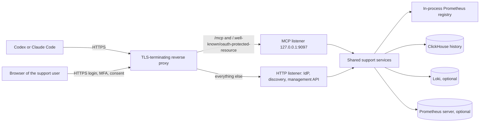
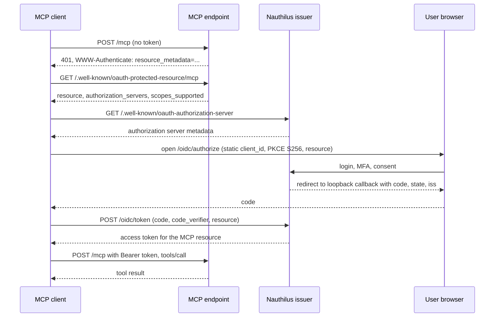

# Read-only Support Access over MCP

Nauthilus can expose its read-only support operations to Model Context Protocol (MCP) clients such as Codex and Claude
Code. Support staff then ask their coding assistant why a login failed, why an address was banned, whether LDAP or
Redis looked unhealthy, or which warnings and errors the instances logged, and the assistant answers from the same
evidence the management API returns.

The MCP endpoint is optional and disabled by default. It runs on its own listener behind a TLS-terminating reverse proxy,
and it accepts only OAuth 2.1 user access tokens that Nauthilus issued itself for this endpoint. The endpoint reuses the
historical authentication diagnosis described in [Support Authentication History](./support-authentication-history.md)
and adds operational diagnostics, a log overview, and the stored log events, which the management HTTP API offers as
well.

:::warning Read-only by design

Nothing reachable through MCP changes state. There is no login test, no unlock, no brute-force flush, no configuration
change, and no free query of any kind: no shell, SQL, Redis, LogQL, or PromQL. Every answer is recorded or observed data.

:::

:::warning Prompt injection

Answers carry values that other people control: user names typed at a login prompt, client identifiers, host names,
and log messages. Such a value can contain text written as instructions to a language model, for example a user name
that asks the assistant to ignore its previous instructions. Nauthilus returns every string as data, and the tool
descriptions tell the model to treat it as untrusted, but no server can guarantee that a model never follows text it
reads. The endpoint stays read-only, so injected text cannot change Nauthilus through it. The risk lies in the MCP
client and in what its other tools can do, so use the interface with care:

- Keep the approval prompts of the client on, and do not let it run commands, write files, send messages, or open
  links on its own while support answers are in its context. A session without other powerful tools is safer.
- Read the conclusions of the assistant as hypotheses and check them against the answer data before you act. Be
  suspicious of a suggestion that only makes sense if text inside a value were an instruction.
- Grant the support scopes only to staff who know these risks.

:::

## What It Is and What It Is Not

| It is | It is not |
| --- | --- |
| An authenticated, read-only MCP server with seven fixed tools | A general administration interface or a query console |
| Protected by Nauthilus as authorization server and resource server | Usable with an external authorization server |
| Open only to pre-registered static OIDC clients | Open to dynamically registered clients |
| Open only to users in a configured directory group, with MFA | Open to every user who can log in |
| The same JSON answers as the management HTTP API | A second implementation with its own interpretation |
| An instance-local runtime view plus optional Loki log, stored log line, and Prometheus metric evidence | A monitoring or alerting system |

Browser clients are not supported: the endpoint sends no CORS headers and refuses foreign `Origin` headers.

## Tools

| MCP tool | Management HTTP route | Scope, any of | Answers |
| --- | --- | --- | --- |
| `authentication_attempts_search` | `POST /api/v1/support/authentication-attempts/search` | `nauthilus:history_read`, `nauthilus:history_detail` | Recorded authentication attempts of one subject in a window of at most 31 days |
| `authentication_attempt_detail` | `POST /api/v1/support/authentication-attempts/detail` | `nauthilus:history_read`, `nauthilus:history_detail` | Every recorded event of one attempt |
| `bruteforce_history` | `POST /api/v1/support/bruteforce-bans/search` | `nauthilus:history_read`, `nauthilus:history_detail` | Recorded brute-force bans of one IP address or network |
| `operational_diagnostics` | `POST /api/v1/support/operations/diagnostics` | `nauthilus:operations_read` | Findings and hypotheses for LDAP, backends, Redis, the ClickHouse export, event delivery, and policy checks |
| `operational_log_overview` | `POST /api/v1/support/operations/log-overview` | `nauthilus:operations_read` | Counts of every message logged at the requested levels (WARN and ERROR by default) per level, exact message, instance, and time bucket |
| `operational_log_events` | `POST /api/v1/support/operations/log-events` | `nauthilus:operations_read` | The stored Loki lines of a window with every field, newest first and paged |
| `support_response_segment` | `POST /api/v1/support/responses/segment` | The scope of the operation that produced the answer | The next segment of an answer above `limits.max_response_bytes`; see [Large Answers](#large-answers) |

Both history scopes release the complete recorded data. `nauthilus:history_detail` grants nothing beyond
`nauthilus:history_read`; it is kept so that existing grants keep working.

`authentication_attempts_search` takes the same optional `response_mode` (`detailed` or `compact`) and
`include_ban_context` arguments as the HTTP route. The tool input schema is generated from the same OpenAPI component,
and the answers are byte-identical. The mode only selects the presentation; see
[Ban context and compact answers](./support-authentication-history.md#ban-context-and-compact-answers).

Both transports share one operation table, one argument decoder, and one renderer, so an MCP tool result carries exactly
the JSON that the HTTP route returns for the same request. The three history tools need a configured support history;
without it they answer `HISTORY_NOT_CONFIGURED`. The diagnostics tool and the two log tools need
`observability.diagnostics.operations`; without it they answer `OPERATIONS_NOT_CONFIGURED`. The log tools read only the
Loki source of that section.

Every tool is listed to every authenticated caller. Each call is authorized from the verified token scopes: a tool call
whose scope the token lacks is answered with HTTP `403` and an `insufficient_scope` challenge that names the scopes of
that tool, before the call reaches the MCP server. The service checks the scope again. `support_response_segment`
passes the transport check with any support scope; the segment store then requires the principal that received the
answer and a scope of the operation that produced it.

The endpoint negotiates the MCP protocol versions `2026-07-28` (stateless), `2025-11-25`, and `2025-06-18`. Older
versions are refused. It runs in stateless Streamable HTTP mode with JSON responses: there are no JSON-RPC batches, no
server-to-client requests, and no SSE streams.

## Architecture



- **Reverse proxy.** Terminates TLS for the public resource URL, for example `https://login.example.com/mcp`. It forwards
  the endpoint path and the protected resource metadata to the MCP listener, and everything else on that host, including
  the OIDC discovery documents and the login pages, to the normal HTTP listener.
- **MCP listener.** Plain HTTP on its own address (default `127.0.0.1:9097`). It serves only the endpoint path and the
  RFC 9728 protected resource metadata and answers `404` for anything else. It enforces the transport guards, verifies
  the bearer token against the issuer in-process, applies limits, and writes the transport audit.
- **Issuer.** The built-in OIDC provider issues tokens for the endpoint. The endpoint is configured as a *hosted
  resource* in `identity.oidc.hosted_resources`; see [Hosted Resources](../configuration/idp/oidc.md#hosted-resources).
- **Services.** One process-owned history service and one operations service (diagnostics, log overview, log events)
  answer HTTP and MCP alike, with the same authorization, limits, concurrency gates, and audit. One process-owned
  segment store keeps answers that exceeded the MCP response bound; see [Large Answers](#large-answers).

The client discovers everything from the first refused request:



## Access Model

Nauthilus is the authorization server and the resource server. The endpoint is identified by its URL, which is also the
RFC 8707 resource indicator and the token audience.

- **Only pre-registered static clients.** A hosted resource admits only the clients listed in `static_clients`. Each
  listed client must be public or set `require_pkce`, may use only `authorization_code` (optionally with
  `refresh_token`), and must require MFA. Device flow and client credentials are never admitted.
- **Dynamic client registration grants nothing.** A dynamically registered client is never admitted, whatever it
  declared at registration. An authorization request of such a client that names the resource is answered with
  `invalid_target`. DCR is deliberately unsupported for MCP access: both Codex and Claude Code register a new client after
  every failed authorization, so approving a single registration would not work.
- **User right from directory data.** At authorization the issuer resolves the user's groups in the same fresh backend
  lookup that builds the token claims and requires one of `user_right.any_of`. A user without it receives
  `access_denied`. A token claim never decides it.
- **Login age.** An authorization request for the resource forces a new login, including MFA, when the browser session's
  login is older than `max_authentication_age`; with `prompt=none` the client receives `login_required`. Code exchange and
  refresh are refused with `invalid_grant` after that age, so a removed group membership ends access at the latest then.
- **Exclusive grant.** The resource is never combined with another resource in one grant (`invalid_target`), so its
  tokens cannot be replayed at another resource server.
- **No device flow.** The device authorization endpoint never grants a hosted resource.
- **Short tokens.** Access tokens for the resource never live longer than `max_access_token_lifetime` (default 15
  minutes), whatever the client's own `access_token_lifetime` says.

There is no per-user scope selection: every user admitted by `user_right` gets the scopes that the client requested and
that both the client and the hosted resource list. There is no reduced support projection of the history: either
history scope releases the complete recorded data, including the identities behind shared addresses, so leaving
`nauthilus:history_detail` out restricts nothing. Admit only staff entitled to that data, and list only
`nauthilus:operations_read` on a resource whose users should see operations but no history; see
[What Leaves the Host](#what-leaves-the-host) and [Support Authentication History](./support-authentication-history.md).

### Token Acceptance

The endpoint accepts a bearer token only when all of the following hold:

1. It is a current user access token of the configured issuer, JWT or opaque: `token_type=access_token`, an authorized
   party (`azp`) and a subject, no service-token `client_id` claim, an expiry in the future, and the exact issuer for JWTs.
   ID tokens and `client_credentials` service tokens are refused.
2. Its audience is exactly the issuing client plus this resource.
3. The issuing client is admitted by the hosted resource now. Removing a client from `static_clients` rejects its existing
   tokens immediately and stops its refresh.
4. It carries at least one scope of the resource; otherwise the answer is `403` with `insufficient_scope`.

A refused token is answered with `401` and `error="invalid_token"`; the reason is never published. When the token state
cannot be read, the answer is `503` with `Retry-After: 5`. Every challenge names the protected resource metadata and the
resource scopes:

```http
HTTP/1.1 401 Unauthorized
WWW-Authenticate: Bearer resource_metadata="https://login.example.com/.well-known/oauth-protected-resource/mcp", error="invalid_token", scope="nauthilus:history_read nauthilus:history_detail nauthilus:operations_read"
```

A request without a token gets the same challenge without the `error` parameter. That is the discovery probe of a client
and is not counted as a failed attempt.

### When Access Ends

| Change | Effect |
| --- | --- |
| Client removed from `static_clients` | Existing tokens are refused at once; refresh fails with `invalid_target`. |
| User-wide token revocation | Existing tokens are refused at once. |
| User removed from the entitling group | Takes effect at the next authorization, at the latest after `max_authentication_age`, when refresh fails with `invalid_grant`. |
| Access token expiry | At most `max_access_token_lifetime` after issuance. |

## Prerequisites

- The built-in OIDC provider is enabled with an HTTPS issuer, signing keys, and the browser frontend
  (`identity.frontend.enabled`), because the support user logs in through the browser.
- MFA is set up for the support users, because every admitted client must require it. See
  [MFA Assurance Policy](../configuration/idp/mfa-assurance.md).
- The authentication backend resolves groups for the `oidc` protocol, for example an LDAP search entry with a `groups`
  block (see [Groups Resolution](../configuration/database-backends/ldap.md#groups-resolution)) or a Lua backend that
  returns groups.
- A reverse proxy terminates TLS for the resource URL on a host name that the MCP clients can reach.
- For the three history tools: a configured support history, see
  [Support Authentication History](./support-authentication-history.md).
- For the diagnostics tool: `observability.diagnostics.operations`, described below. The log overview and the log
  events also need its `loki` source, on Loki 2.9 or newer.
- Behind a load balancer with several instances: sticky routing for the MCP endpoint, because the segments of a large
  answer live in the instance that produced it.

## Configuration

The configuration has four parts: one static client, one hosted resource, the MCP listener, and optionally the
operational diagnostics. A complete example follows the reference tables.

### Static Client

Register one public client for Codex and Claude Code. Both clients receive the authorization response on a loopback
port chosen at runtime; static loopback redirect URIs match on any port.

```yaml
identity:
  oidc:
    clients:
      - name: "Support CLI"
        client_id: "support-cli"
        token_endpoint_auth_method: "none"
        require_pkce: true
        redirect_uris:
          - "http://127.0.0.1/callback"
          - "http://localhost/callback"
        grant_types: ["authorization_code", "refresh_token"]
        require_mfa: ["totp", "webauthn"]
        scopes:
          - "openid"
          - "offline_access"
          - "nauthilus:history_read"
          - "nauthilus:history_detail"
          - "nauthilus:operations_read"
        access_token_lifetime: 10m
        refresh_token_lifetime: 12h
```

`require_mfa` requires every listed method to be registered. List only the methods your support users actually have,
or use `required_mfa_level` instead; either one satisfies the hosted resource's MFA requirement. The client's `scopes`
must contain at least one scope of the hosted resource.

### Hosted Resource

```yaml
identity:
  oidc:
    hosted_resources:
      - name: "support-mcp"
        resource: "https://login.example.com/mcp"
        scopes:
          - "nauthilus:history_read"
          - "nauthilus:history_detail"
          - "nauthilus:operations_read"
        user_right:
          from: "groups"
          any_of: ["nauthilus-support"]
        max_authentication_age: 12h
        max_access_token_lifetime: 15m
        static_clients: ["support-cli"]
```

| Key under `identity.oidc.hosted_resources[]` | Default | Rules |
| --- | --- | --- |
| `name` | required | 1 to 63 lower-case letters, digits, or dashes, starting with a letter or digit; unique. Referenced by `runtime.servers.mcp.hosted_resource`. |
| `resource` | required | Absolute HTTPS URL with a host and without query, user info, fragment, or whitespace; plain HTTP only for loopback hosts. Unique, not equal to a `client_id` or a resource owned by a `token_introspection` block, and not a reserved `nauthilus:` audience. |
| `scopes` | required | Non-empty, duplicate-free subset of `nauthilus:history_read`, `nauthilus:history_detail`, and `nauthilus:operations_read`. Both history scopes grant the same complete history data. |
| `user_right.from` | required | `groups` (group names) or `group_dns` (group distinguished names). |
| `user_right.any_of` | required | At least one group; no duplicates, no empty or padded values. |
| `max_authentication_age` | `12h` | `5m` to `720h`. |
| `max_access_token_lifetime` | `15m` | `1m` to `1h`. |
| `static_clients` | required | At least one configured static client, no duplicates. Each must be public or set `require_pkce`, allow only `authorization_code` with optional `refresh_token`, require MFA (`require_mfa` or `required_mfa_level`), and list at least one of the resource scopes. |

### MCP Listener

```yaml
runtime:
  servers:
    mcp:
      enabled: true
      address: "127.0.0.1:9097"
      hosted_resource: "support-mcp"
      tls_termination: "trusted_reverse_proxy"
      trusted_proxies: ["127.0.0.1/32"]
      allowed_hosts: ["login.example.com"]
      allowed_browser_origins: []
      limits:
        timeout: 15s
        max_concurrent: 8
        max_concurrent_per_principal: 2
        max_request_bytes: 65536
        max_response_bytes: 1048576
        failed_auth_per_minute: 30
      audit:
        enabled: true
```

| Key under `runtime.servers.mcp` | Default | Rules and meaning |
| --- | --- | --- |
| `enabled` | `false` | Opens the listener. Requires `identity.oidc.enabled` and a valid `hosted_resource`. |
| `address` | `127.0.0.1:9097` | Plain HTTP `host:port`. Keep it on loopback or a private network reachable only by the proxy. |
| `hosted_resource` | required when enabled | Name of an `identity.oidc.hosted_resources[]` entry. Its URL fixes the endpoint path and the metadata location. |
| `tls_termination` | `trusted_reverse_proxy` | The only supported value: TLS ends at the reverse proxy. |
| `trusted_proxies` | `[]` | IP addresses or CIDRs of the reverse proxy. Required for an HTTPS resource. Independent of `runtime.servers.http.trusted_proxies`. |
| `allowed_hosts` | the resource host | Accepted `Host` or `X-Forwarded-Host` values, as `host` or `host:port`. |
| `allowed_browser_origins` | `[]` | Origins such as `https://host` that may send an `Origin` header; `*` and `null` are rejected. Leave empty: browser clients are not supported. |
| `limits.timeout` | `15s` | Time budget of one tool call; at most `1m`. |
| `limits.max_concurrent` | `8` | In-flight requests of the endpoint; at most `64`. |
| `limits.max_concurrent_per_principal` | `2` | In-flight requests of one user through one client; at most `max_concurrent`. |
| `limits.max_request_bytes` | `65536` | Request body bound; at most `1048576`. |
| `limits.max_response_bytes` | `1048576` | Bound of one serialized MCP response: the JSON-RPC envelope with the request ID, the text copy, the structured copy, and the error flag. A larger answer arrives in segments (see [Large Answers](#large-answers)); at most `16777216`. |
| `limits.failed_auth_per_minute` | `30` | Failed bearer attempts per client (IPv4 address or IPv6 `/64`) per minute; must not be negative. |
| `audit.enabled` | `true` | Writes the transport audit records described below. |

A limit set to `0` uses its default; limits cannot be switched off.

### Operational Diagnostics

```yaml
observability:
  diagnostics:
    operations:
      enabled: true
      sources:
        nauthilus_runtime:
          enabled: true
        loki:
          enabled: true
          url: "https://loki.example.com"
          tenant: "mail-prod"
          selector:
            app: "nauthilus"
            namespace: "mail"
          instance_label: "pod"
          query_profile: "nauthilus_diagnostics"
          timeout: 3s
          max_time_window: 1h
          max_series: 200
          max_response_bytes: 1048576
          bearer_token: "${LOKI_READ_TOKEN}"
        prometheus:
          enabled: true
          url: "https://prometheus.example.org"
          selector:
            job: "nauthilus"
          instance_label: "instance"
          query_profile: "nauthilus_diagnostics"
          timeout: 3s
          max_time_window: 1h
          max_series: 200
          max_response_bytes: 1048576
          bearer_token: "${PROMETHEUS_READ_TOKEN}"
```

| Key under `observability.diagnostics.operations` | Default | Rules and meaning |
| --- | --- | --- |
| `enabled` | `false` | Enables the diagnostics service for MCP and the management API. |
| `sources.nauthilus_runtime.enabled` | `true` | Instance-local runtime source. At least one source must be enabled. |
| `sources.loki.enabled` | `false` | Optional historical log source; the log overview and the log events read only this source. Requires `enabled: true` on the section. |
| `sources.loki.url` | required | HTTP or HTTPS base URL without query, fragment, or user info. `/loki/api/v1/query` is appended to its path; the log overview and the log events also use `/loki/api/v1/query_range` and `/loki/api/v1/series`. |
| `sources.loki.tenant` | `""` | Sent as `X-Scope-OrgID`; 1 to 64 letters, digits, dots, dashes, or underscores. |
| `sources.loki.selector` | required | Fixed stream selector with at least one label. Names use Prometheus label syntax; values are 1 to 128 characters of letters, digits, and `._:/@-`. |
| `sources.loki.instance_label` | required | Label that names the Nauthilus instance of a stream, for example `pod`. Counts are grouped by it, and the `instance` filter of the log events matches it. |
| `sources.loki.query_profile` | `nauthilus_diagnostics` | The only compiled query profile. |
| `sources.loki.timeout` | `3s` | Per Loki request; at most `30s`. |
| `sources.loki.max_time_window` | `1h` | Longest span one query covers; at most `24h`. A longer window is answered in up to 24 parts; see [Windows and Parts](#windows-and-parts). |
| `sources.loki.max_series` | `200` | Series bound of one result; at most `1000`. |
| `sources.loki.max_response_bytes` | `1048576` | Byte bound of one Loki response; at most `8388608`. |
| `sources.loki.bearer_token` | `""` | Bearer credential. Mutually exclusive with `basic_auth`. |
| `sources.loki.basic_auth.username`, `.password` | `""` | Basic credentials; both are required together, the username without colon or space. |
| `sources.loki.tls` | | Outbound TLS settings: `ca_file`, `cert`, `key`, `min_tls_version`, `cipher_suites`, `skip_verify`. The files are part of the validated file-artifact snapshot. |

`sources.prometheus` takes exactly the keys of `sources.loki`, with the same defaults, ceilings, and rules (`enabled`,
`url`, `tenant`, `selector`, `instance_label`, `query_profile`, `timeout`, `max_time_window`, `max_series`,
`max_response_bytes`, `bearer_token`, `basic_auth`, and `tls`). The differences are the appended path, which is
`/api/v1/query`, and the selector, which names the scrape job of the Nauthilus instances, for example `job: nauthilus`.
The tenant is sent as `X-Scope-OrgID`, which Mimir and Cortex read. The `instance_label` is the series label that names
an instance: `instance` is the scrape address, and a relabeled `pod` label reads better.

The Loki and Prometheus clients ignore proxy environment variables and never follow redirects. Selector, tenant,
credentials, and endpoint come only from the configuration. No caller value reaches a diagnostics, overview, or
Prometheus query; only the log events take an instance and a message, both rendered as quoted LogQL strings (see
[Log Events](#log-events)). The log overview and the log events need no further configuration: they use the selector,
tenant, credentials, `timeout`, `max_time_window`, `max_series`, and `max_response_bytes` of the `loki` source.

### Complete Example

This example passes the production configuration check. Secrets come from the environment.

```yaml
runtime:
  instance_name: "mx-1"
  servers:
    http:
      address: "127.0.0.1:8080"
      trusted_proxies: ["127.0.0.1"]
    # Plain HTTP on loopback; the reverse proxy terminates TLS for https://login.example.com/mcp and
    # https://login.example.com/.well-known/oauth-protected-resource/mcp and forwards both here.
    mcp:
      enabled: true
      address: "127.0.0.1:9097"
      hosted_resource: "support-mcp"
      tls_termination: "trusted_reverse_proxy"
      trusted_proxies: ["127.0.0.1/32"]
      allowed_hosts: ["login.example.com"]
      allowed_browser_origins: []
      limits:
        timeout: 15s
        max_concurrent: 8
        max_concurrent_per_principal: 2
        max_request_bytes: 65536
        max_response_bytes: 1048576
        failed_auth_per_minute: 30
      audit:
        enabled: true

observability:
  diagnostics:
    operations:
      enabled: true
      sources:
        nauthilus_runtime:
          enabled: true
        loki:
          enabled: true
          url: "https://loki.example.com"
          tenant: "mail-prod"
          selector:
            app: "nauthilus"
            namespace: "mail"
          instance_label: "pod"
          query_profile: "nauthilus_diagnostics"
          bearer_token: "${LOKI_READ_TOKEN}"
        prometheus:
          enabled: true
          url: "https://prometheus.example.org"
          selector:
            job: "nauthilus"
          instance_label: "instance"
          query_profile: "nauthilus_diagnostics"
          bearer_token: "${PROMETHEUS_READ_TOKEN}"

storage:
  redis:
    primary:
      address: "127.0.0.1:6379"
    prefix: "nt:"
    encryption_secret: "${REDIS_ENCRYPTION_SECRET}"
    password_nonce: "${REDIS_PASSWORD_NONCE}"
  history:
    clickhouse:
      url: "http://127.0.0.1:8123/"
      database: "nauthilus"
      username: "nauthilus_history"
      password: "${CLICKHOUSE_HISTORY_PASSWORD}"
      deployment: "prod"

identity:
  frontend:
    enabled: true
    encryption_secret: "${FRONTEND_ENCRYPTION_SECRET}"
  mfa:
    totp:
      issuer: "Nauthilus"
  oidc:
    enabled: true
    issuer: "https://login.example.com"
    scopes_supported:
      - "openid"
      - "offline_access"
      - "nauthilus:history_read"
      - "nauthilus:history_detail"
      - "nauthilus:operations_read"
    signing_keys:
      - id: "main"
        key: "${OIDC_SIGNING_KEY}"
        algorithm: "RS256"
        active: true
    clients:
      - name: "Support CLI"
        client_id: "support-cli"
        token_endpoint_auth_method: "none"
        require_pkce: true
        redirect_uris:
          - "http://127.0.0.1/callback"
          - "http://localhost/callback"
        grant_types: ["authorization_code", "refresh_token"]
        require_mfa: ["totp", "webauthn"]
        scopes:
          - "openid"
          - "offline_access"
          - "nauthilus:history_read"
          - "nauthilus:history_detail"
          - "nauthilus:operations_read"
        access_token_lifetime: 10m
        refresh_token_lifetime: 12h
    hosted_resources:
      - name: "support-mcp"
        resource: "https://login.example.com/mcp"
        scopes:
          - "nauthilus:history_read"
          - "nauthilus:history_detail"
          - "nauthilus:operations_read"
        user_right:
          from: "groups"
          any_of: ["nauthilus-support"]
        max_authentication_age: 12h
        max_access_token_lifetime: 15m
        static_clients: ["support-cli"]
    # Mail clients may still register dynamically. Registration grants no MCP access: the hosted resource admits only
    # its static_clients, and the support scopes are not part of the mail-client-v1 profile.
    dynamic_client_registration:
      enabled: true
      profile: "mail-client-v1"
      source_hmac_key: "${DCR_SOURCE_HMAC_KEY}"
      required_scopes: ["openid"]
      optional_scopes: ["offline_access"]
      allow_refresh_tokens: true
```

Validate a copy before you deploy it:

```bash
nauthilus --config /etc/nauthilus/nauthilus.yml --config-check
```

Listing the support scopes in `scopes_supported` makes the discovery documents advertise them.

### Load-Time Validation

The configuration check rejects, among others:

- unknown keys, for example a `dynamic_clients` block below a hosted resource;
- an enabled MCP listener without `identity.oidc.enabled` or with a `hosted_resource` that names no entry;
- a hosted resource that is not HTTPS (plain HTTP only for loopback hosts), owned by a client, or reserved;
- hosted resource scopes outside the three support scopes, and a user right other than `groups` or `group_dns`;
- static clients that are missing, dynamic, confidential without PKCE, allowed other grants, or require no MFA;
- an HTTPS resource without `trusted_proxies`;
- Loki and Prometheus URLs with query, fragment, or user info, selectors or tenants with unsafe characters, both
  `bearer_token` and `basic_auth`, a query profile other than `nauthilus_diagnostics`, and an enabled Loki or Prometheus
  source while the diagnostics section is disabled;
- every limit above its ceiling.

### Reload Behaviour

The MCP listener is started together with the HTTP servers, from the same configuration snapshot as the IdP handlers.
Listener, transport, and limit changes take effect when the HTTP servers restart (`SIGUSR1` after `SIGHUP`, see
[Reloading](../configuration/index.md#reloading)) or when the process restarts. On stop, in-flight tool calls drain for
at most 5 seconds before the listener reports done.

Hosted resources, static clients, and scopes are read through the issuer on every request. Changing a hosted resource
URL requires a restart; until then the endpoint and its metadata answer `503`.

The diagnostics service and its sources are built when the process starts. Restart the process after you change
`observability.diagnostics.operations`. A Loki or Prometheus source that cannot be built is logged as
`Loki diagnostics source disabled` or `Prometheus diagnostics source disabled` and left out; the runtime source keeps
working and the omitted source reports `not_configured`.

## Reverse Proxy

The MCP listener checks the transport before it looks at a token:

- **TLS and proxy.** A request must come from a `trusted_proxies` address with `X-Forwarded-Proto` equal to the resource
  scheme. Only a plain-HTTP loopback resource may be reached directly from loopback, for local tests.
- **Client IP.** The client is the right-most `X-Forwarded-For` hop that is not a trusted proxy (`ip` or `ip:port`).
  Hops left of it are client-supplied and never decide it. A request from a trusted proxy without such a hop is refused,
  so clients never collapse into the proxy's address. Every proxied location must therefore send `X-Forwarded-For`.
- **Host.** `Host`, or `X-Forwarded-Host` when the proxy sends it, must be in `allowed_hosts`.
- **Origin.** A request with an `Origin` outside `allowed_browser_origins`, or with more than one `Origin` header, is
  refused.

An nginx server block for `login.example.com` adds two locations in front of the normal Nauthilus proxy configuration:

```nginx
location = /mcp {
    proxy_pass http://127.0.0.1:9097;
    proxy_set_header Host $host;
    proxy_set_header X-Forwarded-Proto $scheme;
    proxy_set_header X-Forwarded-For $proxy_add_x_forwarded_for;
    proxy_buffering off;
}

location /.well-known/oauth-protected-resource {
    proxy_pass http://127.0.0.1:9097;
    proxy_set_header Host $host;
    proxy_set_header X-Forwarded-Proto $scheme;
    proxy_set_header X-Forwarded-For $proxy_add_x_forwarded_for;
}
```

All other paths of the host, in particular `/.well-known/openid-configuration`,
`/.well-known/oauth-authorization-server`, `/oidc/*`, and the login pages, stay on the normal HTTP listener.

The endpoint serves the protected resource metadata at
`<resource origin>/.well-known/oauth-protected-resource<resource path>` and, for a resource with a path, also at
`/.well-known/oauth-protected-resource`:

```json
{
  "resource": "https://login.example.com/mcp",
  "authorization_servers": ["https://login.example.com"],
  "scopes_supported": ["nauthilus:history_read", "nauthilus:history_detail", "nauthilus:operations_read"],
  "bearer_methods_supported": ["header"],
  "resource_name": "Nauthilus support diagnostics (read-only)"
}
```

The issuer serves RFC 8414 authorization server metadata at `/.well-known/oauth-authorization-server`, and every
authorization response carries the RFC 9207 `iss` parameter. See
[Authorization Server Metadata and Issuer Identification](../configuration/idp/oidc.md#authorization-server-metadata-and-issuer-identification).

## Client Setup

Users must be members of a group in `user_right.any_of` and complete MFA. Both clients below must be configured with the
static client ID. Without it they fall back to dynamic registration, which Nauthilus refuses for this resource.

**Codex**, with `codex mcp add` or in `~/.codex/config.toml`:

```bash
codex mcp add nauthilus --url https://login.example.com/mcp --oauth-client-id support-cli
```

```toml
[mcp_servers.nauthilus]
url = "https://login.example.com/mcp"

[mcp_servers.nauthilus.oauth]
client_id = "support-cli"
```

**Claude Code:**

```bash
claude mcp add --transport http nauthilus https://login.example.com/mcp --client-id support-cli
```

Both clients discover the issuer through the protected resource metadata and RFC 8414, use PKCE `S256` and the
`resource` parameter, and verify the `iss` parameter of the callback.

MCP clients list the tools when they connect. After an upgrade that adds tools, reconnect existing clients to see them.

## Requests and Responses

An MCP tool call, protocol version `2025-06-18`:

```http
POST /mcp HTTP/1.1
Host: login.example.com
Authorization: Bearer <access token>
Content-Type: application/json
Accept: application/json, text/event-stream
MCP-Protocol-Version: 2025-06-18

{"jsonrpc":"2.0","id":3,"method":"tools/call","params":{"name":"operational_diagnostics",
 "arguments":{"schema_version":"1","components":["ldap","redis"],"audit_reference":"INC-4711"}}}
```

The result carries the same JSON twice: as `structuredContent` and as text content. A service error is a tool result
with `isError: true` and the same envelope the HTTP route returns:

```json
{"jsonrpc":"2.0","id":4,"result":{"isError":true,
 "content":[{"type":"text","text":"{\"error\":{\"code\":\"HISTORY_NOT_CONFIGURED\",\"message\":\"No history source is configured on this instance.\"},\"schema_version\":\"1\"}"}],
 "structuredContent":{"error":{"code":"HISTORY_NOT_CONFIGURED","message":"No history source is configured on this instance."},"schema_version":"1"}}}
```

The body inspection refuses, before the MCP server sees the request: bodies above `max_request_bytes`, duplicate JSON
member names, case variants of the JSON-RPC member names, JSON-RPC batches, and `Mcp-Method` or `Mcp-Name` headers that
disagree with the body. Operation arguments are decoded with the same strict rules on HTTP and MCP: unknown fields and
duplicate names are `INVALID_REQUEST`. A result above `max_response_bytes` arrives in segments, as described below. A
panic inside any support operation answers `INTERNAL_ERROR` on both transports and never ends the process.

### Large Answers

An answer above the transport bound is never discarded. Over MCP the bound is the serialized HTTP response itself:
the JSON-RPC envelope with the request's own ID, the text copy (the answer escaped once more as a JSON string), the
structured copy, and the error flag. An answer whose serialized response exceeds `limits.max_response_bytes` is
stored, and the tool result carries its first segment instead:

```json
{"schema_version":"1",
 "segment":{"operation":"operational_log_events","offset":0,"total_bytes":2483112,"next_cursor":"..."},
 "data":"{\"schema_version\":\"1\",\"scope\":..."}
```

Call `support_response_segment` with `segment.next_cursor` as `cursor` until `next_cursor` is `null`:

```json
{"jsonrpc":"2.0","id":9,"method":"tools/call","params":{"name":"support_response_segment",
 "arguments":{"schema_version":"1","cursor":"..."}}}
```

Concatenating `data` of every segment in order yields the complete JSON answer byte for byte, so one large log event or
a large attempt detail arrives complete. `offset` is the byte position of `data` in the complete answer, and
`total_bytes` its length.

- **Lifetime and size.** Segments are kept for ten minutes, in a store of 64 MiB in total; when it is full, the oldest
  answers go first. One answer can be at most 16 MiB; a larger answer is `RESPONSE_TOO_LARGE`, so narrow the request.
  Each principal holds at most 16 MiB; its own oldest answers go first, never another principal's.
- **Binding.** Segments are bound to the principal that received the answer (credential method and identity) and to
  the scopes of its operation. Another caller, or a token without one of those scopes, receives `FORBIDDEN`.
- **Fit.** Every segment is rendered to the bound of the call that fetches it, measured the same way, as the longest part
  of the answer that fits without splitting a UTF-8 character. Every raw MCP response therefore stays within
  `limits.max_response_bytes`, also for a long request ID or an answer dense in quotes and backslashes. A bound too small
  for one character of a segment is `RESPONSE_TOO_LARGE`.
- **One instance.** The store lives in the instance that produced the answer. Behind a load balancer, segment fetches
  must reach the same instance (sticky routing); otherwise they answer `SEGMENT_UNKNOWN`, as does a segment that
  expired or was evicted. Repeat the original call then.
- **HTTP.** The management API offers the same operation as `POST /api/v1/support/responses/segment` with the same
  body. HTTP answers themselves have no size bound and are never segmented; today only the MCP response bound produces
  segments. See [readSupportResponseSegment](../api-reference/management/read-support-response-segment.api.mdx).
- **Audit.** A segment fetch is a transport call that the `support_mcp` record covers; the answer was audited by its
  service when it was produced.

## Operational Diagnostics

The diagnostics operation answers which support-relevant components looked unhealthy, from up to three kinds of
evidence: the current runtime state of the answering instance and, when configured, recorded Loki log lines and
Prometheus counter increases inside the requested window.

### Request

| Field | Default | Rules |
| --- | --- | --- |
| `schema_version` | required | `"1"` |
| `window` | last 15 minutes | `from` inclusive, `until` exclusive and not in the future; at most 24 hours (`WINDOW_TOO_LARGE`). |
| `components` | all | `ldap`, `auth_backend`, `backend_monitoring`, `redis`, `clickhouse_export`, `auth_event_delivery`, `policy`. |
| `sources` | all configured | `nauthilus_runtime`, `loki`, `prometheus`. |
| `audit_reference` | none | Optional ticket reference for the audit record; 1 to 64 letters, digits, or `._:/-`. |

Unknown or repeated components and sources are `INVALID_REQUEST`.

### Reading the Answer

- **Missing data is `unknown`, never `ok`.** `not_observed` requires proven coverage.
- **Runtime findings describe this instance now.** Gauges are `current_state`. Counters are `process_lifetime_counter`
  with `counting_since` and never claim anything about the requested window.
- **Log findings count lines inside the covered window** (`log_window`). **Prometheus findings count the increase of
  fixed counters inside it** (`metric_window`).
- **Sources are never merged.** Hypotheses relate findings of different sources, are listed separately, reach at most
  `medium` confidence (only when current state and log or metric evidence agree), and always carry caveats such as
  `CORRELATION_IS_NOT_CAUSATION`, `LOCAL_INSTANCE_ONLY`, or `METRIC_EVIDENCE_IS_NOT_CURRENT_STATE`.
- **A failing source never fails the call.** Its report says `partial`, `timeout`, `unavailable`, `not_configured`, or
  `not_requested`, with a reason code such as `LOKI_RESULT_TRUNCATED`, `LOKI_WINDOW_CLIPPED`, `LOKI_TIMEOUT`,
  `LOKI_QUERY_REJECTED`, `LOKI_UNREACHABLE`, or the matching `PROMETHEUS_*` code.

A shortened answer:

```json
{
  "schema_version": "1",
  "scope": {"window": {"from": "2026-11-18T06:00:00Z", "until": "2026-11-18T07:00:00Z"},
            "queried_at": "2026-11-18T07:00:04Z", "deployment": "prod", "instance": "mx-1"},
  "sources": [
    {"name": "nauthilus_runtime", "kind": "local_current", "status": "ok", "truncated": false,
     "coverage": {"from": "2026-11-18T07:00:04Z", "until": "2026-11-18T07:00:04Z", "instances": ["mx-1"], "view": "local_instance"}},
    {"name": "loki", "kind": "historical", "status": "partial", "code": "LOKI_RESULT_TRUNCATED", "truncated": true,
     "coverage": {"from": "2026-11-18T06:00:00Z", "until": "2026-11-18T07:00:00Z", "instances": ["mx-1", "mx-2"], "view": "log_labels"}}
  ],
  "findings": [
    {"id": "F1", "component": "ldap", "source": "nauthilus_runtime", "status": "failing",
     "scope": {"kind": "instance", "instance": "mx-1"}, "labels": {"pool": "auth", "target": "ldap://dc1.example.com"},
     "observed": {"at": "2026-11-18T07:00:04Z"},
     "freshness": {"observed_at": "2026-11-18T07:00:04Z", "basis": "current_state", "age_seconds": 0},
     "symptoms": [{"code": "LDAP_TARGET_UNHEALTHY", "count": 1}, {"code": "LDAP_BREAKER_OPEN", "count": 1}]},
    {"id": "F2", "component": "ldap", "source": "loki", "status": "observed",
     "scope": {"kind": "instance", "instance": "mx-1"},
     "observed": {"from": "2026-11-18T06:00:00Z", "until": "2026-11-18T07:00:00Z"},
     "freshness": {"observed_at": "2026-11-18T07:00:04Z", "basis": "log_window", "age_seconds": 4},
     "symptoms": [{"code": "LDAP_CONNECTION_ERROR", "count": 37}]}
  ],
  "hypotheses": [
    {"code": "DIRECTORY_UNREACHABLE_OR_OVERLOADED", "confidence": "medium", "finding_ids": ["F1", "F2"],
     "basis": "LDAP target health, breaker state, or LDAP connection errors",
     "caveats": ["CORRELATION_IS_NOT_CAUSATION", "LOCAL_INSTANCE_ONLY", "LOG_EVIDENCE_IS_NOT_CURRENT_STATE"]}
  ],
  "notes": ["VALUES_ARE_UNTRUSTED_DATA", "LOCAL_VIEW_NOT_CLUSTER", "RUNTIME_COUNTERS_ARE_PROCESS_LIFETIME",
            "HISTORICAL_SOURCE_INCOMPLETE", "HYPOTHESES_ARE_NOT_FINDINGS"]
}
```

`scope.instance` is `runtime.instance_name`; `scope.deployment` is `storage.history.clickhouse.deployment` when set.

### Windows and Parts

Every window of the operations requests (diagnostics, log overview, and log events) is half open, `[from, until)`, and
kept in whole milliseconds, the precision of a range selector. Finer digits are dropped, and the answer states the
window it used. A historical count covers exactly that window: it is an instant query with the window length in
milliseconds as its range, evaluated at the window end. Loki counts a range as `(t-range, t]`, so a Loki count runs one
nanosecond before the end: a line on the window start counts, a line on the window end does not. No count uses a range
query, so how a query frontend aligns range evaluations (`align_queries_with_step`) never matters, and any valid window
works without rounding.

A window longer than the `max_time_window` of a source (the longest span one query covers, default `1h`) is split into
consecutive parts of at most `max_time_window` that end at the window end; only the oldest part may be shorter. The
counts of the parts are added, and the log events read the window part by part. One window takes at most 24 parts, so
with `max_time_window: 1h` every window up to the 24-hour maximum is answered completely. A window that needs more
parts, which happens only with a `max_time_window` below one hour, keeps its newest 24 parts and is stated as clipped
(`LOKI_WINDOW_CLIPPED` or `PROMETHEUS_WINDOW_CLIPPED`, source `partial`).

- The source `timeout` applies per part, within the 10-second budget of the call. A source that runs out of time reports
  `timeout`.
- A source answers one call with at most four queries at a time. A twelve-hour diagnostics call with the eight profile
  queries and the coverage query sends 12 × 9 Loki queries.
- Prometheus estimates the increase of each part with `increase()`, so the sum of the parts can differ by a fraction
  from one long increase.

### Runtime Source

`nauthilus_runtime` reads the in-process Prometheus registry. It never dials a backend and does not use `/healthz`.

| Component | Evidence | Status |
| --- | --- | --- |
| `ldap` | `ldap_target_health` and `ldap_breaker_state` per pool and target; `ldap_errors_total` per pool, operation, and result code | `failing`, `degraded`, `ok`; `observed`, `not_observed` |
| `backend_monitoring` | `backend_servers_status` with `server_status` `wanted` and `alive` | `failing` (none alive), `degraded`, `ok` |
| `redis` | `redis_connection_timeouts_total` per pool | `observed`, `not_observed` |
| `clickhouse_export` | ClickHouse plugin flush-batch and queued-row counters | `observed`, `not_observed` |
| `auth_event_delivery` | `plugin_auth_events_total` with `outcome="dropped"` per lane | `observed`, `not_observed` |
| `policy` | `policy_check_technical_errors_total` | `observed`, `not_observed` |
| `auth_backend` | `plugin_calls_total` with `extension_point="backend"` and result `error`, `panic`, or `timeout` per module and component; `lua_vm_replaced_total` of Lua backend VM pools (`backend:<name>`); `auth_application_errors_total` per transport | `observed`, `not_observed` |

A metric family that is not registered, for example because a plugin is not loaded, makes its component `unknown`.

#### LDAP error classification

`ldap_errors_total` counts every failed directory operation, including the directory's answer to a wrong user password
(`op="bind"`, result code `49`). That answer is an outcome about the client, not a fault of the directory. It is
therefore reported as the informational symptom `LDAP_BIND_REJECTED` and never derives a hypothesis. Every other
operation and code stays `LDAP_ERRORS`. The finding labels carry `pool`, `op`, and `code`; the codes `network` and
`other` mean a failure below the LDAP protocol.

#### Backend evidence

`auth_backend` findings are labeled with `kind` (`plugin`, `lua`, or `application`) and `name`. Plugin calls that ended
`canceled` (the client went away) or `admission_limited` (host capacity), and Lua VM pools of other roles, are not
backend evidence and are not counted. A Lua backend that fails without replacing its VM, and a plugin that reports a
fault inside a successful result, are not visible here.

### Loki Source

Only the compiled `nauthilus_diagnostics` profile runs: one instant metric query per symptom,
`sum by (<instance_label>) (count_over_time(<selector> |= "<literal>" |~ "<msg pattern>" [<window>ms]))`, plus one
coverage query without a line filter that counts all lines per instance. A window above `max_time_window` sends these
queries once per part ([Windows and Parts](#windows-and-parts)).

The substring stage drops every line without the literal before the pattern runs, so a query stays cheap on windows with
many lines, for example after a restart with debug logging. The pattern matches a literal only as the complete `msg`
field of a slog JSON line (`"msg":"<literal>"`) or text line (`msg="<literal>"`). Both log encoders escape quotes inside
values, so text that a client typed, for example a username, can never be counted as a symptom.

| Component | Symptom | Log message |
| --- | --- | --- |
| `ldap` | `LDAP_CONNECTION_ERROR` | `LDAP connection error` |
| `ldap` | `LDAP_CONNECTION_FAILED` | `LDAP connection failed` |
| `ldap` | `LDAP_SEARCH_ERROR` | `LDAP search error` |
| `auth_backend` | `AUTH_BACKENDS_FAILED` | `All backends failed` |
| `auth_backend` | `UNCLASSIFIED_BACKEND_TEMPFAIL` | `Unclassified backend error answered as a temporary failure` |
| `redis` | `REDIS_PIPELINE_ERROR` | `Redis batching pipeline returned error` |
| `redis` | `REDIS_WRITE_PIPELINE_FAILED` | `Execute write pipeline failed` |
| `clickhouse_export` | `CLICKHOUSE_FLUSH_FAILED` | `clickhouse pending batch flush failed` |

:::warning Store the raw log line

The profile requires Loki to store the raw slog line of the JSON or text log handler. A shipper that wraps lines, for
example unparsed Docker `json-file` records with escaped quotes, or the coloured console format makes every symptom query
miss while the coverage query still counts lines, so the components read `not_observed`. When you connect a new log
pipeline, check one known message with a manual LogQL query.

:::

The diagnostics answer contains counts per instance label, with the instance values complete. The diagnostics profile
counts only the eight messages above; the [Log Overview](#log-overview) counts every message, and the
[Log Events](#log-events) return the stored lines. Loki diagnostics evidence carries no first-seen or last-seen times
and depends on Loki retention.

### Prometheus Source

`prometheus` complements the instance-local runtime view: it asks one Prometheus for every scraped instance and ties
the counts to the requested window. Only the compiled `nauthilus_diagnostics` profile runs: instant queries of the form
`sum by (<instance_label>) (increase(<series>{<selector>}[<window>ms]))`, evaluated at the end of the window, over the
same counter families and with the same classification as the runtime source.

| Component | Symptom | Series |
| --- | --- | --- |
| `ldap` | `LDAP_BIND_REJECTED` | `ldap_errors_total` with `op="bind"` and `code="49"` |
| `ldap` | `LDAP_ERRORS` | every other `ldap_errors_total` series |
| `auth_backend` | `PLUGIN_BACKEND_CALL_FAILURES` | `plugin_calls_total` with `extension_point="backend"` and result `error`, `panic`, or `timeout` |
| `auth_backend` | `LUA_BACKEND_VM_REPLACED` | `lua_vm_replaced_total` with a `key` that starts with `backend:` |
| `auth_backend` | `AUTH_APPLICATION_ERRORS` | `auth_application_errors_total` |
| `redis` | `REDIS_POOL_TIMEOUTS` | `redis_connection_timeouts_total` |
| `auth_event_delivery` | `AUTH_EVENTS_DROPPED` | `plugin_auth_events_total` with `outcome="dropped"` |
| `clickhouse_export` | `CLICKHOUSE_FLUSH_FAILED`, `CLICKHOUSE_ROWS_DROPPED` | The plugin's scoped flush and enqueue counters with a failure `result` |
| `policy` | `POLICY_CHECK_TECHNICAL_ERRORS` | `policy_check_technical_errors_total` |

Gauges (LDAP target health, breaker state, monitored backend servers) stay with the runtime source. The ClickHouse
streams are matched by a name pattern. Because `increase()` drops the metric name, those two queries keep the family as a
label (`label_replace`) and run on a subquery with a 15-second step, so streams that share every other label never
collide.

The selector, tenant, credentials, and endpoint are fixed in the configuration. No caller value reaches a query, no
series leaves Prometheus, redirects are never followed, and answers are bounded by `max_response_bytes` and
`max_series`; a truncated answer marks the source `partial`. Windows above `max_time_window` are counted in parts, and
the `increase()` estimates of the parts are added ([Windows and Parts](#windows-and-parts)). The failure codes are
`PROMETHEUS_UNREACHABLE`, `PROMETHEUS_QUERY_REJECTED`, `PROMETHEUS_RESULT_TRUNCATED`, and `PROMETHEUS_TIMEOUT`.

#### Coverage

An instance counts as covered only when the core gauge `nauthilus_version_info` has at least two scrape samples inside
the window, because a counter increase needs two samples. A scrape that drops core metrics therefore yields no coverage,
and every requested component reads `unknown` for the deployment instead of a false `not_observed`. This is the designed
fail-safe, and the typical cause is a `metric_relabel_configs` keep rule that lets only plugin metrics through. Check it
once when you connect a Prometheus: the source report lists the covered instances, and the coverage `view` is
`metric_labels`.

#### Scrape requirements

The scrape must keep the families the profile reads: `nauthilus_version_info`, `ldap_errors_total`,
`redis_connection_timeouts_total`, `plugin_auth_events_total`, `policy_check_technical_errors_total`,
`plugin_calls_total`, `lua_vm_replaced_total`, `auth_application_errors_total`, and the ClickHouse plugin streams. A
`metric_relabel_configs` keep rule that already lists the plugin families only needs this alternation added; Prometheus
anchors the expression:

```yaml
metric_relabel_configs:
  - source_labels: [__name__]
    action: keep
    regex: >-
      nauthilus_version_info|ldap_errors_total|redis_connection_timeouts_total|plugin_auth_events_total|policy_check_technical_errors_total|plugin_calls_total|lua_vm_replaced_total|auth_application_errors_total|nauthilus_plugin_.*clickhouse.*_(flush_batches|queued_rows)_total
```

A labeled counter family appears in Prometheus only after its first increment. A family without series therefore usually
means that nothing was counted since the process started, and `not_observed` is the answer for a covered instance.

Instance values are returned complete. Counts are rounded: `increase()`
extrapolates, and a series that first appears inside the window counts only from its second sample, so a restart of the
only instance can hide the first increments. Prometheus evidence carries no first-seen or last-seen times either.

### Diagnostics over the Management API

`POST /api/v1/support/operations/diagnostics` answers the same request with the same JSON. The
[Log Overview](#log-overview) and the [Log Events](#log-events) are `POST /api/v1/support/operations/log-overview` and
`POST /api/v1/support/operations/log-events` under the same rules. They require a backchannel
caller holding `nauthilus:operations_read`: a bearer service token (`client_credentials`) or a scoped Basic credential
(`auth.backchannel.basic_auth.users`). No other scope is needed, in particular not `nauthilus:authenticate`; see
[OIDC Bearer Access for /api/v1](../rest-api.md#oidc-bearer-access-for-apiv1). The unrestricted Basic credential and
`nauthilus:admin` alone grant no access. Filters are accepted only in the JSON body; query parameters are refused.
Answers carry `Cache-Control: no-store`.

Unlike the management HTTP API, the MCP endpoint never accepts Basic credentials or service tokens: it requires an
OAuth user token as described under [Token Acceptance](#token-acceptance).

```yaml
auth:
  backchannel:
    oidc_bearer:
      enabled: true

identity:
  oidc:
    clients:
      - name: "Support console"
        client_id: "support-console"
        client_secret: "${SUPPORT_CONSOLE_SECRET}"
        token_endpoint_auth_method: "client_secret_basic"
        grant_types: ["client_credentials"]
        scopes:
          - "nauthilus:operations_read"
```

The same access with a scoped Basic credential, one entry per person or tool:

```yaml
auth:
  backchannel:
    basic_auth:
      enabled: true
      users:
        - username: "support-console"
          password: "${NAUTHILUS_SUPPORT_CONSOLE_PASSWORD}"
          scopes:
            - "nauthilus:operations_read"
```

```http
POST /api/v1/support/operations/diagnostics HTTP/1.1
Authorization: Bearer <backchannel service token>
Content-Type: application/json

{"schema_version":"1","window":{"from":"2026-11-18T06:00:00Z","until":"2026-11-18T07:00:00Z"},"components":["ldap"]}
```

The error codes of the operations routes and the segment operation:

| Code | HTTP status | Meaning |
| --- | --- | --- |
| `INVALID_REQUEST` | `400` | Malformed body, unknown component, source, or level, invalid window, page limit, or audit reference, query parameters |
| `WINDOW_TOO_LARGE` | `400` | Window above 24 hours |
| `INVALID_CURSOR` | `400` | Log overview or log events: a cursor of another query, window, or level set |
| `FORBIDDEN` | `403` | The verified caller lacks `nauthilus:operations_read`; for a segment, the caller is not the principal that received the answer or lacks a scope of its operation |
| `SEGMENT_UNKNOWN` | `404` | The segment expired, was evicted, or lives in another instance; repeat the original call |
| `OPERATIONS_BUSY` | `429` | The operations concurrency gate is full; retry later |
| `INTERNAL_ERROR` | `500` | Unexpected service failure, also a panic inside an operation; the cause is logged on the host |
| `OPERATIONS_NOT_CONFIGURED` | `503` | Diagnostics are not enabled on this instance |
| `RESPONSE_TOO_LARGE` | tool result | MCP only, and no longer for normal large answers: the answer is larger than 16 MiB, or `runtime.servers.mcp.limits.max_response_bytes` is too small for one character of a segment |

The generated references are [diagnoseOperations](../api-reference/management/diagnose-operations.api.mdx),
[overviewOperationsLogs](../api-reference/management/overview-operations-logs.api.mdx),
[readOperationsLogEvents](../api-reference/management/read-operations-log-events.api.mdx), and
[readSupportResponseSegment](../api-reference/management/read-support-response-segment.api.mdx).

## Log Overview

The diagnostics profile counts eight fixed messages; anything else, such as RBL resolver timeouts or WebAuthn warnings,
stays invisible there. `operational_log_overview` counts every line of the Loki source at the requested levels in a
window, one group per level and exact message text, so messages nobody profiled become visible as well. It needs no
configuration beyond the `loki` source.

### Overview Request

| Field | Default | Rules |
| --- | --- | --- |
| `schema_version` | required | `"1"` |
| `window` | last 15 minutes | As for the diagnostics; at most 24 hours (`WINDOW_TOO_LARGE`). Windows above `max_time_window` are counted in parts. |
| `levels` | `error`, `warn` | Any of `error`, `warn`, `notice`, `info`, `debug`, without repeats. |
| `page.limit` | `50` | At most `200` message groups per page. |
| `page.cursor` | none | `page.next_cursor` of the previous answer of the same query. |
| `audit_reference` | none | Optional ticket reference for the audit record. |

```json
{"schema_version":"1","window":{"from":"2026-11-18T06:00:00Z","until":"2026-11-18T07:00:00Z"},
 "levels":["error","warn"],"page":{"limit":50},"audit_reference":"INC-4711"}
```

Loki receives one coverage query per window part and, for every bucket (and every part of a bucket longer than
`max_time_window`), one instant count per slog encoder, evaluated one nanosecond before the bucket end. The overview
therefore needs no knowledge of the log format, and each count covers exactly its bucket. The JSON query has this
shape:

```text
sum by (<instance_label>, nauthilus_level, nauthilus_msg) (count_over_time(<selector>
  |~ "\"level\":\"(ERROR|WARN)\"" | json nauthilus_level="level", nauthilus_msg="msg"
  | __error__="" | nauthilus_level=~"ERROR|WARN" [<bucket>ms]))
```

The text query is the same with the filters `!~ "^\s*\{" |~ "(^|\s)level=(ERROR|WARN)(\s|$)"` and `| logfmt`. A text line
fails the JSON parser and is dropped by `__error__=""`; the text query excludes JSON lines first, so a `level=ERROR`
typed into a JSON value never counts. Only level names of the fixed vocabulary reach the query. The label extraction
parameters of `json` and `logfmt` need Loki 2.9 or newer; an older Loki rejects both queries, and the source reads
`unavailable`.

### Reading the Overview

- **`source`** is the Loki report with status, code, truncation, and coverage: the instances that logged any line in
  the window and the covered time span. An instance in the coverage without a message group logged nothing at these
  levels.
- **`buckets` and `bucket_seconds`** are up to 12 buckets that tile the window exactly and end at its end. Every bucket
  spans `bucket_seconds`, a whole number of seconds, except the first, which starts at the window start and may be
  shorter. A line counts in the bucket whose `[from, until)` holds its time, so the bucket counts add up to exactly the
  lines that `operational_log_events` returns for the same window and filters.
- **`messages`** is one page of groups, most frequent first (more severe levels first at equal counts). Each group has
  `id` (its position in the whole answer), `level`, the complete `message`, the total `count`, one count per bucket in
  `counts`, `first_bucket_from` and `last_bucket_until` of the buckets with a count, and the counts per `instances`.
  Identical messages of several instances share a group; different messages never do. A message of the diagnostics
  profile also carries its `component` and `symptom`.
- **`message_exact`** is `true` when `message` is the stored text unchanged. Only then does it work as the `message`
  filter of the log events; when a secret was replaced or a format character made visible, filter the events by
  instance and the group's buckets instead.
- **`page`** has `limit`, `offset`, `total` (every group of the answer), and `next_cursor` (`null` on the last page).
- **`notes`** always hold `VALUES_ARE_UNTRUSTED_DATA` and `LOG_MESSAGES_ARE_NOT_INCIDENTS`, and when they apply
  `LOG_SECRETS_REDACTED`, `LOG_MORE_PAGES`, `LOG_PAGES_REQUERY_THE_SOURCE`, `HISTORICAL_SOURCE_INCOMPLETE` (partial,
  clipped, truncated, or timed out), `NO_HISTORICAL_SOURCE`, and `LOG_NO_COVERAGE` (no instance logged any line in the
  window: check the selector and the retention).

Every group has the status `observed`. A counted warning is evidence that a code path logged, not an outage: retries,
fallbacks, and client errors log warnings during normal operation. The overview derives no hypotheses and never
reports `failing` or `degraded`. Use `operational_diagnostics` and the runtime source for component state, and the log
events with a group's `message` and an instance to read its stored lines.

```json
{
  "schema_version": "1",
  "scope": {"window": {"from": "2026-11-18T06:00:00Z", "until": "2026-11-18T07:00:00Z"},
            "queried_at": "2026-11-18T07:00:03Z", "deployment": "prod", "instance": "mx-1"},
  "source": {"name": "loki", "kind": "historical", "status": "ok", "truncated": false,
             "coverage": {"from": "2026-11-18T06:00:00Z", "until": "2026-11-18T07:00:00Z", "instances": ["mx-1", "mx-2"], "view": "log_labels"}},
  "buckets": [
    {"from": "2026-11-18T06:00:00Z", "until": "2026-11-18T06:05:00Z"},
    {"from": "2026-11-18T06:05:00Z", "until": "2026-11-18T06:10:00Z"},
    {"from": "2026-11-18T06:10:00Z", "until": "2026-11-18T06:15:00Z"},
    {"from": "2026-11-18T06:15:00Z", "until": "2026-11-18T06:20:00Z"},
    {"from": "2026-11-18T06:20:00Z", "until": "2026-11-18T06:25:00Z"},
    {"from": "2026-11-18T06:25:00Z", "until": "2026-11-18T06:30:00Z"},
    {"from": "2026-11-18T06:30:00Z", "until": "2026-11-18T06:35:00Z"},
    {"from": "2026-11-18T06:35:00Z", "until": "2026-11-18T06:40:00Z"},
    {"from": "2026-11-18T06:40:00Z", "until": "2026-11-18T06:45:00Z"},
    {"from": "2026-11-18T06:45:00Z", "until": "2026-11-18T06:50:00Z"},
    {"from": "2026-11-18T06:50:00Z", "until": "2026-11-18T06:55:00Z"},
    {"from": "2026-11-18T06:55:00Z", "until": "2026-11-18T07:00:00Z"}
  ],
  "bucket_seconds": 300,
  "messages": [
    {"id": "L1", "level": "error", "message": "LDAP connection error", "message_exact": true, "status": "observed",
     "component": "ldap", "symptom": "LDAP_CONNECTION_ERROR", "count": 37, "counts": [0, 0, 0, 0, 0, 0, 0, 0, 12, 25, 0, 0],
     "first_bucket_from": "2026-11-18T06:40:00Z", "last_bucket_until": "2026-11-18T06:50:00Z",
     "instances": [{"instance": "mx-1", "count": 37}]}
  ],
  "page": {"limit": 50, "offset": 0, "total": 1, "next_cursor": null},
  "notes": ["VALUES_ARE_UNTRUSTED_DATA", "LOG_MESSAGES_ARE_NOT_INCIDENTS"]
}
```

### Overview Pages and Bounds

Every page runs the Loki queries again for the same window and returns the groups from the cursor offset. A cursor
carries the window of the first page, so a follow-up may repeat the request without `window`; an explicit window must
be the same. A cursor of another window or level set is `INVALID_CURSOR`. A window in the past is stable; a window that
still receives lines can shift between pages (`LOG_PAGES_REQUERY_THE_SOURCE`).

- `max_series` bounds the series per count query (instance, level, and message). A truncated answer keeps the first
  series in label order and marks the source `partial` with `truncated: true`.
- A Loki response above `max_response_bytes` drops that count (`LOKI_RESULT_TRUNCATED`). A failed count makes the
  source `partial`; when every count fails, the source is `unavailable`, never an empty `ok`.
- Windows above `max_time_window` are counted in parts ([Windows and Parts](#windows-and-parts)).
- Messages with variable content, such as counters or addresses, are separate groups and raise the series count. A
  Loki `max_query_series` limit below the series count rejects the query.
- A one-hour window sends 25 instant queries (one coverage query, 12 buckets × 2 encoders). A 24-hour window with
  `max_time_window: 1h` sends 72 (24 coverage parts, 12 buckets of two parts × 2 encoders), at most four at a time.

## Log Events

`operational_log_events` returns the stored lines themselves, newest first: everything a group of the overview counted,
with its timestamp in nanoseconds, its instance, its stream labels, and every field of the line.

### Events Request

| Field | Default | Rules |
| --- | --- | --- |
| `schema_version` | required | `"1"` |
| `window` | last 15 minutes | As for the overview. |
| `levels` | `error`, `warn` | As for the overview. |
| `instance` | all instances | Exact value of the instance label, at most 256 characters. |
| `message` | all messages | Exact message, at most 4096 characters, for example the `message` of an overview group with `message_exact: true`. |
| `page.limit` | `100` | At most `500` events per page. |
| `page.cursor` | none | `page.next_cursor` of the previous answer of the same query. |
| `audit_reference` | none | Optional ticket reference for the audit record. |

```json
{"schema_version":"1","window":{"from":"2026-11-18T06:00:00Z","until":"2026-11-18T07:00:00Z"},
 "instance":"mx-1","message":"LDAP connection error","page":{"limit":100}}
```

Loki receives one log query per slog encoder with `direction=backward` and `limit`. The JSON query has this shape:

```text
{<selector>} | <instance_label>="<instance>" |~ "\"level\":\"(ERROR|WARN)\""
  | json nauthilus_level="level", nauthilus_msg="msg" | __error__="" | nauthilus_level=~"ERROR|WARN"
  | nauthilus_msg="<message>"
```

The instance and the message are the only caller values that reach a query. Both are rendered as quoted LogQL strings,
so they can neither close the selector nor add a pipeline stage, and the instance is a label filter after the fixed
selector, so it can only narrow it. The lines of both encoder queries merge in one unique order: newest first, then by
the complete stream label set, then by line. Pages are therefore stable even when two streams hold the same line at the
same time.

### Reading the Events

Every event holds:

| Field | Meaning |
| --- | --- |
| `at` | Timestamp of the stored line with nanosecond precision |
| `instance`, `level`, `message` | Instance label value, level, and message of the line |
| `format` | `json`, `logfmt`, or `raw` for a line that is neither |
| `line` | The complete stored line |
| `labels` | Stream labels, without the parser labels |
| `fields` | Every field of the line, nested objects included and numbers as written; a raw line has no fields |
| `repeated_fields` | Names the line repeats; such a field holds the list of all its values in line order |
| `redacted_fields`, `secrets_redacted` | Replaced authentication secrets, see [What Leaves the Host](#what-leaves-the-host) |

The answer also carries `source`, `filter` (the applied levels, instance, and message), `gaps`, `page` (`limit`,
`limit_applied`, `next_cursor`), and `notes`. A shortened event:

```json
{"at": "2026-11-18T06:41:07.123456789Z", "instance": "mx-1", "level": "error", "message": "LDAP connection error",
 "format": "json", "labels": {"app": "nauthilus", "namespace": "mail", "pod": "mx-1"},
 "line": "{\"time\":\"2026-11-18T06:41:07.123456789Z\",\"level\":\"ERROR\",\"msg\":\"LDAP connection error\",\"pool\":\"auth\",\"ldap_bind_password\":\"<redacted>\"}",
 "fields": {"time": "2026-11-18T06:41:07.123456789Z", "level": "ERROR", "msg": "LDAP connection error", "pool": "auth",
            "ldap_bind_password": "<redacted>"},
 "redacted_fields": ["ldap_bind_password"], "secrets_redacted": true}
```

### Event Pages

`next_cursor` continues before the time of the last returned line and skips the lines already returned at exactly that
time, so no line is repeated or skipped. A page can hold fewer lines than `limit` and still carry `next_cursor`. A
cursor carries the window and is bound to the levels, the instance, and the message; a follow-up may omit `window`.
Cursors are not signed, so they work on every instance of a deployment; every field is validated and bounded, and an
edited cursor can only move its own pages.

Loki cuts a run of lines with one timestamp in its own order. The source therefore pages such runs stream by stream:

- A page only uses lines newer than the oldest line of a full read, so every run inside it is complete and sorted the
  same way on every page.
- A run larger than one read (the read grows up to 5000 lines, the usual Loki entry limit) is paged stream by stream,
  with the streams taken from the Loki series listing in label-set order. A page of a run reads at most 16 streams.
- The stream listing holds up to 5000 streams; it does not use `max_series`. Streams beyond it are one gap
  `STREAMS_EXCEED_LISTING_BOUND` at that time, and a failed listing is one gap `STREAMS_UNLISTED`
  (`LOKI_STREAMS_UNLISTED`). Paging continues before that time in both cases.
- A single stream with more lines at one timestamp than one read returns is listed in `gaps` with its time, labels, and
  `STREAM_RUN_EXCEEDS_READ`, and paging continues with the next stream and the older lines. The lines of that run are
  not returned: a log query offers no position inside such a run, and identical lines cannot be told apart. Raising
  Loki's `max_entries_limit_per_query` does not help on its own, because the read size of this source is fixed at 5000
  lines.
- When the streams of a run change between pages, in a window that still receives lines, the source reads `partial`
  with `LOKI_STREAMS_CHANGED`. When done lines meet a gap stream, they are dropped (`LOKI_RUN_POSITION_RESET`), so lines
  may repeat but never vanish.

When a Loki answer exceeds `max_response_bytes`, the read halves down to one line: `page.limit_applied` is then below
`page.limit` (`LOG_PAGE_REDUCED_BY_SOURCE_LIMIT`), and the cursor continues without a gap. A line larger than the bound
itself is read with its stream at its time; when that read still exceeds the bound, the stream's lines at that time are
listed in `gaps` with `LINES_EXCEED_SOURCE_BYTE_BOUND`. Raise the source's `max_response_bytes` to read them. Every page
with a gap reads `partial` with `LOKI_GAPS`; nothing is skipped without a gap entry.

One read spans at most `max_time_window` before its end ([Windows and Parts](#windows-and-parts)). When a part returns
no line, the next older part is read in the same call. When a part ends the read before the window start, the page
carries `next_cursor` at the part start, so a page can hold fewer lines than `limit` while older parts remain. A part of
which nothing could be read (`unavailable`, `timeout`) is never passed over: the page ends without a cursor, and the
request can be repeated. One failed encoder query makes the source `partial`, both make it `unavailable`. An answer
above the MCP bound arrives in segments ([Large Answers](#large-answers)).

## Limits

| Limit | Value | Answer when reached |
| --- | --- | --- |
| Tool call budget | `limits.timeout` (default `15s`) | The call is cancelled; diagnostics sources still running report `timeout`, history answers `HISTORY_TIMEOUT` |
| In-flight requests | `limits.max_concurrent`, `limits.max_concurrent_per_principal` | `429` with `Retry-After: 1` |
| Failed bearer attempts | `limits.failed_auth_per_minute` per IPv4 address or IPv6 `/64` | `429` with `Retry-After: 60` |
| Request body | `limits.max_request_bytes` | `413` |
| Serialized MCP response | `limits.max_response_bytes` | The answer arrives in segments; see [Large Answers](#large-answers) |
| Segment store | 10 minutes; 64 MiB in total; 16 MiB per answer and per principal | `SEGMENT_UNKNOWN` after expiry or eviction; `RESPONSE_TOO_LARGE` for an answer above 16 MiB |
| Operations service (diagnostics, log overview, log events) | 4 calls in flight, 2 per caller, 10-second budget | `OPERATIONS_BUSY` |
| Operations window | 24 hours; one Loki or Prometheus query spans at most `max_time_window`, one window at most 24 parts | `WINDOW_TOO_LARGE`; beyond 24 parts `LOKI_WINDOW_CLIPPED`, `PROMETHEUS_WINDOW_CLIPPED` |
| Source queries | 4 at a time per call and source; the source `timeout` per part | The source reports `timeout` |
| Log pages | Overview 50 groups by default, at most 200; events 100 by default, at most 500 | `INVALID_REQUEST` above the maximum |
| Log event reads | 5000 lines per read, 5000 listed streams, 16 streams per page of a run | Gaps `STREAM_RUN_EXCEEDS_READ`, `STREAMS_EXCEED_LISTING_BOUND` |
| History window | 31 days | See [Support Authentication History](./support-authentication-history.md) |
| History inner lists | 200 events of an attempt, 500 contributions and 50 claimants of a ban per page | Continue with the cursor; see [Inner lists](./support-authentication-history.md#inner-lists) |

A missing token is a discovery probe and is not counted as a failed attempt. The failure table tracks at most 10,000
clients per minute; when it is full, new clients are not tracked rather than refused, so a flood of rotating addresses
cannot lock out valid tokens.

## Audit and Monitoring

Each service writes its own audit record, at `info` level, for every call over HTTP or MCP:

| Record | Message | Fields |
| --- | --- | --- |
| `audit=support_operations` | `support operations access` | `operation` (`operations_diagnose`, `operations_log_overview`, or `operations_log_events`), `caller`, `caller_method`, `allowed`, `result_code`, `results`, `audit_reference`, `duration` |
| `audit=support_history` | `support history access` | See [Support Authentication History](./support-authentication-history.md) |
| `audit=support_mcp` | `support mcp access` | `result`, `status`, `client_ip`, and when known `reason`, `tool`, `principal`, `code` |

The caller of a user token is `<client>#<subject>`, for example `support-cli#<sub claim>`, and `caller_method` is
`oauth_user`; a service token is identified by its client ID with `caller_method` `oidc_bearer`, and a scoped Basic
credential by its username with `caller_method` `basic_auth`. The endpoint writes
`support_mcp` records for every refused request and every tool call, including `support_response_segment`; set
`runtime.servers.mcp.audit.enabled: false` to turn them off. A segment fetch writes no service record, because the
answer was audited when it was produced. Tokens, arguments, results, and secrets are never logged.

`mcp_requests_total{result}` counts refused requests and tool calls with these results:

| `result` | Meaning |
| --- | --- |
| `ok` | Tool call answered with a result |
| `tool_error` | Tool call answered with a service error envelope |
| `unauthorized` | `401`: missing or refused token |
| `forbidden` | `403`: insufficient scope |
| `rejected` | Transport guard or body inspection refused the request |
| `rate_limited` | Failed bearer attempt limit reached |
| `busy` | Concurrency limit reached |
| `error` | Token state could not be read |

Alert on a sustained rise of `unauthorized`, `rate_limited`, or `error`.

## What Leaves the Host

Answers carry the complete recorded and observed diagnostic data: logins and accounts of every identity in an attempt
or ban (also those behind a shared address), client IPs, protocols, client IDs, status texts, factor evidence, error
codes and texts, internal instance and host names, LDAP pool and target names, Redis pool names, Loki and Prometheus
labels, log messages, and every field of a stored log line. Nothing is cut, merged, or masked heuristically. Two
transformations remain: authentication secrets in log data are replaced by `<redacted>`, and invisible format
characters are made visible. The history never reads password hashes, OTPs, recovery codes, tokens, or WebAuthn
payloads in the first place; see [Support Authentication History](./support-authentication-history.md#privacy-and-audit).

:::warning Personal data

The answers are personal data. Grant the support scopes only to staff entitled to it, and point a model client at the
endpoint only if the operator of that model may process the data. A local model keeps the data on premises.

:::

### Secret Names

A name is a secret name when its last word is `password`, `passwd`, `passphrase`, `pwd`, `pass`, `pw`, `bindpw`,
`passcode`, `passwort`, `kennwort`, `secret`, `token`, `authorization`, `cookie`, `assertion`, `jwt`, `otp`, `totp`,
`apikey`, or `credential`, or when its last two words are `api key`, `private key`, `secret key`, `signing key`,
`access key`, `client key`, `recovery code`, `totp code`, `otp code`, `password hash`, or `code verifier`. Words are
split at `_`, `-`, `.`, space, `/`, `:`, brackets, and case changes; digits around a word and a plural `s` are ignored.

| Secret, replaced | Not a secret, complete |
| --- | --- |
| `ldap_bind_password`, `userPassword`, `session_tokens`, `password2`, `db:password`, `X-API-Key` | `current_password_retries`, `total_passwords_seen`, `tokens_issued`, `credential_id`, `session`, `session_id` |

`session` and `session_id` are request IDs in Nauthilus logs and stay. Log fields with a secret name are replaced and
named in `redacted_fields` as dotted paths; in an array, the item after a secret-named flag item
(`["--password","..."]`) is replaced as well. A stream label with a secret name is replaced and named as
`labels.<name>`; other label values pass the free-text rules below.

### Stored Lines and Embedded JSON

The stored `line` of an event gets the same replacements as its fields. A JSON or slog text line is read token by token,
and names and values are decoded, so `"pass\u0077ord"` or an escaped value cannot hide a secret. A secret-named value
becomes `"<redacted>"`; every other string value passes the free-text rules and is encoded again only when they changed
it. Everything else stays byte for byte, repeated names and their order included, so `line` decodes to exactly the
redacted `fields`. JSON objects and arrays embedded in a text value, such as a dumped request body, are rewritten the
same way in fields, lines, and overview messages. An embedded JSON value that is the value of a secret-named assignment
(`password=[123456]`, `client_secret: {...}`, `--password ["..."]`) is replaced as a whole.

### Free Text

Inside free text (messages, error texts, raw lines), only unambiguous secret syntax is replaced:

- signed JWTs, URL passwords, and `code`, token, and secret query parameters in URLs;
- the credential of an `Authorization: <scheme> ...` header, with the scheme staying visible, and a
  `Bearer`, `Basic`, `Negotiate`, or `Digest` word that looks like a credential (digits, base64 symbols, inner capitals,
  or 32 characters);
- the value of a secret-named command-line flag (`--password value`), also quoted (`--password 'a b'`);
- the values of secret-named assignments in the forms `name=value`, `"name": value` (JSON with any key, also escaped
  inside a string; an object or array value as a whole), `Name:value` without a space (struct dumps), LDIF
  `name:: value`, identifiers written `userPassword: value` or `bind_password: value`, and HTTP headers written
  `X-API-Key: value` or `Authorization: value`;
- a `Cookie:` or `Set-Cookie:` header, to the line end, when its value starts with a `name=value` pair or is a bracketed
  header dump such as `map[Cookie:[a=b; c=d]]`.

Any other `name: reason` with a space is how Go wraps errors, so `token: redis: connection pool timeout`,
`parse token: illegal base64 data`, `cookie: invalid or tampered cookie`, `Set-Cookie: header too large`, and
`Authorization: header missing` stay complete. A quoted value ends at its quote, an unquoted value at whitespace or
`,`, `;`, or `&` (struct dumps also at a closing bracket, headers at the line end). Values after an escaped newline or
quote inside a stored JSON line, doubly escaped JSON, quoted values after `name: `, and keys with an annotation in
parentheses are covered. An event or overview group with a replacement inside a text carries `secrets_redacted`, and
the answer carries the note `LOG_SECRETS_REDACTED`.

Not recognized:

- a password with spaces or those separators in an unquoted value; only its first part is replaced, and after
  `userPassword: ` an unquoted value of several words stays, so `userPassword: attribute missing` stays readable;
- prose with a space before the colon, such as `config password: value`;
- a value glued to a short flag (`-pvalue`) and a short lower-case word after `Bearer` in prose;
- names outside the vocabulary, for example `signature`;
- OAuth codes in a `code=` assignment outside a URL, because `code` also names error codes.

A rare `token:reason` without a space, or a placeholder in a usage text (`--password PROMPT`), is replaced although it
is no secret.

### Format Characters and Untrusted Data

Invisible format characters (Unicode category Cf, for example bidirectional overrides) are shown as `<U+XXXX>`, and
invalid UTF-8 bytes become U+FFFD, which JSON cannot carry otherwise. Newlines and tabs stay. This applies to every
answer, history and operations alike.

The tool descriptions and the server instructions tell the model to treat every string as untrusted data. That does not
make natural-language content harmless, so do not expose the endpoint to clients or users you do not trust. Answers are
audited per call with the principal, the operation, and the result count.

## Verification

1. **Configuration.** `nauthilus --config /etc/nauthilus/nauthilus.yml --config-check` exits with `0`. The log shows
   `MCP endpoint started` with the address and the resource.
2. **Challenge.** An anonymous request answers `401` with the metadata location:

   ```bash
   curl -si -X POST https://login.example.com/mcp | grep -i '^www-authenticate'
   ```

3. **Protected resource metadata.** The resource and the issuer are correct:

   ```bash
   curl -s https://login.example.com/.well-known/oauth-protected-resource/mcp
   ```

4. **Authorization server metadata.** The issuer advertises RFC 9207:

   ```bash
   curl -s https://login.example.com/.well-known/oauth-authorization-server | grep authorization_response_iss
   ```

5. **Client.** Add the server in Codex or Claude Code with the static client ID, log in with a member of the support
   group, and run `operational_diagnostics`. The log shows a `support_operations` record with
   `caller_method=oauth_user` and a `support_mcp` record with `result=ok`. The client lists seven tools.
6. **Log source.** Run `operational_log_overview`. The `source` lists the instances in its coverage;
   `LOG_NO_COVERAGE` or `unavailable` points to the selector, the retention, or a Loki older than 2.9.
7. **Refusals.** A user outside the support group receives `access_denied` after login, and a client configured without
   the static client ID is refused.

## Troubleshooting

Transport refusals are answered with a small JSON body such as `{"error":"untrusted_transport"}`.

| Symptom | Cause | Fix |
| --- | --- | --- |
| `403` `untrusted_transport` | The direct peer is not in `runtime.servers.mcp.trusted_proxies`. | List the proxy address. |
| `403` `forwarded_for_missing` | The proxy sent no `X-Forwarded-For`, or every hop is a trusted proxy. | Set `X-Forwarded-For` on every location. For a local plain-HTTP loopback test, do not list the loopback address in `trusted_proxies`. |
| `403` `scheme_mismatch` | `X-Forwarded-Proto` is missing or not the resource scheme. | Send `X-Forwarded-Proto $scheme` from the TLS proxy. |
| `403` `host_not_allowed` | `Host` or `X-Forwarded-Host` is not in `allowed_hosts`. | Forward the public host or add it to `allowed_hosts`. |
| `403` `origin_not_allowed` | A browser `Origin` header reached the endpoint. | Use a CLI client; browser clients are not supported. |
| `401` `invalid_token` | Expired token, ID token, service token, wrong audience, or a client no longer in `static_clients`. | Authorize again with the static client; check `static_clients`. |
| `403` `insufficient_scope` | The token lacks the scope of the called tool. | Add the scope to the client and the hosted resource, then authorize again. |
| `429` `failed_authentication_limit` | Too many failed bearer attempts from one client. | Wait 60 seconds; fix the client's token handling. |
| `429` `too_many_requests` | Concurrency limit of the endpoint or the principal reached. | Retry; raise `max_concurrent` if it happens regularly. |
| `503` `token_authority_unavailable` | Token state or signing keys cannot be read, or the hosted resource URL changed without a restart. | Check the IdP Redis; restart after a resource URL change. |
| `503` `resource_not_configured` from the metadata | The hosted resource URL changed without a restart. | Restart Nauthilus. |
| Client attempts dynamic registration, which fails, or authorization fails with `invalid_target` | The client was added without the static client ID. | Re-add it with `--oauth-client-id` or `--client-id`. |
| `invalid_target` at authorize or token | Client not in `static_clients`, another resource requested together with the hosted resource, or a device flow. | Use only the hosted resource with a listed client and the authorization code flow. |
| `access_denied` after login | The user holds no group of `user_right.any_of`, or the backend resolves no groups for the `oidc` protocol, or `from` does not match the group values (`groups` versus `group_dns`). | Fix the membership or the backend group lookup. |
| `login_required` or `invalid_grant` on refresh | The login is older than `max_authentication_age`. | Log in again. |
| History tools answer `HISTORY_NOT_CONFIGURED` | No support history is configured. | See [Support Authentication History](./support-authentication-history.md). |
| Diagnostics or log tools answer `OPERATIONS_NOT_CONFIGURED` | `observability.diagnostics.operations.enabled` is `false`, or the service could not be built. | Enable it and restart; check the log for `Operations diagnostics disabled`. |
| Loki reports `not_configured` although configured | The Loki source could not be built at startup. | Check the log for `Loki diagnostics source disabled`. |
| Prometheus reports `not_configured` although configured | The Prometheus source could not be built at startup. | Check the log for `Prometheus diagnostics source disabled`. |
| Loki components read `not_observed` although errors were logged | The pipeline wraps or colours log lines. | Store the raw slog JSON or text line; verify with a manual LogQL query. |
| Prometheus is `ok` but every component reads `unknown` | The scrape drops core metrics, so no instance has two `nauthilus_version_info` samples in the window. | Extend the `metric_relabel_configs` keep rule as shown under [Prometheus Source](#prometheus-source) and check that the source report lists the instances. |
| `RESPONSE_TOO_LARGE` | The answer exceeds 16 MiB, one principal's share of the segment store, or `max_response_bytes` is too small for one character of a segment. Normal large answers arrive in segments. | Narrow the window, filters, or page size. |
| Answer carries `segment` and `data` instead of the result | The answer exceeded `max_response_bytes`. | Follow `segment.next_cursor` with `support_response_segment` and concatenate `data`; see [Large Answers](#large-answers). |
| `SEGMENT_UNKNOWN` | The segment expired after ten minutes, was evicted, or the fetch reached another instance. | Repeat the original call; behind a load balancer, route the endpoint to one instance per client (sticky routing). |
| `FORBIDDEN` on a segment | Another principal, or a token without a scope of the original operation, fetched the segment. | Fetch segments with the token that received the answer. |
| Log overview or log events read `unavailable` | Both encoder queries failed, for example on a Loki older than 2.9, which rejects the label extraction parameters. | Upgrade Loki; check the source `code`. |
| Log overview notes `LOG_NO_COVERAGE` | No instance logged any line in the window. | Check the `selector` and the Loki retention. |
| Log overview, log events, or a long diagnostics call reports `timeout` | A long window sends one query per part and bucket, at most four at a time, within the fixed 10-second budget of the operations service. | Narrow the window or split it into several calls; raise the source `timeout` only when single queries are slow. |
| Source `partial` with `LOKI_WINDOW_CLIPPED` or `PROMETHEUS_WINDOW_CLIPPED` | The window needs more than 24 parts, because `max_time_window` is below one hour. | Raise the source's `max_time_window` to at least the window divided by 24, or narrow the window. |
| Log events list gaps `STREAM_RUN_EXCEEDS_READ` | One stream holds more lines at one timestamp than one read of 5000 lines returns. | The source cannot return that run; the gap states its time and stream labels, and paging continues. |
| Log events list gaps `LINES_EXCEED_SOURCE_BYTE_BOUND` | A line is larger than the source's `max_response_bytes`. | Raise `sources.loki.max_response_bytes`. |
| `INVALID_CURSOR` on a log page | The cursor belongs to another window, level set, instance, or message. | Repeat the follow-up with the same filters, or omit `window`. |

## Known Limits

- Only Nauthilus as the issuer is supported; external authorization servers are not.
- Dynamic client registration and Client ID Metadata Documents are not supported for MCP access.
- The runtime view is one instance; there is no cluster fan-out. Process-lifetime counters are not tied to a window.
- One MCP listener serves one hosted resource.
- A removed group membership takes effect at the next authorization, at the latest after `max_authentication_age`.
- No JSON-RPC batches, no server-to-client requests, no SSE streams, no browser clients.
- Loki diagnostics evidence counts messages; it carries no first-seen or last-seen times and depends on Loki retention.
  The log overview resolves time only to its buckets; the log events carry the exact time of every line.
- The log events cannot return a run of one stream with more lines at one timestamp than one read of 5000 lines
  (`STREAM_RUN_EXCEEDS_READ`); the gap is stated.
- Segments live in the instance that produced the answer; behind a load balancer, segment fetches need sticky routing.
- Window bounds are kept in whole milliseconds; finer digits of a request are dropped.
- History pages hold at most 200 events of an attempt, 500 contributions, and 50 claimants of a ban; each list
  continues with its cursor (see [Inner lists](./support-authentication-history.md#inner-lists)). The lifecycle rows of
  one network are bounded (`LIFECYCLE_ROWS_TRUNCATED`, newest kept) without a continuation.
- Prometheus evidence is only as complete as the scrape: sampling gaps, a relabeling that drops core metrics (reported
  as `unknown`), and counter resets inside the window limit it. It carries no first-seen or last-seen times either.
- History stays bound to its own contract (ClickHouse only, 31-day window).
