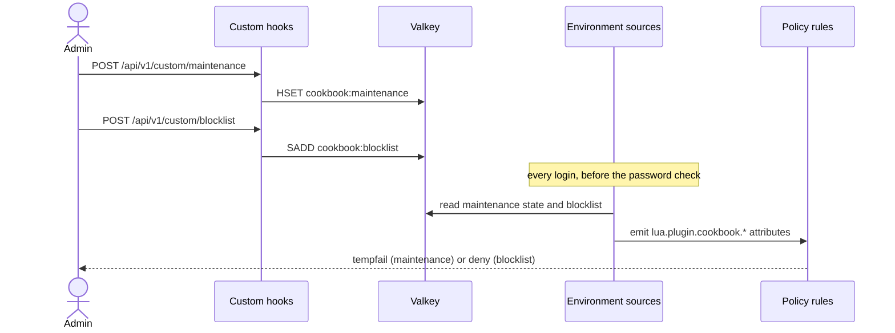

import CodeBlock from '@theme/CodeBlock';
import compose from '@site/static/cookbook/admin-toolkit/docker-compose.yml?raw';
import config from '@site/static/cookbook/admin-toolkit/nauthilus/nauthilus.yml?raw';
import toolkitLua from '@site/static/cookbook/admin-toolkit/nauthilus/lua/admin_toolkit.lua?raw';
import maintenanceHook from '@site/static/cookbook/admin-toolkit/nauthilus/lua/hooks/maintenance.lua?raw';
import blocklistHook from '@site/static/cookbook/admin-toolkit/nauthilus/lua/hooks/blocklist.lua?raw';
import maintenanceEnv from '@site/static/cookbook/admin-toolkit/nauthilus/lua/environment/maintenance.lua?raw';
import blocklistEnv from '@site/static/cookbook/admin-toolkit/nauthilus/lua/environment/ip_blocklist.lua?raw';
import registryLua from '@site/static/cookbook/admin-toolkit/nauthilus/lua/policy/registry.lua?raw';
import backendLua from '@site/static/cookbook/admin-toolkit/nauthilus/lua/backend.lua?raw';
import testSh from '@site/static/cookbook/admin-toolkit/test.sh?raw';

# Recipe: Admin toolkit

Two switches that every mail administrator needs sooner or later:

- **Maintenance mode.** During a migration, logins should fail with a *temporary* error, so mail clients retry later
  instead of asking users for their password. Administrators must still be able to log in.
- **IP blocklist.** A network that attacks you, or a client that hammers the server with an old password, should be
  shut out at once, without a configuration change and without a restart.

This recipe builds both as small HTTP APIs inside Nauthilus (custom hooks) and enforces them for every login
(environment sources).

**Interfaces:** custom hooks, environment sources, policy registry script.<br />
**Download:** [admin-toolkit.tar.gz](pathname:///cookbook/admin-toolkit.tar.gz)

## What happens



The hooks only write state; the environment sources only read it. Both use the same shared module, so the key names
and the network matching exist once.

## Start and test

```bash
docker compose up -d --wait
./test.sh
```

Switch maintenance on and try a login:

```bash
curl -u admin:admin-backchannel-secret -H 'Content-Type: application/json' \
  -d '{"enabled": true, "message": "Mail server upgrade until 22:00"}' \
  http://127.0.0.1:28083/api/v1/custom/maintenance

curl -i -u mailserver:mailserver-backchannel-secret -H 'Content-Type: application/json' \
  -d '{"username":"alice","password":"alice-secret","protocol":"imap","client_ip":"192.0.2.10"}' \
  http://127.0.0.1:28083/api/v1/auth/json
```

The login gets a temporary failure with `Auth-Status: Mail server upgrade until 22:00`. The same login from
`10.20.30.40`, an address in the administrator network, still works. Switch maintenance off again with `{"enabled": false}`.

Block a network:

```bash
curl -u admin:admin-backchannel-secret -H 'Content-Type: application/json' \
  -d '{"add": ["198.51.100.0/24"]}' http://127.0.0.1:28083/api/v1/custom/blocklist

curl -u admin:admin-backchannel-secret http://127.0.0.1:28083/api/v1/custom/blocklist
```

## The stack

<CodeBlock language="yaml" title="docker-compose.yml">{compose}</CodeBlock>

`COOKBOOK_ADMIN_NETWORKS` lists the networks that may still log in during maintenance. The environment source reads it
with `os.getenv`.

## The configuration

<CodeBlock language="yaml" title="nauthilus/nauthilus.yml">{config}</CodeBlock>

What is new:

- **The `admin` credential holds the scope `cookbook:admin`.** You can invent scopes for your own hooks. Each hook
  entry lists the scopes that may call it; the mail server credential does not hold `cookbook:admin` and gets HTTP 403.
- **`auth.controls.lua.hooks`** binds one HTTP method of `/api/v1/custom/<http_location>` to a script. GET and POST of
  the same location are two entries; both point to the same script, which asks for the method.
- **`environment_vm_pool_size` and `hook_vm_pool_size`** size the pools of prepared Lua VMs for these two interfaces.
  A VM is reused for many requests; Nauthilus gives every request a fresh environment on top of it.
- **`policy.namespaces.authn`** is where environment sources live:
  - `schema_contributions.lua.registry_scripts` loads the registry script that declares the recipe's policy
    attributes.
  - `providers` defines the two environment sources (`kind: lua_environment`). A provider definition only names a
    script.
  - `domain_plans.toolkit` schedules them. `pre_auth` runs before the password check; `auth_backend` runs the backends
    of `auth.backends.order`; `auth_decision` is the last checkpoint. A domain plan lists every checkpoint it uses, so
    `auth_backend` must be there, or no password would ever be checked.
  - `policy_sets.toolkit` holds the two rules. `maintenance_tempfail` answers with `tempfail` while the maintenance
    attribute is true, with the message from the attribute's `status_message` detail (`from: attribute_detail`), so
    clients see the text that the administrator stored; `blocklist_deny` answers with `deny` and its own text.
    `require_providers` makes a rule wait for the provider that emits its attribute.
- **`policy.targets`** activates all of this for `authenticate` requests. `default_policy: authn/standard_auth` keeps the
  built-in rules for everything the recipe does not decide.

## The shared module

<CodeBlock language="lua" title="nauthilus/lua/admin_toolkit.lua">{toolkitLua}</CodeBlock>

- `KEY_MAINTENANCE` and `KEY_BLOCKLIST` name the Redis keys. Change them here and both hooks and environment sources
  follow.
- `ipv4_to_number` and `parse_network` turn addresses and networks such as `198.51.100.0/24` into number ranges, so
  `contains` only compares numbers. A network is valid only if it parses; the hook refuses anything else. The module
  handles IPv4; extend `parse_network` for IPv6 the same way.
- `reply_error` sets an HTTP error status and returns the body; the hook returns it, and Nauthilus sends it as JSON with
  that status. Before Nauthilus 4.1.3 such an answer had an empty body.

## The custom hooks

<CodeBlock language="lua" title="nauthilus/lua/hooks/maintenance.lua">{maintenanceHook}</CodeBlock>

<CodeBlock language="lua" title="nauthilus/lua/hooks/blocklist.lua">{blocklistHook}</CodeBlock>

A hook defines `nauthilus_run_hook(request)`. Nauthilus checks the caller's credential and scope before it runs the
script.

- `nauthilus_http_request.get_http_method()` and `get_http_request_body()` read the request. The bundled `json` module
  decodes the body; `pcall` turns a malformed body into a clean HTTP 400 instead of a script error.
- A returned table becomes the JSON answer with HTTP 200.
- `nauthilus_redis.redis_hset`, `redis_sadd`, `redis_srem`, and `redis_del` write to Valkey through the connection that
  Nauthilus already holds. `"default"` names that connection.
- The blocklist hook validates **every** entry before it changes anything, so a typo does not leave a half-changed list.

## The environment sources

<CodeBlock language="lua" title="nauthilus/lua/environment/maintenance.lua">{maintenanceEnv}</CodeBlock>

<CodeBlock language="lua" title="nauthilus/lua/environment/ip_blocklist.lua">{blocklistEnv}</CodeBlock>

An environment source defines `nauthilus_call_environment(request)` and returns three values: triggered, abort, and a
result code. It runs before the password is checked, so it sees the client address, protocol, and username, but not
yet whether the password is right.

- Both scripts emit a registered policy attribute with `nauthilus_policy.emit_attribute`, and a rule in
  `nauthilus.yml` makes the decision. That keeps the decision in the configuration, where an administrator looks for
  it, and lets a rule answer with `tempfail` instead of the default `deny`.
- When Valkey cannot be read, the scripts report `ENVIRONMENT_RESULT_FAIL` instead of guessing. Nauthilus itself
  cannot work without Valkey either, so such a login ends as a temporary failure.
- `nauthilus_builtin.custom_log_add` adds fields to the log line of the request, for example
  `blocklist_match=198.51.100.0/24`.
- Module-level code such as `ADMIN_NETWORKS = ...` runs for every request, because Nauthilus executes the script anew
  in a fresh request environment. Keep it cheap.

:::note Triggers are facts
Returning `ENVIRONMENT_TRIGGER_YES` makes the fact `nauthilus.auth.lua.environment.<name>.triggered` true, and the
built-in rules of `authn/standard_auth` deny it unless a configured rule decides first. `ip_blocklist.lua` returns it as
well; its own rule only adds the clear message. Nauthilus 4.0.0 to 4.1.2 ignored such a trigger, so use 4.1.3 or later.
:::

## The policy registry script

<CodeBlock language="lua" title="nauthilus/lua/policy/registry.lua">{registryLua}</CodeBlock>

Lua may only emit policy attributes that a registry script declared. The declaration fixes the attribute's type, the
checkpoint (`stage`) where it is emitted, the operations, and optional details. Nauthilus runs the registry script when
it builds the policy snapshot, at startup and after a reload, and rejects a script that emits an undeclared
attribute.

## The demo backend

<CodeBlock language="lua" title="nauthilus/lua/backend.lua">{backendLua}</CodeBlock>

Two accounts in a Lua table, so the recipe has someone to log in as. The [Flat-file users](flatfile-users.mdx) and
[SQL users](sql-users.mdx) recipes show real account sources.

## What the test checks

<CodeBlock language="bash" title="test.sh">{testSh}</CodeBlock>

The last section puts 50 networks on the blocklist and sends 200 logins, so the matching loop runs many times in the
same pooled Lua VMs.

## Ideas for your own changes

- Let the maintenance hook accept an end time and switch maintenance off automatically.
- Give blocklist entries a reason and an expiry, stored in a Redis hash instead of a set.
- Allow only one protocol during maintenance, for example webmail over `http`.
