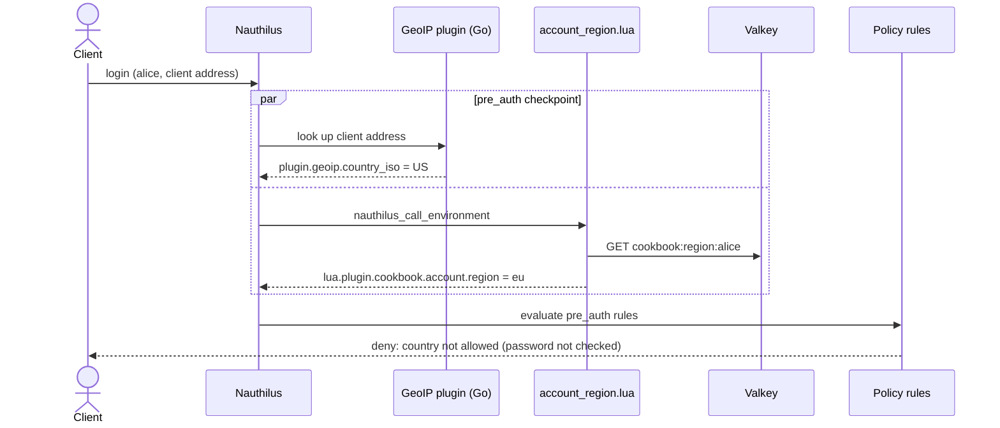

import CodeBlock from '@theme/CodeBlock';
import compose from '@site/static/cookbook/geo-regions/docker-compose.yml?raw';
import config from '@site/static/cookbook/geo-regions/nauthilus/nauthilus.yml?raw';
import geoipJson from '@site/static/cookbook/geo-regions/nauthilus/geoip/geoip.json?raw';
import regionLua from '@site/static/cookbook/geo-regions/nauthilus/lua/environment/account_region.lua?raw';
import registryLua from '@site/static/cookbook/geo-regions/nauthilus/lua/policy/registry.lua?raw';
import testSh from '@site/static/cookbook/geo-regions/test.sh?raw';

# Recipe: Country rules per account

Some accounts should only log in from certain countries. Accounting works from the EU, the US team from the US, and
everyone else from anywhere. When an administrator changes the region of an account, the rule applies at the next
login.

This recipe shows how a **native Go plugin** and a **Lua script** work together. Neither of them decides anything:

- The bundled **GeoIP plugin** knows where the client is. It provides the fact `plugin.geoip.country_iso`.
- A **Lua environment source** knows which region an account belongs to. It provides the fact
  `lua.plugin.cookbook.account.region`.
- **Policy rules** in `nauthilus.yml` combine both facts and decide.

**Shown:** native Go plugin, Lua environment source, policy registry script, condition sets.<br />
**Download:** [geo-regions.tar.gz](pathname:///cookbook/geo-regions.tar.gz)

## What happens



Both providers run at the `pre_auth` checkpoint, before the password is checked. A login from a forbidden country is
refused without testing the password, so the answer does not tell an attacker whether a guessed password was right.

The Lua script cannot read the plugin's facts, and the plugin knows nothing about accounts. That is intended: each
component delivers what it knows, and the decision stays in the configuration, where an administrator can read it.

## Start and test

```bash
docker compose up -d --wait
./test.sh
```

Give alice a region and try two logins:

```bash
docker compose exec valkey valkey-cli SET cookbook:region:alice eu

curl -i -u mailserver:mailserver-backchannel-secret -H 'Content-Type: application/json' \
  -d '{"username":"alice","password":"alice-secret","protocol":"imap","client_ip":"198.51.100.10"}' \
  http://127.0.0.1:28087/api/v1/auth/json
```

The address `198.51.100.10` lies in the US network of the demo database, so the answer is HTTP 403 with
`Auth-Status: Login from this country is not allowed for this account`. With `192.0.2.10` (Germany) alice logs in.
Remove the region with `docker compose exec valkey valkey-cli DEL cookbook:region:alice`.

## The stack

<CodeBlock language="yaml" title="docker-compose.yml">{compose}</CodeBlock>

The Nauthilus image already contains the bundled plugins below `/usr/local/lib/nauthilus/plugins`: `geoip.so`,
`clickhouse.so`, `haveibeenpwnd.so`, and `reputation.so`. The stack only mounts the GeoIP database next to the
configuration and the Lua scripts.

## The GeoIP database

<CodeBlock language="json" title="nauthilus/geoip/geoip.json">{geoipJson}</CodeBlock>

The plugin reads MaxMind databases and, for tests and development, this JSON format. The three networks are reserved
for documentation (RFC 5737), so the demo needs neither a license nor internet access. The most specific network that
contains the client address wins. Add your own networks, for example your office network with your home country,
to try the rules with real addresses.

## The configuration

<CodeBlock language="yaml" title="nauthilus/nauthilus.yml">{config}</CodeBlock>

### Loading the plugin

- **`plugins.allowed_dirs`** lists the directories from which Nauthilus loads native plugins.
- **`plugins.modules`** loads `geoip.so` under the module name `geoip`. `optional: false` stops Nauthilus from starting
  when the plugin cannot be loaded, so a broken plugin never goes unnoticed.
- **`verification_policy: when_present`** verifies a checksum or signature only when one is configured. The recipe
  configures none, so it works with every image. In production pin the artifact with `checksum: sha256:...` or a
  minisign `signature`; see [Native Go plugins](../configuration/native-go-plugins.md). Native plugins are trusted
  code in the Nauthilus process, not a sandbox.
- **`config`** is the plugin's own configuration. Nauthilus passes it to the plugin, which checks it strictly; an
  unknown key or a wrong value stops the start with a clear error.
  - `decision_bindings` registers one fact provider. Its `component` name `environment` becomes part of the provider
    identity `authn/plugin.geoip.environment`. `input` names the fact that holds the client address.
  - `database_path` and `database_format` point to the JSON file.
  - `freshness` says how old the data may be. A JSON database is as old as its file; after `max_stale_age` (at most
    365 days) the plugin reports `unavailable`. Run `touch nauthilus/geoip/geoip.json` to make an old demo file
    fresh again.

### Wiring both providers into the policy

- **`condition_sets.strings`** holds the country lists. Rules reference them as `@string.eu_countries`.
- **`providers.environment`** declares the plugin's provider (`kind: native`). `produced_facts` must name every fact
  the plugin can return with this configuration. Nauthilus rejects an answer that contains an undeclared fact; the
  request then ends as a temporary failure.
- **`providers.lua_environment_account_region`** declares the Lua environment source.
- **`domain_plans.geo_regions`** runs both providers at `pre_auth`. The plugin's provider is used by its identity
  `authn/plugin.geoip.environment`, the Lua source by `authn/lua_environment_account_region`.

### The rules

- `eu_account_outside_eu` and `us_account_outside_us` deny when the account's region is set and the client's country
  is `not_in` the region's list.
- `restricted_account_unknown_location` closes a gap. A rule whose fact is missing does not match: an address the
  database does not know has no country, so without this rule a restricted account would get through. The plugin
  always reports `plugin.geoip.lookup_state` (`fresh`, `stale`, `not_found`, or `unavailable`), and the rule denies
  restricted accounts unless the location is known.
- `require_providers` makes each rule wait for both providers.
- Accounts without a region never match a rule, so the built-in rules of `authn/standard_auth` decide as usual.

## The Lua environment source

<CodeBlock language="lua" title="nauthilus/lua/environment/account_region.lua">{regionLua}</CodeBlock>

- The region comes from Valkey, so an administrator, a script, or a custom hook can change it at any time.
- Only the known regions `eu` and `us` are emitted. A typo such as `mars` is ignored instead of locking the account.
- The script always returns "not triggered". It only delivers a fact; the decision is the policy's.
- `nauthilus_builtin.custom_log_add` adds `account_region=eu` to the log line of the request.

## The policy registry script

<CodeBlock language="lua" title="nauthilus/lua/policy/registry.lua">{registryLua}</CodeBlock>

The attribute is a string emitted at `pre_auth`. Native plugins declare their facts in their own code; Lua declares
its attributes in a registry script.

## What the test checks

<CodeBlock language="bash" title="test.sh">{testSh}</CodeBlock>

## Ideas for your own changes

- Add a region `dach` with `[DE, AT, CH]`: one more condition set, one more rule, and `dach` in `KNOWN_REGIONS`.
- Allow every country from your office network: add it to `geoip.json` and a rule condition on `plugin.geoip.network`.
- Use a licensed MaxMind database: set `database_path` to the `.mmdb` file and `database_format: mmdb`.
- Let the [Login journal](login-journal.mdx) POST-action record the country as well. Lua cannot read plugin facts,
  but a native POST-action such as the bundled ClickHouse plugin receives them.
